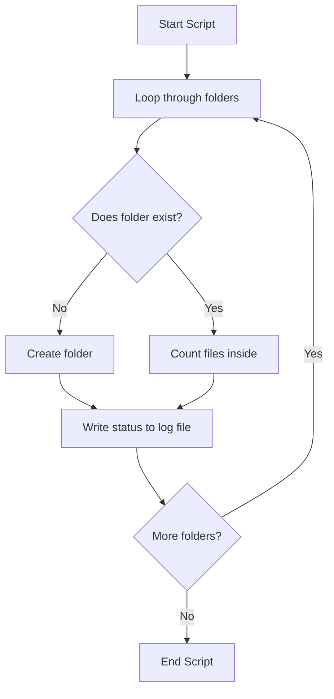

# Learning Python for Managing Systems

When you manage more than one server, doing everything by hand gets messy fast. If you login to five servers to check their disk space, you will spend ten minutes typing the same commands. If you have to do this every day, you will eventually make a mistake. Python lets you write down your steps in a file so the computer can run them for you in less than a second. 

This guide covers the basics of Python, starting from why we use it to how you write your first scripts. You will learn how to handle data, make decisions in code, and read files. By the end, you will be able to write scripts that check system health and save you from boring, repetitive work.

## Why Python is Popular

You might already know how to write shell scripts using Bash. While Bash is great for running one or two commands, it becomes hard to read when your script grows. Python is much easier to read and write. It runs on Windows, Mac, and Linux, so you do not have to rewrite your scripts when your systems change.

Here is a simple look at how manual work, Bash, and Python compare when you need to automate tasks.

| Action | Manual Work | Bash Scripting | Python Scripting |
| :--- | :--- | :--- | :--- |
| **Speed** | Very slow | Fast | Fast |
| **Reading Code** | No code to read | Hard to read for large scripts | Easy to read like plain English |
| **Running on Windows** | Easy to do by hand | Hard to configure | Works without changes |
| **Handling APIs** | Hard to do manually | Requires extra tools like curl and jq | Built-in libraries make it easy |
| **Error Handling** | You notice it visually | Easy to miss silent failures | Easy to catch and handle errors |

## Setting up Your First Script

Before you write any code, you need to know how to run it. Python files end with `.py`. You write code in a text editor and then run it using your computer's terminal. 

Let's start by printing a message to the screen. Create a file named `hello.py` and write the code below.

```python
print("Connecting to the database server...")
```

To run this code, open your terminal and run this command:

```bash
python hello.py
```

Expected output:
```text
Connecting to the database server...
```

## Running Python on Any System

When you write scripts, you need to make sure they run the same way on everyone's computer. Python packages sometimes conflict with each other when you install them globally. You can solve this problem by using virtual environments. A virtual environment is just a private folder where you install libraries for a single project.

Let's create a virtual environment, activate it, and install a package.

```bash
python -m venv myenv
myenv\Scripts\activate
pip install requests
```

Expected output:
```text
Successfully installed requests-2.31.0 urllib3-2.0.7
```

## Working with Simple Data

To automate systems, you need to store information like server names, IP addresses, and port numbers. Python uses variables to hold this information. You do not need to tell Python what kind of data you are storing; it figures it out automatically.

### Using Strings for Text
Strings store words, paths, or IP addresses. You put quotation marks around the text.

```python
server_name = "database-prod-01"
print(server_name)
```

Expected output:
```text
database-prod-01
```

### Using Numbers for Count and Ports
Integers store whole numbers like port numbers, and floats store decimals like disk space percentages.

```python
port = 5432
disk_free_gb = 45.5
print(port)
print(disk_free_gb)
```

Expected output:
```text
5432
45.5
```

### Using Booleans for Status Checks
Booleans store either `True` or `False`. They help you track whether a check passed or failed.

```python
is_online = True
has_errors = False
print(is_online)
print(has_errors)
```

Expected output:
```text
True
False
```

## Working with Collections of Data

Sometimes you need to work with more than one piece of data at a time. For example, you might have a list of five server names or a collection of details about a single database.

### Storing Lists of Items
A list keeps items in a specific order. You can add new items, remove items, or read an item using its position number.

```python
web_servers = ["web-01", "web-02", "web-03"]
web_servers.append("web-04")

print(web_servers[0])
print(web_servers[3])
print(len(web_servers))
```

Expected output:
```text
web-01
web-04
4
```

### Storing Key and Value Pairs
A dictionary stores data in pairs, like a real dictionary. You look up a key to find its value. This is useful for storing settings.

```python
config = {
    "ip_address": "192.168.1.10",
    "port": 80,
    "environment": "production"
}

print(config["ip_address"])
print(config["environment"])
```

Expected output:
```text
192.168.1.10
production
```

## Making Decisions in Your Code

Your scripts need to behave differently depending on the situation. If a disk is full, you want to log a warning. If a service is down, you want to restart it.

### Using Simple Checks
You use `if` statements to compare values. Python looks at the spacing to see which lines belong to the check.

```python
cpu_load = 92

if cpu_load > 90:
    print("Alert: CPU load is too high!")
elif cpu_load > 70:
    print("Warning: CPU load is moderate.")
else:
    print("Success: CPU load is normal.")
```

Expected output:
```text
Alert: CPU load is too high!
```

### Checking Multiple Conditions
You can combine checks using `and` or `or` to make more complex decisions.

```python
disk_full = True
is_weekend = False

if disk_full and not is_weekend:
    print("Action: Clean up logs immediately.")
```

Expected output:
```text
Action: Clean up logs immediately.
```

## Repeating Tasks with Loops

If you have to check ten servers, you do not want to copy and paste your check ten times. Loops let you run a block of code multiple times.

### Using For Loops
A `for` loop goes through a list one item at a time.

```python
hosts = ["10.0.0.1", "10.0.0.2", "10.0.0.3"]

for host in hosts:
    print("Sending ping to " + host)
```

Expected output:
```text
Sending ping to 10.0.0.1
Sending ping to 10.0.0.2
Sending ping to 10.0.0.3
```

### Using While Loops
A `while` loop keeps running as long as a condition remains true. This is useful when waiting for a server to start.

```python
attempts = 0

while attempts < 3:
    attempts = attempts + 1
    print("Connection attempt number " + str(attempts))
```

Expected output:
```text
Connection attempt number 1
Connection attempt number 2
Connection attempt number 3
```

## Grouping Code in Functions

As your script grows, you will find yourself writing the same code over and over. You can group code into a function to make it reusable. A function takes some input, performs an action, and returns a result.

### Creating a Simple Function
Let's write a function that calculates the free disk percentage.

```python
def check_disk(total_gb, used_gb):
    free_gb = total_gb - used_gb
    free_percent = (free_gb / total_gb) * 100
    return free_percent

space_left = check_disk(100, 75)
print("Free space: " + str(space_left) + "%")
```

Expected output:
```text
Free space: 25.0%
```

### Using Default Arguments
You can give arguments default values. This means you do not have to provide them every time you call the function.

```python
def create_connection(host, port=80):
    print("Connecting to " + host + " on port " + str(port))

create_connection("192.168.1.1")
create_connection("192.168.1.1", port=443)
```

Expected output:
```text
Connecting to 192.168.1.1 on port 80
Connecting to 192.168.1.1 on port 443
```

## Handling Errors Gracefully

Sometimes your script will fail. A server might be offline, or a configuration file might be missing. If you do not handle these errors, your script will crash and stop running. You can use `try` and `except` blocks to catch errors and handle them.

```python
try:
    failed_connections = 0
    success_rate = 100 / failed_connections
except ZeroDivisionError:
    print("Error: Could not calculate success rate because no connections succeeded.")
```

Expected output:
```text
Error: Could not calculate success rate because no connections succeeded.
```

## Reading and Writing Files

Many system tasks require reading configuration files or writing log messages. Python makes it easy to work with files using the `with` statement. The `with` statement makes sure the file closes automatically when you are done, even if an error happens.

### Writing to a Log File
Let's write a status message to a file.

```python
with open("status.txt", "w") as file:
    file.write("All systems operational\n")
```

Expected output:
No output is printed to the screen, but a file named `status.txt` is created on your disk.

### Reading from a Log File
Now let's read the status message back from the file.

```python
with open("status.txt", "r") as file:
    content = file.read()
    print(content)
```

Expected output:
```text
All systems operational
```

## A Real-World Example

Let's build a real tool. This script checks a list of folder paths to see if they exist and checks if they contain too many temporary files. If a directory is missing, it creates it. If it exists, it counts the files and writes the summary to a log file.

Here is how the script processes the folders:



Create a file named `log_cleaner.py` and add this code.

```python
import os

folders_to_check = ["logs/app", "logs/database", "logs/cache"]
log_report_path = "report.txt"

# Make sure our parent log folder exists for testing
os.makedirs("logs", exist_ok=True)

with open(log_report_path, "w") as report:
    report.write("System Directory Scan Report\n")
    report.write("============================\n")
    
    for folder in folders_to_check:
        if not os.path.exists(folder):
            os.makedirs(folder)
            report.write("Created missing folder: " + folder + "\n")
            print("Created: " + folder)
        else:
            # Count the files inside the directory
            files = os.listdir(folder)
            file_count = len(files)
            report.write("Checked folder: " + folder + " - Files inside: " + str(file_count) + "\n")
            print("Checked: " + folder + " (" + str(file_count) + " files)")

print("Scan complete. Report written to " + log_report_path)
```

Expected output (first run when folders do not exist):
```text
Created: logs/app
Created: logs/database
Created: logs/cache
Scan complete. Report written to report.txt
```

If you run the script a second time, the folders already exist, so the output changes.

Expected output (second run):
```text
Checked: logs/app (0 files)
Checked: logs/database (0 files)
Checked: logs/cache (0 files)
Scan complete. Report written to report.txt
```

Let's read the report file to see what it wrote:

```python
with open("report.txt", "r") as file:
    print(file.read())
```

Expected output:
```text
System Directory Scan Report
============================
Checked folder: logs/app - Files inside: 0
Checked folder: logs/database - Files inside: 0
Checked folder: logs/cache - Files inside: 0
```

## Common Mistakes

### Forgetting to Close Files
If you open a file without the `with` statement, the file remains open in memory. This can lock the file and stop other processes from using it.

* **The Bad Way:**
```python
file = open("app.log", "w")
file.write("Error occurred")
# If the script crashes here, the file stays open
file.close()
```

* **The Good Way:**
```python
with open("app.log", "w") as file:
    file.write("Error occurred")
```

### Confusing Strings and Numbers
You cannot add a string and a number together directly. Python will raise an error. You must convert the number to a string first.

* **The Bad Way:**
```python
port = 80
print("Running on port " + port)
```

* **The Good Way:**
```python
port = 80
print("Running on port " + str(port))
```

### Catching All Errors Without Checking
If you write an empty `except:` block, it catches every single error, including syntax errors or when you press Ctrl+C to stop the script. This makes debugging very difficult.

* **The Bad Way:**
```python
try:
    import non_existent_module
except:
    print("Something went wrong")
```

* **The Good Way:**
```python
try:
    import non_existent_module
except ModuleNotFoundError as error:
    print("Could not find the module: " + str(error))
```

## Summary

* Python helps you replace slow, manual tasks with fast scripts that run on any system.
* Variables store details like server IPs, and lists store collections of servers.
* Dictionaries store detailed key-value configuration settings for your infrastructure.
* If statements let your script make decisions, like raising an alert when disk usage goes over a limit.
* Loops let you repeat checks across a list of servers or directories without repeating code.
* Functions group related steps into a single block that you can run multiple times.
* Try and except blocks stop your script from crashing when network or file errors happen.
* The with statement is the safest way to read and write files because it manages closing them for you.
* Splitting your automation tasks into small, readable steps makes your code easy to maintain.
* Writing clean scripts saves you time, prevents manual mistakes, and keeps your systems happy.
