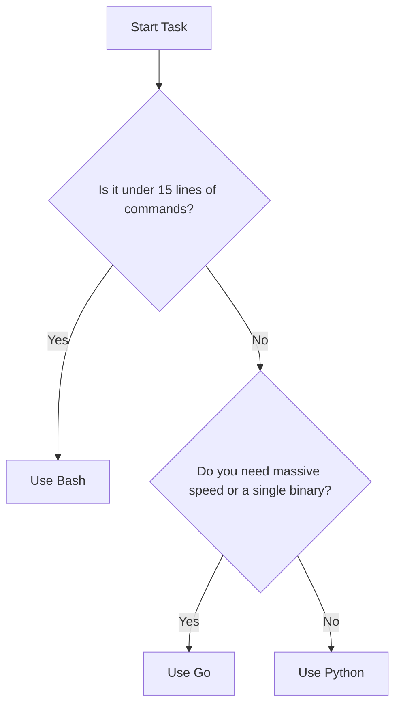

# Comparing Python, Bash, and Go

When you want to automate tasks on servers, you have to choose a tool. You will find that most people choose between Bash, Python, or Go. Choosing the wrong tool can make your life difficult, while choosing the right one lets you finish your tasks quickly. 

In this guide, we will compare these three languages. We will look at what each one does best, write the same server check in all three, and learn how to pick the right one for your daily tasks.

## Why the Choice Matters

Every language was built to solve a different problem. If you try to write a complex program in a language meant for quick shell scripts, your code will get messy and hard to debug. If you write a simple five-line script using a complex language, you will waste time setting up build tools.

Here is a quick look at when to use each language based on what you need to build.



## Comparing the Three Options

Let's look at a table to see how these tools compare side-by-side. 

| Feature | Bash | Python | Go |
| :--- | :--- | :--- | :--- |
| **Setup Needed** | Already installed on Linux | Needs Python installed | Needs compiler to build binaries |
| **Code Readability** | Hard for complex tasks | Very clean and easy | Structured and strict |
| **Speed** | Slow | Medium | Extremely fast |
| **Error Handling** | Hard to catch silent errors | Easy using try-except | Strict and must be written out |
| **Package Manager** | None | Uses pip | Uses go modules |

### Bash: The Quick System Tool
Bash is already on your Linux systems. It is great for running commands one after another just like you type them in your terminal. You do not need to install anything, but writing loops or handling complex data like JSON is hard.

### Python: The Readable Worker
Python is easy to read because it looks like plain English. It has thousands of packages you can download to talk to cloud databases or web APIs. You need to make sure Python is installed on your servers to run your code.

### Go: The Speed Champion
Go compiles down to a single binary file. This means you can build your code on your laptop and copy it to any server, and it will run without installing anything. It is fast and great for big tools, but it takes longer to write.

## Writing a Server Checker in Bash

Let's look at the first example. We want to check if a website is online by hitting a test endpoint. We will write a Bash script that uses the curl tool to check the status.

Create a file named `check.sh` and add this code.

```bash
#!/bin/bash
URL="https://httpbin.org/status/200"

echo "Checking website status..."
STATUS=$(curl -s -o /dev/null -w "%{http_code}" "$URL")

if [ "$STATUS" -eq 200 ]; then
    echo "Website is online"
    exit 0
else
    echo "Website is offline with status: $STATUS"
    exit 1
fi
```

To run this file, you must give it execute permissions first.

```bash
chmod +x check.sh
./check.sh
```

Expected output:
```text
Checking website status...
Website is online
```

## Writing the Checker in Python

Now let's write the exact same tool using Python. Python uses built-in modules to make the web request, so you do not need to rely on curl.

Create a file named `check.py` and write the code below.

```python
import urllib.request
import sys

url = "https://httpbin.org/status/200"

print("Checking website status...")

try:
    with urllib.request.urlopen(url, timeout=5) as response:
        code = response.getcode()
        if code == 200:
            print("Website is online")
            sys.exit(0)
        else:
            print("Website is offline with status: " + str(code))
            sys.exit(1)
except Exception as error:
    print("Website check failed: " + str(error))
    sys.exit(1)
```

Run this file with the Python command.

```bash
python check.py
```

Expected output:
```text
Checking website status...
Website is online
```

## Writing the Checker in Go

Finally, let's write the checker in Go. Go requires you to write more boilerplate code, but it runs extremely fast and compiles to a single file.

Create a file named `check.go` and write the code below.

```go
package main

import (
	"fmt"
	"net/http"
	"os"
	"time"
)

func main() {
	url := "https://httpbin.org/status/200"
	fmt.Println("Checking website status...")

	client := http.Client{
		Timeout: 5 * time.Second,
	}

	response, err := client.Get(url)
	if err != nil {
		fmt.Println("Website check failed:", err)
		os.Exit(1)
	}
	defer response.Body.Close()

	if response.StatusCode == 200 {
		fmt.Println("Website is online")
		os.Exit(0)
	} else {
		fmt.Println("Website is offline with status:", response.StatusCode)
		os.Exit(1)
	}
}
```

To run this Go code, compile it into a binary first.

```bash
go build check.go
./check
```

Expected output:
```text
Checking website status...
Website is online
```

## Real-World Example: Parsing JSON Data

When you talk to cloud services, you get data back in JSON format. Bash cannot parse JSON without installing third-party tools like `jq`. Python handles JSON out of the box using its built-in modules.

Let's write a script that reads database metadata in JSON format and extracts the database name and status.

```python
import json

# This string represents metadata we fetched from an API
json_data = '{"database": "users-db", "status": "active", "backup_enabled": true}'

# Parse the JSON string
metadata = json.loads(json_data)

print("Database name: " + metadata["database"])
print("Is backup active? " + str(metadata["backup_enabled"]))
```

Run the script to see the output.

```bash
python parse_json.py
```

Expected output:
```text
Database name: users-db
Is backup active? True
```

## Common Mistakes

### Using Bash for Complex Data
A common mistake is trying to parse configuration files using Bash. Bash scripts that use multiple grep and awk commands are fragile. If the format of the file changes slightly, the script will break without warning.

* **The Bad Way (in Bash):**
```bash
# This breaks if the JSON keys change order or spacing
DB_NAME=$(grep -o '"database": "[^"]*' metadata.json | cut -d'"' -f4)
```

* **The Good Way (in Python):**
```python
# This is safe and parses correctly regardless of spacing
import json
with open("metadata.json", "r") as file:
    data = json.load(file)
    db_name = data["database"]
```

### Not Using Exit Codes
When writing scripts that run inside automated pipelines, you must return the correct exit code. If your script fails but exits with status code 0, the pipeline will think everything is fine and keep going.

* **The Bad Way:**
```python
# If this fails, python might print the error but exit with code 0 anyway
try:
    open("critical_config.txt", "r")
except FileNotFoundError:
    print("Missing config file!")
```

* **The Good Way:**
```python
import sys
try:
    with open("critical_config.txt", "r") as file:
        config = file.read()
except FileNotFoundError:
    print("Error: Missing config file!")
    sys.exit(1)
```

## Summary

* Bash is built-in and perfect for small scripts under 15 lines that run native system commands.
* Python shines when your script needs to handle loops, complex data like JSON, or make API calls.
* Go compiles to a single binary file that you can deploy to any server without installing a runtime.
* Python scripts are easier to read and maintain than complex Bash scripts using grep and awk.
* If your automation runs inside a deployment pipeline, always use exit codes like 1 to indicate a failure.
* Virtual environments are useful for separating project packages so they do not conflict.
* Use try-except blocks in Python to catch file or connection issues before they crash your script.
* Use dictionaries in Python to handle structured configuration files cleanly.
* Do not write scripts in Go for simple tasks that change frequently, as you will waste time compiling.
* When managing large clusters of servers, Python provides the best balance of readability and library support.
