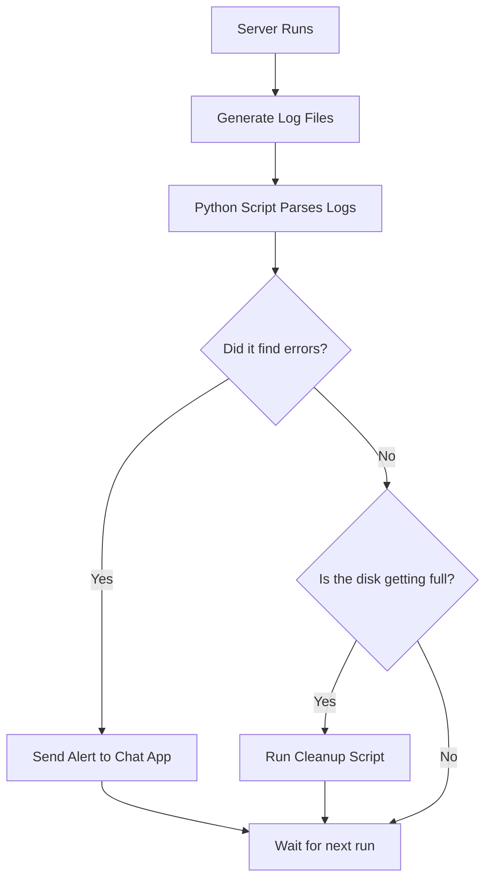

# Practical Uses of Python

When you start learning Python, you might wonder what you will actually build with it. Automating systems sounds nice, but it is easier to understand when you look at real examples. In your daily work, you will write scripts to search through logs, clean up old files, and send notifications to your team.

In this guide, we will look at three common tasks that you can automate with Python. We will write real code for each task, see the expected output, and learn how to avoid common pitfalls.

## Three Common Automation Tasks

Let's compare the three tasks to see how they help you manage systems and what libraries you need to use.

| Task | What it Does | Why it Matters | Tools Used |
| :--- | :--- | :--- | :--- |
| **Parsing Logs** | Searches files for error messages | Finds bugs before users complain | `json`, `re` |
| **Cleaning Files** | Deletes old build files and logs | Prevents hard drives from filling up | `os`, `time` |
| **Sending Alerts** | Sends notifications to chat apps | Tells you immediately when tasks fail | `urllib.request` |

Here is a diagram showing how these tasks fit together into a automated cycle:



## Searching Through Logs

Servers create thousands of log lines every hour. Finding a single error in these files by hand is like searching for a needle in a haystack. You can write a Python script to scan these files, find errors, and count them for you.

Let's write a script that scans a list of logs and prints only the lines that contain the word "ERROR".

```python
# A list of log lines to simulate a log file
logs = [
    "2026-06-25 08:00:00 - INFO - User logged in successfully",
    "2026-06-25 08:01:05 - ERROR - Database connection timeout",
    "2026-06-25 08:02:10 - INFO - Page served in 45ms",
    "2026-06-25 08:03:15 - WARNING - High memory usage detected",
    "2026-06-25 08:04:20 - ERROR - Failed to write file to disk"
]

error_count = 0

print("Scanning log data...")
for log in logs:
    if "ERROR" in log:
        print("Found Error: " + log)
        error_count = error_count + 1

print("Total errors found: " + str(error_count))
```

Run this file using Python in your terminal.

```bash
python log_scanner.py
```

Expected output:
```text
Scanning log data...
Found Error: 2026-06-25 08:01:05 - ERROR - Database connection timeout
Found Error: 2026-06-25 08:04:20 - ERROR - Failed to write file to disk
Total errors found: 2
```

## Cleaning Up Old Files

Temporary files and old logs build up quickly on servers. If the hard drive fills up, the server will stop working. You can write a script to look through a folder and delete files that have not been modified for a long time.

Let's write a script that checks a temporary directory, prints the age of the files, and decides which ones should be deleted.

```python
import os
import time

# Create a test folder and a test file first
os.makedirs("temp_files", exist_ok=True)
test_file = "temp_files/old_log.txt"

with open(test_file, "w") as file:
    file.write("This is an old log file.")

# Get the current time and check the file's last modified time
current_time = time.time()
file_modified_time = os.path.getmtime(test_file)
age_seconds = current_time - file_modified_time

print("File path: " + test_file)
print("File age in seconds: " + str(int(age_seconds)))

# If the file is older than 5 seconds, we clean it up
if age_seconds > 5:
    os.remove(test_file)
    print("Deleted old file: " + test_file)
else:
    print("File is still fresh, keeping it.")
```

Run this script.

```bash
python cleaner.py
```

Expected output:
```text
File path: temp_files/old_log.txt
File age in seconds: 0
File is still fresh, keeping it.
```

Wait a few seconds and run the script again.

Expected output (second run):
```text
File path: temp_files/old_log.txt
File age in seconds: 6
Deleted old file: temp_files/old_log.txt
```

## Sending Notifications to Your Team

When a deployment fails or a server runs out of memory, you need to know immediately. You can write a Python script to send messages to your team's chat application.

We will write a script that sends a status message to a test website that accepts data posts.

```python
import urllib.request
import json

webhook_url = "https://httpbin.org/post"

alert_data = {
    "status": "danger",
    "message": "Database server backup failed on server-db-01",
    "code": 501
}

# Convert the dictionary to JSON format
json_payload = json.dumps(alert_data).encode("utf-8")

# Configure the request headers
headers = {
    "Content-Type": "application/json"
}

request = urllib.request.Request(webhook_url, data=json_payload, headers=headers, method="POST")

try:
    print("Sending alert message...")
    with urllib.request.urlopen(request) as response:
        response_body = response.read().decode("utf-8")
        parsed_response = json.loads(response_body)
        
        # Check if httpbin received our data
        if response.getcode() == 200:
            print("Alert successfully sent!")
            print("Received data check: " + parsed_response["json"]["message"])
except Exception as error:
    print("Failed to send alert: " + str(error))
```

Run this script.

```bash
python send_alert.py
```

Expected output:
```text
Sending alert message...
Alert successfully sent!
Received data check: Database server backup failed on server-db-01
```

## Common Mistakes

### Hardcoding Secret Keys
Never write passwords or API keys directly in your scripts. If you upload your script to a shared repository, anyone can see your secrets. Always load them from environment variables instead.

* **The Bad Way:**
```python
# Anyone reading this file can see your token
api_token = "super_secret_token_12345"
```

* **The Good Way:**
```python
import os
# Load the token from the system environment
api_token = os.environ.get("ALERT_API_TOKEN")
```

### Deleting Files Without Checking Types
When cleaning up old files, make sure you do not delete directories by accident. If your code checks the age of a folder and deletes it, you might lose all the files inside.

* **The Bad Way:**
```python
import os
# This deletes the target path even if it is a folder containing files
os.remove("temp_files/old_folder")
```

* **The Good Way:**
```python
import os
path = "temp_files/old_folder"
# Always verify that the path is a file before using os.remove
if os.path.isfile(path):
    os.remove(path)
else:
    print("Skipping: " + path + " is a directory.")
```

### Ignoring Permission Errors
Sometimes your cleanup script will try to delete a file that is currently being used by another program. If you do not handle this, the script will crash and stop before checking the rest of the files.

* **The Bad Way:**
```python
import os
for file in ["file1.txt", "file2.txt"]:
    # If file1 is locked, file2 will never be checked
    os.remove(file)
```

* **The Good Way:**
```python
import os
for file in ["file1.txt", "file2.txt"]:
    try:
        if os.path.isfile(file):
            os.remove(file)
    except PermissionError:
        print("Warning: Could not delete " + file + " because it is in use.")
```

## Summary

* Parsing logs with Python lets you find errors and search files without opening them by hand.
* You can write cleanup scripts to delete old logs and stop hard drives from running out of space.
* Webhook integrations let you send alerts to chat apps when databases or backups fail.
* Always load API tokens and passwords from environment variables instead of writing them in code.
* Use `os.path.isfile` to check if a path is a file before trying to delete it.
* Use `try-except` blocks to handle permission errors so your cleanup scripts do not crash halfway.
* Reading files with `with open` makes sure files close even when errors happen.
* Regular expressions help you extract complex information like IP addresses from logs.
* You can run your Python automation scripts on schedules using tools like cron or task scheduler.
* Keeping your code broken down into small functions makes it easy to update later.
