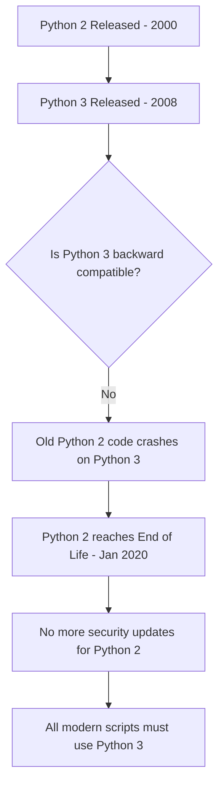

# Understanding Python Versions

When you log into older servers, you might run into scripts that look like Python but fail when you try to run them. Or you might try to run a command and see a warning message saying that Python is deprecated. This happens because of a major split in Python's history between Python 2 and Python 3.

In this guide, we will look at the differences between these two versions. We will learn why Python 2 is no longer used, how to check which version is running on your systems, and how to write scripts that check for the right version automatically.

## The Story of Python 2 and Python 3

Python was created a long time ago. Over the years, the language grew, but some early design decisions caused issues. To fix these issues, the creators released Python 3 in 2008. 

Unlike most software updates, Python 3 was not designed to run old Python 2 code. This means if you try to run a Python 2 script using Python 3, it will crash. 

Here is a diagram showing the history and why we avoid Python 2 today:



## How the Versions Compare

Let's look at a table to see the key differences between the two versions.

| Feature | Python 2 | Python 3 | Why it Matters |
| :--- | :--- | :--- | :--- |
| **Parentheses in Print** | `print "hello"` (Optional) | `print("hello")` (Required) | Scripts will throw syntax errors instantly if you mix these up |
| **Division** | `5 / 2` gives `2` | `5 / 2` gives `2.5` | Calculations for disk space or memory will be wrong in Python 2 |
| **Text Handling** | ASCII (Breaks on special characters) | Unicode (Handles all characters) | Crucial when parsing logs containing special symbols or non-English text |
| **Input Function** | Uses `raw_input()` | Uses `input()` | Terminal prompts will crash if you use the wrong function |
| **Security Updates** | Stopped in 2020 | Active | Using Python 2 exposes your systems to unpatched security bugs |

## Checking the Version on Your Server

When you log into a new server, you should always check which version of Python is installed. On many Linux systems, typing `python` runs Python 2, while typing `python3` runs Python 3.

Open your terminal and run these commands to check your environment:

```bash
python --version
python3 --version
```

Expected output:
```text
Python 2.7.18
Python 3.10.12
```

If the first command prints `Python 2.x`, you must always use `python3` to run your scripts.

## Writing a Version Checker

When you share your scripts with other team members, you cannot control which version of Python they have installed. To prevent your scripts from crashing with weird errors, you can add a version check at the beginning of your code.

Create a file named `check_version.py` and write the code below.

```python
import sys

print("Checking Python version...")

# Get the version numbers
major = sys.version_info.major
minor = sys.version_info.minor

print("Running Python major version: " + str(major))
print("Running Python minor version: " + str(minor))

# We require at least Python 3.8 for our scripts
if major < 3:
    print("Error: This script requires Python 3!")
    sys.exit(1)
elif major == 3 and minor < 8:
    print("Warning: Your Python 3 version is older than 3.8. Some features might fail.")
else:
    print("Success: Your Python version is supported!")
```

Run this file with Python.

```bash
python3 check_version.py
```

Expected output:
```text
Checking Python version...
Running Python major version: 3
Running Python minor version: 10
Success: Your Python version is supported!
```

## How Text and Division Behave Natively

Let's look at working code examples to see how calculations and text display differently between the two versions.

### Division Behavior
In Python 2, dividing two integers always returns a whole number, dropping any decimal remainder. In Python 3, it returns the exact decimal value.

```python
# In Python 3, this returns a float
calculation = 7 / 2
print("7 / 2 equals: " + str(calculation))
```

Expected output:
```text
7 / 2 equals: 3.5
```

### Text and Unicode
Python 3 handles special symbols like emojis and foreign accents natively, while Python 2 requires special prefixes.

```python
# Python 3 handles unicode natively
status_message = "System Status: 🟢 Healthy"
print(status_message)
```

Expected output:
```text
System Status: 🟢 Healthy
```

## Common Mistakes

### Using Parentheses Wrongly in Print
If you write a print statement without parentheses in Python 3, your script will crash before running any other commands.

* **The Bad Way:**
```python
# This fails instantly in Python 3
print "Starting backup script"
```

* **The Good Way:**
```python
# This works on both versions but is required for Python 3
print("Starting backup script")
```

### Relying on the Default Python Command
Many engineers write `python script.py` in their automation tools. If the server is updated and the default python command points to Python 2, the automation tool will break.

* **The Bad Way:**
```bash
# This might run Python 2 on older Linux servers
python deployment_script.py
```

* **The Good Way:**
```bash
# This forces the server to use Python 3
python3 deployment_script.py
```

### Ignoring Deprecation Warnings
When running scripts on older servers, you might see warning messages in your logs about deprecated features. Ignoring these means your scripts will break when the server is upgraded.

* **The Bad Way:**
```text
# Ignoring this log message in your deployment outputs:
DeprecationWarning: The popen2 module is deprecated.
```

* **The Good Way:**
Update the code to use the `subprocess` module before the legacy module is completely removed from Python.

## Summary

* Python 3 was released in 2008 to fix design flaws but is not backward-compatible with Python 2.
* Python 2 reached its end of life in January 2020 and no longer receives security updates.
* Running Python 2 in production makes your systems vulnerable to unpatched security bugs.
* In Python 3, the `print()` function requires parentheses, whereas Python 2 used it as a statement.
* Division in Python 3 returns exact decimal values, while Python 2 rounds down to whole numbers.
* Unicode is supported natively in Python 3, making it easy to parse log files with special characters.
* Always check the Python version on a new server using the `python3 --version` command.
* You can write a version check using `sys.version_info` to stop your scripts from running on unsupported runtimes.
* Modern cloud libraries like Boto3 have completely dropped support for Python 2.
* Always configure your automation tools to call `python3` instead of the generic `python` command.
