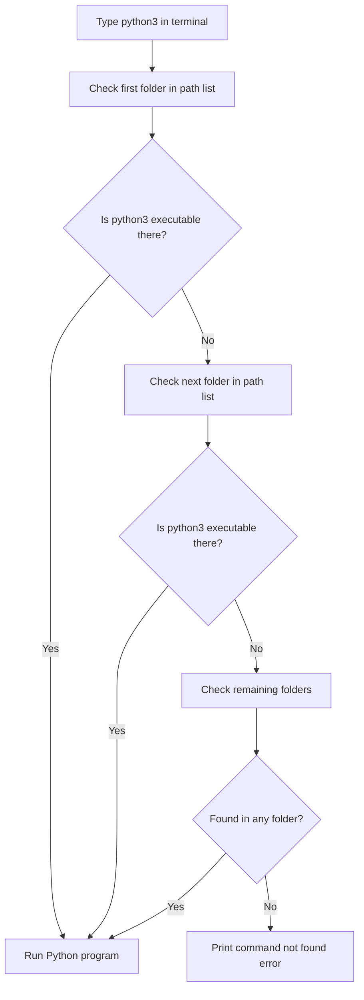

# Installing Python on Your Computer

Before you can write any scripts to automate your tasks, you need to install Python on your machine. You will work with different environments, including your personal laptop (which might be Windows or Mac) and production servers (which run Linux). Knowing how to get Python running on all of these systems is a core skill.

In this guide, we will walk through how to install Python on Windows, Mac, and Linux. We will also learn how the system command path works so that your terminal can find Python when you type a command.

## How Your Terminal Finds Python

When you open your terminal and type `python3`, your computer needs to know where to find that command. It does this by looking at a list of directories called the system path. If the directory containing Python is not on this list, your computer will say "command not found."

Here is a diagram showing how your computer searches for the python command when you type it in the terminal:



## Installation Methods by Operating System

Let's look at a table comparing how you install Python on different operating systems and what package managers you use.

| Operating System | Package Manager | Installation Command | Verification Command |
| :--- | :--- | :--- | :--- |
| **Ubuntu Linux** | `apt` | `sudo apt install python3` | `python3 --version` |
| **RedHat Linux** | `dnf` | `sudo dnf install python3` | `python3 --version` |
| **macOS** | `Homebrew` | `brew install python` | `python3 --version` |
| **Windows** | Windows Store / Web Installer | Download installer | `python --version` |

## Installing Python on Linux

Linux is what most production servers run. Most modern Linux distributions come with Python 3 pre-installed, but you might need to install additional tools like the package manager (pip) and virtual environment tools.

### Installing on Ubuntu or Debian
To update your package list and install Python 3 along with its helper tools, run these commands in your terminal.

```bash
sudo apt update
sudo apt install -y python3 python3-pip python3-venv
```

Expected output:
```text
Reading package lists... Done
Building dependency tree... Done
python3 is already the newest version (3.10.6-1~22.04).
python3-pip is already the newest version (22.0.2+dfsg-1ubuntu0.4).
python3-venv is already the newest version (3.10.6-1~22.04).
```

### Installing on RedHat or Rocky Linux
If you are using RedHat-based systems, use the `dnf` package manager instead.

```bash
sudo dnf install -y python3 python3-pip
```

Expected output:
```text
Last metadata expiration check: 0:45:12 ago.
Package python3-3.9.16-1.el9.x86_64 is already installed.
Package python3-pip-21.2.3-6.el9.noarch is already installed.
```

## Installing Python on macOS

Modern Macs do not come with Python 3 pre-installed. The easiest way to install and update Python on a Mac is to use a free tool called Homebrew.

First, open your terminal and run this command to install Python:

```bash
brew install python
```

Expected output:
```text
==> Downloading https://ghcr.io/v2/homebrew/core/python/3.11/manifests/3.11.4
==> Installing python
==> Summary
🍺  /opt/homebrew/Cellar/python@3.11/3.11.4: 3,240 files, 60.5MB
```

## Installing Python on Windows

To install Python on Windows, you download the installer from the official website.

1. Go to the [Python Downloads Page](https://www.python.org/downloads/).
2. Click the download button for the latest version.
3. Open the downloaded file.
4. **CRITICAL STEP:** Look at the bottom of the installer window and check the box that says **"Add python.exe to PATH"**.
5. Click **Install Now**.

If you forget to check that box, your terminal will not recognize the `python` command when you try to run your scripts.

## Auditing Your Setup

Once you have installed Python, you can write a script to check if the installation is correct. This script prints your operating system details, the folder where Python is installed, and the directories in your system path.

Create a file named `audit_setup.py` and write the code below.

```python
import os
import sys
import platform

print("=== Running Installation Audit ===")
print("Operating System: " + platform.system())
print("OS Version: " + platform.release())
print("Python Executable Path: " + sys.executable)
print("Python Version: " + sys.version.split()[0])

# Get the path environment variable
system_path = os.environ.get("PATH", "")

# Paths are separated by ';' on Windows and ':' on Linux/Mac
separator = ";" if platform.system() == "Windows" else ":"
directories = system_path.split(separator)

print("\nFirst 3 folders in your system path list:")
for directory in directories[:3]:
    print(" - " + directory)

# Verify if Python's directory is in the path list
python_dir = os.path.dirname(sys.executable)
found_in_path = False

for directory in directories:
    if python_dir.lower() == directory.lower():
        found_in_path = True
        break

if found_in_path:
    print("\n✅ Verification Passed: Python folder is in the system path list.")
else:
    print("\n⚠️ Verification Note: Python folder not found in default path list.")
```

Run this file in your terminal.

```bash
python3 audit_setup.py
```

Expected output:
```text
=== Running Installation Audit ===
Operating System: Windows
OS Version: 10
Python Executable Path: C:\Users\patel\AppData\Local\Programs\Python\Python310\python.exe
Python Version: 3.10.9

First 3 folders in your system path list:
 - C:\Windows\system32
 - C:\Windows
 - C:\Users\patel\AppData\Local\Programs\Python\Python310

✅ Verification Passed: Python folder is in the system path list.
```

## Common Mistakes

### Forgetting to Check the Add to PATH Box on Windows
If you install Python on Windows and forget to check the PATH box, you will get an error when typing `python` in your command prompt.

* **The Bad Way:**
```text
C:\Users\patel> python
'python' is not recognized as an internal or external command,
operable program or batch file.
```

* **How to Fix it:**
Re-run the installer file you downloaded, click **Modify**, check the **Add Python to environment variables** option under advanced options, and click install.

### Confusing pip with pip3
On systems with both Python 2 and Python 3 installed, using the generic `pip` command might install packages for Python 2. This means your Python 3 script will still say the library is missing.

* **The Bad Way:**
```bash
# This might install libraries for Python 2
pip install requests
```

* **The Good Way:**
```bash
# This forces the system to install packages for Python 3
pip3 install requests
# OR run pip directly through the python3 command
python3 -m pip install requests
```

### Running Commands in the Wrong Terminal
If you install Python and immediately try to run it in a terminal that was already open, you will get an error. This is because the terminal only loads the system path list when it starts up.

* **The Bad Way:**
Keep using the same command prompt window you had open before running the installation.

* **The Good Way:**
Close your terminal window and open a fresh one. This forces the terminal to load the new path list containing Python.

## Summary

* You need to install Python on your local computer and on your remote servers to run scripts.
* Your operating system uses the PATH list to find executable programs when you type commands.
* On Linux, you install Python 3 using built-in managers like apt or dnf.
* On Mac, the easiest way to install and manage Python is by using Homebrew.
* On Windows, you must check the "Add python.exe to PATH" option in the installer.
* Running `python3 --version` lets you confirm that Python 3 is installed and ready.
* The `sys.executable` command in Python shows you exactly which folder is running your script.
* Close and reopen your terminal after installing Python so the system path updates.
* Use `python3 -m pip` to install packages for Python 3 and avoid installing them for Python 2.
* Always check that you have installed the virtual environment tool (`python3-venv`) on Linux servers.
