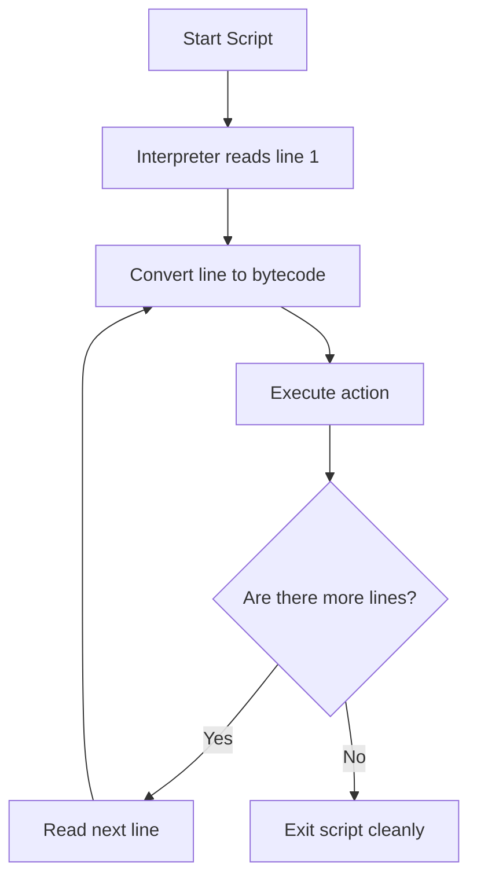

# Running Python Code

Once you have installed Python, you need to understand how to run it. You will run Python in different ways depending on your task. You might want to test a single line of code quickly, run a script on a schedule, or build a tool that runs like a native system command.

In this guide, we will look at how the Python interpreter works. We will learn about interactive mode, running scripts from files, using the shebang line on Linux, and how to control how your script exits.

## Ways to Run Your Code

Let's look at a table comparing the three main ways to run Python code.

| Run Method | How You Do It | What it is Best For | Works on Windows? |
| :--- | :--- | :--- | :--- |
| **Interactive Mode** | Type `python3` in terminal | Testing commands quickly | Yes |
| **Script Mode** | Run `python3 script.py` | Automated tasks and cron jobs | Yes |
| **Native Execution** | Run `./script.py` | Creating custom system utilities | Fails without bash emulator |

Here is a diagram showing how the Python interpreter reads and runs your script:



## Using Interactive Mode

If you just want to test a line of code, you do not need to create a file. You can open Python directly in your terminal. This is called the interactive interpreter or the REPL.

To open the interactive interpreter, type this command in your terminal:

```bash
python3
```

Expected output:
```text
Python 3.10.6 (default, Nov 14 2022, 16:10:14)
[GCC 11.3.0] on linux
Type "help", "copyright", "credits" or "license" for more information.
>>>
```

The `>>>` symbol means Python is waiting for you to type some code. Let's type a simple math equation:

```python
5 + 10
```

Expected output:
```text
15
```

To exit interactive mode and go back to your normal terminal, type `exit()` or press `Ctrl + D`.

## Running Scripts from Files

Interactive mode is great for testing, but your code is lost when you close the terminal. For real automation, you write your code in a file and run it.

Create a file named `runner.py` and write the code below.

```python
print("Script execution started...")
print("Script execution finished.")
```

Run this file by typing this command in your terminal:

```bash
python3 runner.py
```

Expected output:
```text
Script execution started...
Script execution finished.
```

## Running Scripts Like Native Commands

On Linux and Mac, typing `python3` before every script can feel tedious. You might want to run your script directly, like a native system command.

You can do this by adding a shebang line to the very top of your file. The shebang tells the operating system which program should run the file.

Create a file named `system_tool.py` and write the code below.

```python
#!/usr/bin/env python3
print("Running as a native utility")
```

The line `#!/usr/bin/env python3` is the shebang. It tells the computer to look up where Python 3 is installed and use it to run the rest of the file.

If you try to run `./system_tool.py` right now, your terminal will block it. You need to give the file permission to run first. Run this command in your terminal:

```bash
chmod +x system_tool.py
./system_tool.py
```

Expected output:
```text
Running as a native utility
```

## Handling System Signals

When you write scripts that run on servers, users might try to stop them by pressing `Ctrl + C`. If they do this, Python will crash and print a messy error stack trace. You can catch this exit signal in your code to shut down your script cleanly.

Create a file named `graceful.py` and write the code below.

```python
#!/usr/bin/env python3
import time
import sys
import signal

def clean_exit(sig, frame):
    print("\nInterrupt received. Stopping services cleanly...")
    sys.exit(0)

# Register the signal handler
signal.signal(signal.SIGINT, clean_exit)

print("Starting server checker loop. Press Ctrl+C to stop.")
while True:
    print("Checking database health...")
    time.sleep(2)
```

Run this file and press `Ctrl + C` after it prints a message.

```bash
python3 graceful.py
```

Expected output:
```text
Starting server checker loop. Press Ctrl+C to stop.
Checking database health...
Checking database health...
Interrupt received. Stopping services cleanly...
```

## Common Mistakes

### Hardcoding the Python Path in the Shebang
Many people write `#!/usr/bin/python3` at the top of their scripts. If you copy this script to a server where Python is installed in a different folder, the script will crash.

* **The Bad Way:**
```python
#!/usr/bin/python3
# This breaks if python is installed in /usr/local/bin
```

* **The Good Way:**
```python
#!/usr/bin/env python3
# This automatically searches the system path to find Python
```

### Forgetting to Set Execute Permissions
If you write a shebang line but do not run the `chmod` command, the operating system will not let you run the script directly.

* **The Bad Way:**
```bash
./my_script.py
# Error: Permission denied
```

* **The Good Way:**
```bash
chmod +x my_script.py
./my_script.py
```

### Leaving Test Code in the Global Scope
If you write test commands in the global scope of a script, those commands will run every time another file imports your script. Always wrap your main script logic inside a check for `__name__ == "__main__"`.

* **The Bad Way:**
```python
# This runs automatically when imported
print("Running database tests")
```

* **The Good Way:**
```python
# This only runs if the file is executed directly
if __name__ == "__main__":
    print("Running database tests")
```

## Summary

* The Python interpreter reads and executes your scripts line-by-line.
* Interactive mode or the REPL is great for testing commands and verifying libraries quickly.
* Exit interactive mode by typing `exit()` or pressing `Ctrl + D` on your keyboard.
* Script mode runs code saved in `.py` files and terminates when the file ends.
* A shebang line (`#!/usr/bin/env python3`) tells Linux and Mac which program runs the script.
* You must run `chmod +x script.py` to give your file permission to execute directly.
* Use Python's `signal` module to catch terminal exits like `Ctrl + C` and shutdown cleanly.
* Avoid hardcoding python file paths in your shebang lines to keep scripts portable.
* Wrap your main script execution code inside `if __name__ == "__main__":` blocks.
* Return proper system exit codes to let your deployment tools know if your script failed.
