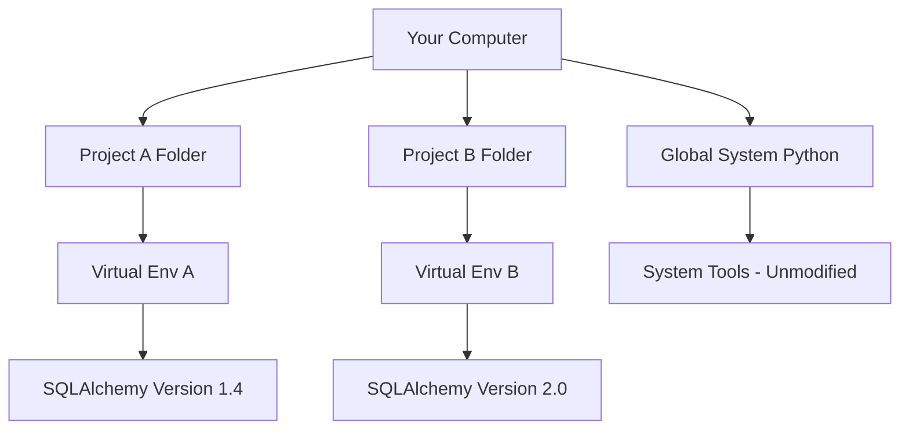

# Isolating Your Workspace

When you write scripts, you will need to install extra libraries. For example, you might need a library to connect to the cloud or another one to read configuration files. If you install all these libraries in the main system folder, you will eventually cause conflicts and break other programs.

In this guide, we will look at how virtual environments solve this problem. We will learn how to create a virtual environment, activate it to run your code, and write a verification script to make sure your workspace is isolated.

## The Problem with Global Packages

When you run installation commands with administrator permissions, the libraries are placed in the computer's central folder. If different scripts need different versions of the same library, they will overwrite each other. This is called a dependency conflict and it can break critical operating system tools that rely on specific library versions.

Let's look at a comparison between using global folders and using virtual environments.

| Feature | Global System Folders | Virtual Environments |
| :--- | :--- | :--- |
| **Workspace Isolation** | None (everything is in one folder) | Complete (each project has its own folder) |
| **Risk to System Tools** | High (can overwrite system dependencies) | None (system files are never modified) |
| **Version Conflicts** | High (only one version allowed globally) | None (different versions can exist per folder) |
| **Clean Up** | Hard (must uninstall files one by one) | Easy (just delete the project folder) |
| **Admin Access Required** | Yes (must use sudo or admin cmd) | No (runs in your local user directory) |

Here is a diagram showing how virtual environments keep your projects separate and safe:



## Creating a Virtual Environment

Python has a built-in module called `venv` that lets you set up an isolated folder. You run this command inside your project directory to create a virtual environment.

Open your terminal and run this command:

```bash
python3 -m venv my_workspace
```

Expected output:
No text is printed to the screen, but a folder named `my_workspace` is created in your active directory.

Let's look at the directories that Python created inside that folder:

```bash
ls my_workspace
```

Expected output:
```text
bin  include  lib  lib64  pyvenv.cfg  share
```

## Activating the Workspace

Once you have created the folder, you must tell your terminal to use it instead of the system folders. This step is called activation. The activation command is slightly different depending on your operating system.

### Activation on Linux or Mac
Run this command in your terminal:

```bash
source my_workspace/bin/activate
```

Expected output:
Your terminal prompt will change to show the environment name in parentheses.
```text
(my_workspace) user@computer:~$
```

### Activation on Windows PowerShell
If you are using Windows, run this command:

```powershell
.\my_workspace\Scripts\Activate.ps1
```

Expected output:
```text
(my_workspace) PS C:\Users\patel>
```

When the environment is active, any library you install using the `pip` command will go directly into this folder, keeping your global system clean.

## Deactivating the Workspace

When you are done working on your project and want to go back to your normal system setup, you can exit the environment.

Run this simple command in your active terminal:

```bash
deactivate
```

Expected output:
The parentheses disappear from your terminal prompt, indicating that you are back in the global environment.
```text
user@computer:~$
```

## Auditing the Active Environment

You can write a Python script to verify if your code is running inside a virtual environment or if it has accidentally leaked into the global system. The script compares the active Python directory to the default base directory.

Create a file named `verify_env.py` and write the code below.

```python
import sys
import os

print("=== Running Environment Audit ===")

# sys.prefix points to the folder running this script
active_folder = sys.prefix

# sys.base_prefix points to the main system folder
base_folder = sys.base_prefix

print("Active Python Folder: " + active_folder)
print("System Base Folder: " + base_folder)

# Check if the folders are different
if active_folder != base_folder:
    print("\n✅ Verification Passed: You are inside a virtual environment.")
    
    # Check if we can find the environment variable set during activation
    env_var = os.environ.get("VIRTUAL_ENV")
    if env_var:
        print("Environment Path: " + env_var)
else:
    print("\n⚠️ WARNING: You are running globally on the system!")
    print("Please activate your virtual environment before running scripts.")
```

Run this file while your environment is active.

```bash
python3 verify_env.py
```

Expected output:
```text
=== Running Environment Audit ===
Active Python Folder: /home/user/project/my_workspace
System Base Folder: /usr
Category: Virtual

✅ Verification Passed: You are inside a virtual environment.
Environment Path: /home/user/project/my_workspace
```

## Common Mistakes

### Forgetting to Activate Before Installing
If you run `pip install` without activating your virtual environment first, you will accidentally install the library in your system's global folder or get a permission error.

* **The Bad Way:**
```bash
# Forgot to run activate command
pip install requests
# Might fail with: Permission denied
```

* **The Good Way:**
```bash
source my_workspace/bin/activate
pip install requests
```

### Uploading the Virtual Environment Folder to Git
The virtual environment folder contains binaries and copies of libraries that can take up hundreds of megabytes. You should never upload this folder to GitHub. Instead, share a list of the packages you need.

* **The Bad Way:**
```bash
git add my_workspace/
git commit -m "Add virtual environment files"
```

* **The Good Way:**
Add the environment folder name to your `.gitignore` file so Git ignores it.
```text
# Inside your .gitignore file:
my_workspace/
```

### Deleting the Folder While Activated
If you delete the virtual environment folder while it is still active in your terminal, your commands will start throwing errors because the terminal is pointing to files that no longer exist.

* **The Bad Way:**
Delete the folder and then try to run Python commands without running deactivate first.

* **The Good Way:**
Run `deactivate` first, and then delete the folder.
```bash
deactivate
rm -rf my_workspace
```

## Summary

* Global package installations can overwrite system libraries and break operating system tools.
* Virtual environments create a sandboxed folder containing its own Python interpreter and package library.
* You create a virtual environment using the built-in `python3 -m venv folder_name` command.
* You must activate the environment in your terminal before installing any project libraries.
* The activation command changes depending on whether you run Linux, Mac, or Windows.
* Run the `deactivate` command to exit the environment and return to the system defaults.
* The `sys.prefix` variable in Python lets you identify the active environment directory.
* Never commit the virtual environment directory to your Git repositories; add it to `.gitignore`.
* Using virtual environments allows you to run different versions of the same library on the same computer.
* If a virtual environment becomes corrupt, you can delete the folder and recreate it in seconds.
