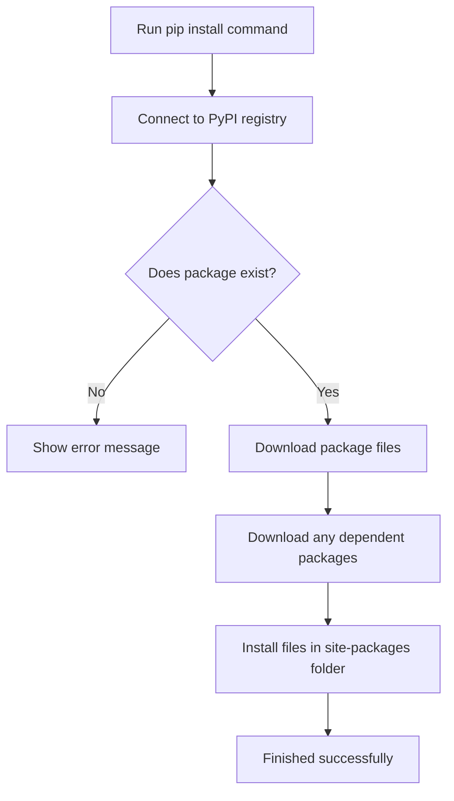

# Managing External Libraries

When writing automation scripts, you do not have to write all the code from scratch. If you want to connect to a cloud provider, parse configurations, or make web requests, you can download libraries created by other developers. Python uses a tool called `pip` to download and install these libraries.

In this guide, we will learn how `pip` works. We will look at how to download packages, how to lock package versions so your scripts do not break during updates, and how to write a tool to audit your active packages.

## The Role of pip in Automation

The `pip` command connects to a public registry called PyPI (Python Package Index). This index contains thousands of open-source libraries. When you run `pip install`, the tool downloads the files and puts them in your project's active directory.

Here is a diagram showing how `pip` fetches and installs packages on your computer:



## Locking Down Package Versions

Many developers make the mistake of installing the newest version of a library without specifying a version number. If the authors of the library update it and change how it works, your script will break without warning. To prevent this, you should lock your packages using version pin settings.

Let's look at a table comparing version pinning options in Python.

| Operator | How to Write It | What it Means | When to Use It |
| :--- | :--- | :--- | :--- |
| **Exact Pin** | `boto3==1.28.0` | Installs exactly version 1.28.0 | Best for production systems |
| **Compatible Pin** | `requests~=2.31.0` | Allows updates to 2.31.1, but blocks 2.32.0 | Best for getting safe bug fixes |
| **Minimum Bound** | `urllib3>=1.26.0` | Installs 1.26.0 or any newer version | Best for development libraries |
| **Double Bound** | `jinja2>=3.0.0,<4.0.0` | Installs any version between 3.0 and 4.0 | Best for major version safety |

## Working with Requirements Files

To keep track of your project libraries, you write them down in a text file named `requirements.txt`. This file goes in the root folder of your project.

### Creating the Requirements File
Create a file named `requirements.txt` and write the lines below.

```text
urllib3==1.26.15
requests~=2.28.0
```

### Installing Your Libraries
To install all the packages listed in your file, run this command in your active terminal:

```bash
pip install -r requirements.txt
```

Expected output:
```text
Collecting urllib3==1.26.15
  Downloading urllib3-1.26.15-py2.py3-none-any.whl (140 kB)
Collecting requests~=2.28.0
  Downloading requests-2.28.2-py3-none-any.whl (62 kB)
Installing collected packages: urllib3, requests
Successfully installed requests-2.28.2 urllib3-1.26.15
```

## Freezing Your Workspace

Once you have tested your script and everything is working, you should save the exact list of libraries you are using. You can do this by using the `freeze` command, which lists all active libraries and their exact versions.

Run this command in your terminal:

```bash
pip freeze
```

Expected output:
```text
requests==2.28.2
urllib3==1.26.15
```

To save this list directly to your configuration file, run:

```bash
pip freeze > requirements.txt
```

This ensures that anyone else who runs your code gets the exact same versions of the libraries, preventing compatibility problems.

## Auditing Installed Packages

You can write a Python script to scan your active environment and check if any installed packages are outdated or present a security risk. This is useful for checking server setups before starting deployments.

Create a file named `audit_packages.py` and write the code below.

```python
import sys
import subprocess
import json

print("=== Running Package Audit ===")

try:
    # Run pip list command to get packages in JSON format
    result = subprocess.run(
        [sys.executable, "-m", "pip", "list", "--format=json"],
        stdout=subprocess.PIPE,
        stderr=subprocess.PIPE,
        text=True,
        timeout=10
    )
    
    if result.returncode == 0:
        packages = json.loads(result.stdout)
        
        # We want to check for old versions of these packages
        monitored_libraries = {
            "urllib3": "1.26.0",
            "requests": "2.28.0"
        }
        
        warnings = 0
        for pkg in packages:
            name = pkg["name"].lower()
            version = pkg["version"]
            
            if name in monitored_libraries:
                print("Checking monitored package: " + name + " (installed version: " + version + ")")
                
                # Check if the installed version is older than recommended
                # In real code, you would use a version comparison library
                if version < monitored_libraries[name]:
                    print(" ⚠️ WARNING: Please update " + name + " to version " + monitored_libraries[name] + " or newer.")
                    warnings = warnings + 1
                else:
                    print(" ✅ Checked: " + name + " meets requirements.")
        
        print("\nAudit finished. Warnings triggered: " + str(warnings))
        
    else:
        print("Error: Could not retrieve package list.")
        print(result.stderr)
except Exception as error:
    print("Failed to run package check: " + str(error))
```

Run this script.

```bash
python3 audit_packages.py
```

Expected output:
```text
=== Running Package Audit ===
Checking monitored package: requests (installed version: 2.28.2)
 ✅ Checked: requests meets requirements.
Checking monitored package: urllib3 (installed version: 1.26.15)
 ✅ Checked: urllib3 meets requirements.

Audit finished. Warnings triggered: 0
```

## Common Mistakes

### Using pip Outside a Virtual Environment
If you run `pip install` globally, you might overwrite packages needed by the operating system. Always make sure your virtual environment is active before running installation commands.

* **The Bad Way:**
```bash
# This installs packages globally and can break system tools
sudo pip install requests
```

* **The Good Way:**
```bash
source myenv/bin/activate
pip install requests
```

### Not Pinning Versions in Production
If you deploy your script to production servers with a blank requirements file or without pinning versions, `pip` will download the newest versions on each run, which will eventually break your code.

* **The Bad Way:**
```text
# Inside requirements.txt:
requests
boto3
```

* **The Good Way:**
```text
# Inside requirements.txt:
requests==2.28.2
boto3==1.28.0
```

### Confusing System Package Managers with pip
Do not confuse Python's package manager (`pip`) with system package managers like `apt` or `brew`. Use system tools to install Python itself, and use `pip` inside your virtual environment to install Python libraries.

* **The Bad Way:**
```bash
# Trying to install python packages using system managers can lead to old versions
sudo apt install python3-requests
```

* **The Good Way:**
```bash
source myenv/bin/activate
pip install requests
```

## Summary

* The `pip` package manager downloads libraries from the public PyPI registry.
* Installing packages without version limits can lead to broken builds when library authors release updates.
* Version pinning allows you to specify exact or compatible versions for your project dependencies.
* A `requirements.txt` file lets you list and share all the packages your script needs to run.
* Run `pip install -r requirements.txt` to install all listed libraries in one command.
* Use `pip freeze` to output your currently installed packages with their exact versions.
* Redirect `pip freeze` output to `requirements.txt` to save a snapshot of your workspace.
* You can write python scripts to audit packages and check for old, vulnerable libraries.
* Always check that you are in an active virtual environment before using `pip install`.
* Do not install Python libraries globally; keep them inside project-specific folders.
