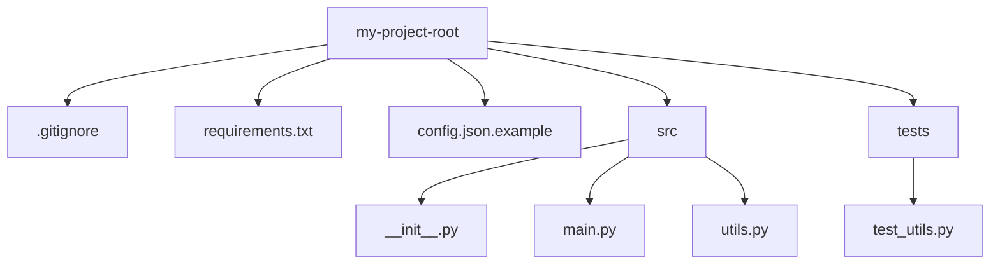

# Organizing Your Project Files

When you start writing scripts, it is tempting to put all your code in a single file and leave it on your Desktop. While this works for tiny tasks, it gets messy as your projects grow. If you have helper files, configuration settings, and tests, a single file becomes hard to manage and share.

In this guide, we will learn how to organize a Python project professionally. We will look at a standard layout, explain what each file does, and write a script that automatically creates a clean project directory framework for you.

## Standard Directory Layout

Having a consistent layout makes it easy for other team members to understand your code. It also helps automated tools find your test files and deployment settings.

Here is a comparison of files we keep locally versus files we share with others:

| File Name | Share on GitHub? | Contains | Purpose |
| :--- | :--- | :--- | :--- |
| **`config.json`** | **NO** (Keep secret) | Real passwords and API tokens | Used locally by your script at runtime |
| **`config.json.example`** | **YES** | Empty placeholders like `"db_pass": ""` | Template for other developers |
| **`.venv/`** | **NO** (Keep local) | Downloaded package files and binaries | Holds local project dependencies |
| **`requirements.txt`** | **YES** | List of libraries with version numbers | Allows others to set up the project |
| **`.gitignore`** | **YES** | List of files to ignore | Stops Git from tracking secret files |

Here is a diagram of a standard project structure:



## The Role of Key Files

### The Source Folder (src)
We put all our active code inside a folder named `src`. This keeps the main folder clean and separates your program code from configuration templates and tests.

### The Init File (`__init__.py`)
This is a special file used by Python. Even if it is completely empty, it tells Python that the directory is a package. This lets you import functions from one file to another, like loading helper functions from `utils.py` into `main.py`.

### The Gitignore File (`.gitignore`)
This file is critical for security. You will work with database passwords and API tokens. You must never upload these to Git. The `.gitignore` file lists files that Git should ignore, preventing accidents.

## Creating a Project Scaffolder Script

Instead of manually creating folders and files every time you start a new project, you can write a script to build this structure automatically.

Create a file named `make_project.py` and write the code below.

```python
import os
import sys

def build_project(base_dir):
    print("Creating project directory: " + base_dir)
    
    # Define folders to create
    folders = [
        base_dir,
        os.path.join(base_dir, "src"),
        os.path.join(base_dir, "tests")
    ]
    
    for folder in folders:
        os.makedirs(folder, exist_ok=True)
        print(" -> Created folder: " + folder)
        
    # Create empty helper files
    init_src = os.path.join(base_dir, "src", "__init__.py")
    with open(init_src, "w") as file:
        file.write("# Marks src folder as a package\n")
        
    # Create gitignore template
    gitignore_path = os.path.join(base_dir, ".gitignore")
    with open(gitignore_path, "w") as file:
        file.write(".venv/\n")
        file.write("__pycache__/\n")
        file.write("config.json\n")
        file.write("*.pyc\n")
        
    # Create configuration template
    config_tmpl = os.path.join(base_dir, "config.json.example")
    with open(config_tmpl, "w") as file:
        file.write('{"db_user": "admin", "db_password": ""}\n')
        
    # Create a basic README
    readme_path = os.path.join(base_dir, "README.md")
    with open(readme_path, "w") as file:
        file.write("# New Automation Tool\n\nRun the tool: `python3 src/main.py`\n")
        
    print("Project scaffold built successfully!")

# Run the build function using a test folder name
build_project("my_new_tool")
```

Run this script.

```bash
python3 make_project.py
```

Expected output:
```text
Creating project directory: my_new_tool
 -> Created folder: my_new_tool
 -> Created folder: my_new_tool/src
 -> Created folder: my_new_tool/tests
Project scaffold built successfully!
```

Let's check the files inside the new directory:

```bash
ls my_new_tool
```

Expected output:
```text
config.json.example  .gitignore  README.md  src  tests
```

## Common Mistakes

### Committing Local Configuration Files containing Passwords
It is easy to run `git add .` and accidentally commit your active `config.json` file. Once a password is pushed to Git history, it is difficult to remove.

* **The Bad Way:**
```bash
git add config.json
git commit -m "Save local server settings"
```

* **The Good Way:**
Always add `config.json` to your `.gitignore` file before running any git commands.
```text
# Inside your .gitignore file:
config.json
```

### Having No Documentation in the Root Folder
If you share your tool with other developers without a README file, they will not know how to install it, what libraries they need, or how to configure it.

* **The Bad Way:**
Leaving the root folder containing only code files and no explanation.

* **The Good Way:**
Always create a `README.md` file that explains how to configure and run the tool in three simple steps.

### Putting Helper Functions in the Main Entry File
Putting database connections, string formatting, and email alerting code directly in your `main.py` file makes the file long and difficult to read.

* **The Bad Way:**
Writing 500 lines of code in `main.py` containing both main logic and small helper functions.

* **The Good Way:**
Move helper functions to a `utils.py` file and import them.
```python
# Inside src/main.py:
from src.utils import send_email_alert
```

## Summary

* Organizing your script project keeps your codebase clean and easy for your team to understand.
* Put all your active Python code inside a `src/` directory to separate it from build configurations.
* Create empty `__init__.py` files to tell Python that directories should be treated as importable modules.
* Use a `.gitignore` file to list directories and config files that Git should never track.
* Never commit real cloud keys or database passwords to public Git repositories.
* Use template files like `config.json.example` to show other developers what settings they need to configure.
* Create a `README.md` file with simple steps on how to install and run your automation tool.
* You can write Python scripts to automate the creation of project directories and template files.
* Keep your main script file clean by moving helper functions to a separate `utils.py` file.
* Good project structure helps automated pipeline runners find and execute test files easily.
