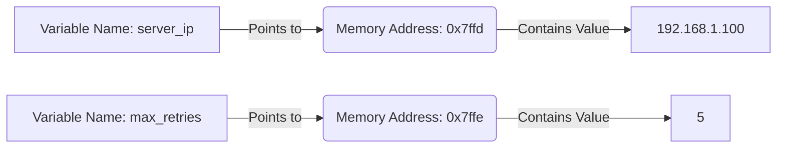

# Storing Data in Variables

When you write scripts to manage systems, you need a way to store information. This could be a server's IP address, a backup folder path, or the number of active alerts. In programming, we store this information in variables. Think of a variable as a labeled box where you can keep data and change it whenever you need.

In this guide, we will learn how to create and use variables in Python. We will look at how Python stores variables in memory, how to name them clearly, and how to update them as your script runs.

## What is a Variable?

A variable is just a name that points to a value. You assign a value to a name using the equals sign (`=`). Once assigned, you can use that name throughout your script instead of typing the raw value over and over.

Let's look at a comparison between hardcoded values and using variables in your scripts.

| Aspect | Hardcoded Values | Using Variables |
| :--- | :--- | :--- |
| **Readability** | Hard to tell what a value represents | Clear because the name explains the data |
| **Updating Code** | Must find and replace every instance | Change it once where the variable is defined |
| **Dynamic Data** | Cannot change while the script is running | Can be updated automatically by the code |
| **Typing Errors** | High risk of typing an IP address wrong | Low risk once stored in a variable |
| **Sharing Code** | Hard because secrets are mixed in code | Easy because values can be isolated at the top |

Here is a diagram showing how Python links variable names to values in your computer's memory:



## Assigning Your First Variables

In Python, you do not need to declare a variable before using it or specify what kind of data it holds. Python looks at the value and figures out the type automatically.

Create a file named `variables.py` and write the code below.

```python
# Storing an IP address
server_ip = "192.168.1.100"

# Storing a port number
port = 22

# Storing server state
is_active = True

print("Connecting to: " + server_ip)
print("Using port: " + str(port))
print("Connection status: " + str(is_active))
```

Run this file in your terminal.

```bash
python3 variables.py
```

Expected output:
```text
Connecting to: 192.168.1.100
Using port: 22
Connection status: True
```

## Reassigning Variables

Variables are called variable because their values can change. You can update a variable by assigning a new value to it. The old value is discarded, and the variable points to the new one.

Let's write a script that tracks the number of failed connection attempts.

```python
failed_attempts = 0
print("Initial failed attempts: " + str(failed_attempts))

# Increment the count after a failure
failed_attempts = failed_attempts + 1
print("Current failed attempts: " + str(failed_attempts))

# Add another failure
failed_attempts = failed_attempts + 1
print("Final failed attempts: " + str(failed_attempts))
```

Run the script to see how the count updates.

```bash
python3 reassign.py
```

Expected output:
```text
Initial failed attempts: 0
Current failed attempts: 1
Final failed attempts: 2
```

## Naming Your Variables Natively

You should name your variables so that any other developer can understand what they store. Python community guidelines recommend using `snake_case` for variable names, which means using lowercase letters and separating words with underscores.

Let's compare good naming practices against bad ones.

* **The Bad Way:**
```python
# What do these names mean?
a = "192.168.1.1"
pt = 80
s = True
```

* **The Good Way:**
```python
# Clear names that describe the data
target_host = "192.168.1.1"
web_port = 80
service_is_running = True
```

## Real-World Example: Server Status Reporter

Let's write a script that manages system metadata using variables. This script stores server environment details, calculates resource usage, and prints a formatted health report.

Create a file named `status_report.py` and write the code below.

```python
# Define system settings
environment = "Production"
server_name = "db-server-01"
disk_total_gb = 500
disk_used_gb = 420

# Calculate disk free space using variables
disk_free_gb = disk_total_gb - disk_used_gb
percent_used = (disk_used_gb / disk_total_gb) * 100

# Print the report
print("=== System Status Report ===")
print("Environment:   " + environment)
print("Server Name:   " + server_name)
print("Total Space:   " + str(disk_total_gb) + " GB")
print("Used Space:    " + str(disk_used_gb) + " GB")
print("Free Space:    " + str(disk_free_gb) + " GB")
print("Disk Usage:    " + str(percent_used) + "%")
```

Run the script.

```bash
python3 status_report.py
```

Expected output:
```text
=== System Status Report ===
Environment:   Production
Server Name:   db-server-01
Total Space:   500 GB
Used Space:    420 GB
Free Space:    80 GB
Disk Usage:    84.0%
```

## Common Mistakes

### Using a Variable Before Defining It
If you try to print or use a variable before you assign a value to it, Python will crash with a `NameError`.

* **The Bad Way:**
```python
# Trying to print 'backup_path' before it is created
print("Target folder: " + backup_path)
backup_path = "/var/backups"
```

* **The Good Way:**
```python
# Always define the variable first
backup_path = "/var/backups"
print("Target folder: " + backup_path)
```

### Using Reserved Keywords
Python has a set of reserved words that you cannot use as variable names because they are part of the language structure. Examples include `if`, `else`, `import`, `for`, and `class`.

* **The Bad Way:**
```python
# This will cause a SyntaxError
import = "config.json"
```

* **The Good Way:**
```python
# Use a descriptive name instead
config_file = "config.json"
```

### Case Sensitivity Issues
Python treats uppercase and lowercase letters as completely different characters. `Server_IP`, `server_ip`, and `SERVER_IP` are three separate variables.

* **The Bad Way:**
```python
server_ip = "10.0.0.1"
# This fails because 'Server_IP' with a capital S is not defined
print("IP: " + Server_IP)
```

* **The Good Way:**
```python
server_ip = "10.0.0.1"
print("IP: " + server_ip)
```

## Summary

* Variables store data values in labeled boxes so you can reuse them throughout your scripts.
* You assign a value to a variable name using the single equals sign (`=`).
* Python figures out the data type of your variable automatically at runtime.
* You can update the value of an existing variable by reassigning a new value to it.
* Use snake_case for variable names to keep your scripts easy to read.
* Avoid short, generic variable names like `x` or `temp` that do not describe the data.
* Do not try to use variables before you have assigned them a value.
* Avoid using Python's reserved keywords like `import`, `if`, or `for` as variable names.
* Remember that variable names in Python are case-sensitive.
* Using variables allows you to update connection details in one place instead of editing multiple files.
