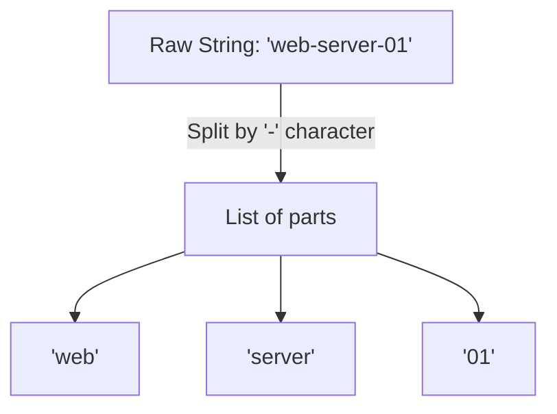

# Working with Text data

When you write scripts, much of the data you deal with is text. This includes server names, path strings, configuration lines, and logs. In Python, text is stored as a string. Understanding how to create, format, and modify strings is essential for parsing log files and building file paths.

In this guide, we will learn how to work with strings in Python. We will look at different types of quotation marks, how to merge strings, how to split text, and how to format messages cleanly.

## What is a String?

A string is a sequence of characters. You define a string by wrapping text in quotation marks. Python allows you to use single quotes (`'`), double quotes (`"`), or triple quotes (`'''` or `"""`).

Let's look at a comparison of when to use each type of quote.

| Quote Type | Syntax Example | Best Use Case |
| :--- | :--- | :--- |
| **Double Quotes** | `"web-server-01"` | Default choice for standard text |
| **Single Quotes** | `'web-server-01'` | Good when the text itself contains double quotes |
| **Triple Quotes** | `"""Multi-line text"""` | Best for long paragraphs or multi-line configuration blocks |

Here is a diagram showing how Python splits a string into a list of characters when you use the split method:



## String Formatting (f-strings)

Connecting strings using the plus sign (`+`) can get messy when you have many variables. Python uses f-strings (formatted strings) to make injecting variables into text clean and easy. You write an `f` before the opening quote and place variables inside curly braces `{}`.

Create a file named `formatting.py` and write the code below.

```python
server = "db-01"
port = 5432
status = "active"

# Formatting string using f-string
message = f"Status Alert: The server {server} on port {port} is currently {status}."

print(message)
```

Run this file in your terminal.

```bash
python3 formatting.py
```

Expected output:
```text
Status Alert: The server db-01 on port 5432 is currently active.
```

## Modifying Strings

Python has built-in methods to clean up and modify text. These methods do not change the original string; instead, they return a new modified string.

### Cleaning Up Spaces
When reading config files, lines often have extra spaces or newline characters at the end. You can use `.strip()` to remove them.

```python
raw_path = "   /var/log/nginx/access.log  \n"
clean_path = raw_path.strip()

print("Original length: " + str(len(raw_path)))
print("Cleaned path: '" + clean_path + "'")
print("Cleaned length: " + str(len(clean_path)))
```

Expected output:
```text
Original length: 31
Cleaned path: '/var/log/nginx/access.log'
Cleaned length: 25
```

### Splitting Text
If you have a comma-separated list of servers, you can split it into a Python list of individual server names using `.split()`.

```python
server_list = "web01,web02,web03,db01"
servers = server_list.split(",")

print(servers)
print("First server: " + servers[0])
```

Expected output:
```text
['web01', 'web02', 'web03', 'db01']
First server: web01
```

### Replacing Text
If you need to change a path template or update a configuration setting, you can use `.replace()`.

```python
template_path = "/opt/app/VERSION/configs"
actual_path = template_path.replace("VERSION", "v2.1.0")

print(actual_path)
```

Expected output:
```text
/opt/app/v2.1.0/configs
```

## Real-World Example: Parsing Log Lines

Let's write a script that parses raw log data. We will extract the timestamp, error type, and actual message by splitting the log string and cleaning up the whitespace.

Create a file named `log_parser.py` and write the code below.

```python
# Raw log line from a service
raw_log = "2026-06-25 08:30:15 | ERROR | Connection to database server-05 timed out.   \n"

# 1. Clean up newlines and spaces
clean_log = raw_log.strip()

# 2. Split the log into components using the pipe symbol
parts = clean_log.split(" | ")

# 3. Extract the components
timestamp = parts[0]
level = parts[1]
message = parts[2]

# 4. Print the formatted result
print("=== Parsed Log Data ===")
print(f"Time:    {timestamp}")
print(f"Level:   {level}")
print(f"Message: {message}")
```

Run the script.

```bash
python3 log_parser.py
```

Expected output:
```text
=== Parsed Log Data ===
Time:    2026-06-25 08:30:15
Level:   ERROR
Message: Connection to database server-05 timed out.
```

## Common Mistakes

### Forgetting that Strings are Read-Only
Strings in Python are immutable, which means they cannot be changed in place. If you try to update a single character directly, your script will crash.

* **The Bad Way:**
```python
hostname = "web-01"
# This will raise a TypeError
hostname[4] = "2"
```

* **The Good Way:**
```python
hostname = "web-01"
# Create a new string using concatenation or replacement
hostname = hostname.replace("01", "02")
```

### Mixing Types in Formatting
If you try to add a string and a number together without converting the number first, your script will crash.

* **The Bad Way:**
```python
port = 8080
# This raises a TypeError
print("Listening on port: " + port)
```

* **The Good Way:**
```python
port = 8080
# Use an f-string which handles conversion automatically
print(f"Listening on port: {port}")
```

### Checking for Substrings Case-Sensitively
When searching log files for warnings, remember that string comparisons are case-sensitive. If you check for lowercase "error", you will miss uppercase "ERROR" messages.

* **The Bad Way:**
```python
log_line = "CRITICAL ERROR: Disk space full"
# This returns False because 'error' is lowercase
if "error" in log_line:
    print("Found error!")
```

* **The Good Way:**
```python
log_line = "CRITICAL ERROR: Disk space full"
# Convert the string to lowercase first
if "error" in log_line.lower():
    print("Found error!")
```

## Summary

* Strings store text data in Python and are wrapped in single, double, or triple quotes.
* Triple quotes allow you to write multi-line strings, which is useful for writing config templates.
* Use f-strings (`f"text {variable}"`) to merge variables into your text cleanly.
* Use the `.strip()` method to clean up extra spaces and newlines from inputs or file lines.
* Use the `.split(delimiter)` method to break a string into a list of smaller parts.
* Use the `.replace(old, new)` method to swap words or template placeholders in a path.
* Remember that strings are immutable and cannot be changed in place.
* Always convert numbers to strings using `str()` before adding them to other strings.
* Convert text to lowercase with `.lower()` to perform safe search checks.
* String operations allow you to clean up raw system command outputs for analysis.
