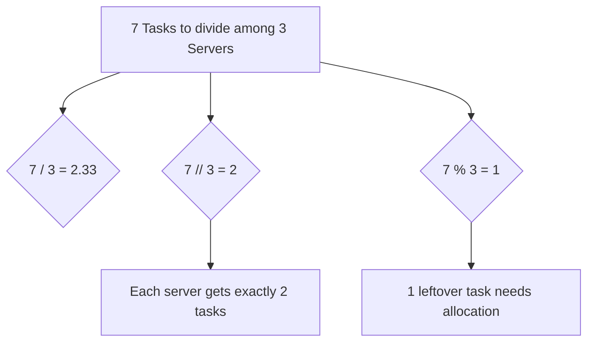

# Working with Numbers

When managing systems, you will often need to do math. This includes calculating how much RAM is free, dividing a server cluster's workload, or finding the percentage of failed web requests. Python handles numbers using two main types: integers for whole numbers, and floats for numbers with decimals.

In this guide, we will look at how Python works with numbers. We will learn how to perform basic math operations, how division behaves, and how to write calculations for resource usage.

## Integers and Floats

An integer is a whole number with no decimal point, like `80` or `-5`. A float is a number with a decimal point, like `99.9` or `0.0`. 

Let's look at a comparison of different division operators in Python.

| Operator | Math Action | Code Example | Result | DevOps Use Case |
| :--- | :--- | :--- | :--- | :--- |
| `/` | Standard Division | `5 / 2` | `2.5` (Float) | Finding exact ratios or percentages |
| `//` | Floor Division | `5 // 2` | `2` (Integer) | Grouping servers or calculating nodes |
| `%` | Modulo (Remainder) | `5 % 2` | `1` (Integer) | Spreading workloads evenly across pools |

Here is a diagram showing how these operators divide a pool of servers:



## Basic Arithmetic Operations

You use standard mathematical symbols to perform calculations. Python follows standard order of operations rules (parentheses first, then multiplication and division, then addition and subtraction).

Create a file named `math_ops.py` and write the code below.

```python
# System metrics
total_memory_mb = 16384
used_memory_mb = 12288

# Addition and Subtraction
free_memory_mb = total_memory_mb - used_memory_mb
print("Free Memory: " + str(free_memory_mb) + " MB")

# Multiplication and Division
free_percentage = (free_memory_mb / total_memory_mb) * 100
print("Percentage Free: " + str(free_percentage) + "%")
```

Run this file in your terminal.

```bash
python3 math_ops.py
```

Expected output:
```text
Free Memory: 4096 MB
Percentage Free: 25.0%
```

## Updating Numbers in Place

When tracking events like failed connections or downloaded bytes, you often want to update a number variable relative to its current value. Python has shorthand operators to make this easy.

```python
retry_count = 0
print("Start retry count: " + str(retry_count))

# Increment by 1
retry_count += 1
print("After first retry: " + str(retry_count))

# Add another step
retry_count += 1
print("After second retry: " + str(retry_count))

# Shorthand subtraction
servers_to_check = 10
servers_to_check -= 1
print("Servers left: " + str(servers_to_check))
```

Run the script.

```bash
python3 update_numbers.py
```

Expected output:
```text
Start retry count: 0
After first retry: 1
After second retry: 2
Servers left: 9
```

## Real-World Example: Node Capacity Planner

Let's write a script that calculates how many cloud server instances (nodes) are required to handle a set of container workloads. We will use floor division to find the minimum number of full nodes and modulo to check for remainder workloads.

Create a file named `node_planner.py` and write the code below.

```python
# Each cloud node can run exactly 8 containers
node_capacity = 8

# Total containers we need to deploy
total_containers = 35

# Calculate nodes using floor division
full_nodes_needed = total_containers // node_capacity

# Calculate remaining containers using modulo
leftover_containers = total_containers % node_capacity

print("=== Capacity Plan ===")
print(f"Total Containers to Deploy: {total_containers}")
print(f"Node Capacity Limit:        {node_capacity}")
print(f"Full Nodes Needed:          {full_nodes_needed}")
print(f"Containers for Last Node:   {leftover_containers}")

# Calculate total nodes actually required
if leftover_containers > 0:
    total_nodes = full_nodes_needed + 1
else:
    total_nodes = full_nodes_needed

print(f"Total Nodes to Provision:   {total_nodes}")
```

Run the script.

```bash
python3 node_planner.py
```

Expected output:
```text
=== Capacity Plan ===
Total Containers to Deploy: 35
Node Capacity Limit:        8
Full Nodes Needed:          4
Containers for Last Node:   3
Total Nodes to Provision:   5
```

## Common Mistakes

### Dividing by Zero
If your script tries to divide any number by zero (for example, calculating failed connection rates when there are zero total connections), the script will crash.

* **The Bad Way:**
```python
total_requests = 0
failed_requests = 0
# This raises a ZeroDivisionError
failure_rate = failed_requests / total_requests
```

* **The Good Way:**
```python
total_requests = 0
failed_requests = 0

if total_requests > 0:
    failure_rate = failed_requests / total_requests
else:
    failure_rate = 0.0

print(f"Failure rate: {failure_rate}")
```

### Performing Math on String Values
When you read values from files or environment variables, Python imports them as strings, not numbers. If you try to do math on these values directly, your script will crash.

* **The Bad Way:**
```python
# Port is read as text
port_str = "8080"
# This raises a TypeError
next_port = port_str + 1
```

* **The Good Way:**
```python
port_str = "8080"
# Convert the string to an integer first
port_num = int(port_str)
next_port = port_num + 1
print(f"Next port: {next_port}")
```

### Confusing Float Precision
Computers store floats in binary, which can sometimes lead to tiny rounding errors when performing math on decimals.

* **The Bad Way:**
```python
# This prints 0.30000000000000004 instead of 0.3 due to precision limits
print(0.1 + 0.2)
```

* **The Good Way:**
Use the `round()` function when displaying decimal results to your users.
```python
result = 0.1 + 0.2
print(round(result, 2))
```

## Summary

* Python uses integers for whole numbers and floats for decimal values.
* Use standard division (`/`) when you need exact float results.
* Use floor division (`//`) to divide and discard the remainder, returning a whole number.
* Use modulo (`%`) to get the remainder of a division, which helps distribute workloads.
* Shorthand operators like `+=` and `-=` make it easy to update counts in place.
* Always check if your denominator is greater than zero before performing division.
* Convert text variables to integers using `int()` before performing math.
* Use the `round()` function to clean up float precision decimal points.
* Mathematical calculations are essential for monitoring disk, memory, and CPU limits.
* Calculations help you automate resource provisioning decisions dynamically.
