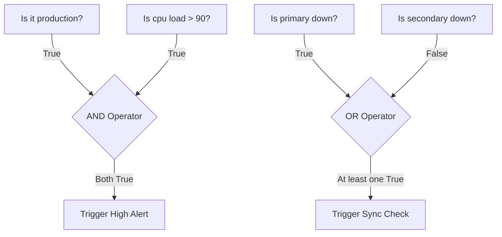

# Working with Booleans

When automating tasks, your scripts need to make decisions. You might ask: Is the server database active? Is the disk usage over 90%? Has the deployment failed? The answers to these questions are either Yes or No. In programming, we represent these answers using Booleans, which can only have one of two values: `True` or `False`.

In this guide, we will look at how to use Booleans in Python. We will learn about comparison checks, combining decisions using logical operators, and writing rules to control your script's flow.

## True and False in Python

Booleans in Python must start with an uppercase letter: `True` or `False`. They are often created by comparing two values using comparison operators like double equals (`==`) for equality, or greater than (`>`).

Let's look at a comparison of logical operators that let you combine multiple Boolean checks.

| Operator | Math Action | Code Example | Result | DevOps Use Case |
| :--- | :--- | :--- | :--- | :--- |
| `and` | Returns True only if both conditions are True | `True and False` | `False` | Alert if server is PROD **and** memory is full |
| `or` | Returns True if at least one condition is True | `True or False` | `True` | Alert if disk is full **or** database is down |
| `not` | Reverses the Boolean value | `not True` | `False` | Run check if service is **not** running |

Here is a diagram showing how logical operators merge conditions:



## Running Comparison Checks

You create Booleans by checking relationships between variables. The output of a comparison is always a Boolean.

Create a file named `comparisons.py` and write the code below.

```python
disk_limit = 90
current_disk = 92

# Check if disk is over the limit
is_over_limit = current_disk > disk_limit
print("Is disk usage over limit? " + str(is_over_limit))

# Check for equality
active_containers = 5
desired_containers = 5
is_healthy = active_containers == desired_containers
print("Are containers healthy? " + str(is_healthy))
```

Run this file in your terminal.

```bash
python3 comparisons.py
```

Expected output:
```text
Is disk usage over limit? True
Are containers healthy? True
```

## Combining Logical Operators

You can build complex logic by combining `and`, `or`, and `not`. It is best to use parentheses to group your statements so your code is easy to read.

```python
is_production = True
is_maintenance_window = False
database_online = False

# We want to alert if the database goes offline, but only in production
# and not during scheduled maintenance windows.
should_alert = is_production and not database_online and not is_maintenance_window

print("Should we send a Slack alert? " + str(should_alert))
```

Run the script.

```bash
python3 logical.py
```

Expected output:
```text
Should we send a Slack alert? True
```

## Real-World Example: Backup Decision Script

Let's write a script that determines if a database backup should run. The backup should execute if it is a scheduled run, OR if an administrator triggers it manually. However, the backup must never run if the server's disk space is critically low.

Create a file named `backup_decision.py` and write the code below.

```python
# System state variables
is_scheduled_time = True
is_manual_trigger = False
disk_free_gb = 5 # Critically low (limit is 10 GB)

# Set constraints
min_disk_required_gb = 10

# Step 1: Check if the user requested a backup run
backup_requested = is_scheduled_time or is_manual_trigger

# Step 2: Check if resources are healthy
has_enough_disk = disk_free_gb >= min_disk_required_gb

# Step 3: Make final decision
should_run_backup = backup_requested and has_enough_disk

print("=== Backup Pre-flight Check ===")
print(f"Backup Requested:        {backup_requested}")
print(f"Has Adequate Disk Space: {has_enough_disk}")
print(f"Proceed with Backup?     {should_run_backup}")

if not should_run_backup and backup_requested:
    print(" ❌ ERROR: Backup aborted due to insufficient disk space!")
```

Run the script.

```bash
python3 backup_decision.py
```

Expected output:
```text
=== Backup Pre-flight Check ===
Backup Requested:        True
Has Adequate Disk Space: False
Proceed with Backup?     False
 ❌ ERROR: Backup aborted due to insufficient disk space!
```

## Common Mistakes

### Confusing assignment (=) with equality comparison (==)
A single equals sign (`=`) is used to store data inside a variable. A double equals sign (`==`) is used to compare two values. Using a single equals sign in comparison checks will cause a syntax error.

* **The Bad Way:**
```python
is_prod = True
# This will cause a SyntaxError
if is_prod = True:
    print("Running in Production")
```

* **The Good Way:**
```python
is_prod = True
# Use double equals, or just use the boolean directly
if is_prod == True:
    print("Running in Production")
```

### Typing Booleans in Lowercase
Python is case-sensitive. If you write `true` or `false` in lowercase, Python will search for a variable with that name instead of loading the Boolean value, causing a crash.

* **The Bad Way:**
```python
# This raises a NameError: name 'true' is not defined
is_active = true
```

* **The Good Way:**
```python
# Always capitalize True and False
is_active = True
```

### Writing Confusing Logical Chains Without Parentheses
If you mix `and` and `or` without parentheses, Python will evaluate them using default precedence rules (evaluating `and` before `or`), which can lead to buggy decisions.

* **The Bad Way:**
```python
# This means: (is_weekend and is_production) or is_manual
# It runs the script even on weekdays if is_manual is True, which might be correct,
# but it is difficult for another developer to read.
run_check = is_weekend and is_production or is_manual
```

* **The Good Way:**
```python
# Use parentheses to make your logic clear
run_check = (is_weekend and is_production) or is_manual
```

## Summary

* Booleans represent logic choices and can only be `True` or `False`.
* You compare values using operators like `==` (equal), `!=` (not equal), and `>` (greater than).
* The `and` operator requires all conditions to be true to return True.
* The `or` operator returns True if at least one condition is true.
* The `not` operator reverses a Boolean value.
* Boolean variable values must start with capital letters (`True` and `False`).
* Do not use the single equals sign (`=`) when performing equality checks.
* Use parentheses to group logical chains containing both `and` and `or` checks.
* Checking system status parameters using Booleans prevents scripts from executing during unsafe conditions.
* Standardizing system checks using Boolean values helps automate troubleshooting and alert routing.
