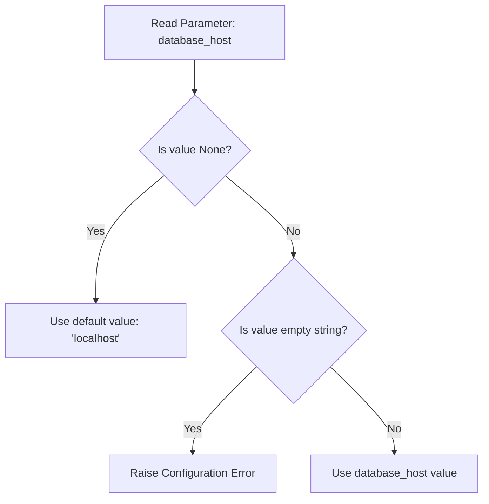

# Working with None Type

When writing automation scripts, you will often deal with missing or uninitialized data. For example, you might try to read a server configuration setting that is not set, or query a database for a server that does not exist. In Python, we represent the absence of a value using a special object called `None`.

In this guide, we will look at how `None` works in Python. We will learn how it compares to empty strings or numbers, how to check for it safely, and how to use it to represent missing configurations.

## What is None?

`None` is a special constant in Python that represents "nothing." It has its own data type called `NoneType`. It is not the same as the number `0`, an empty string `""`, or a Boolean `False`. 

Let's look at a table comparing `None` against other "empty" values.

| Value | Data Type | Meaning | What it Evaluates To in an If Check |
| :--- | :--- | :--- | :--- |
| **`None`** | `NoneType` | Absolute absence of any value | False (Falsy) |
| **`""`** | `str` | A text string with zero characters | False (Falsy) |
| **`0`** | `int` | The mathematical value of zero | False (Falsy) |
| **`False`** | `bool` | The logical value of false | False (Falsy) |

Here is a diagram showing the decision flow when checking if a configuration parameter is missing:



## Checking for None Safely

To check if a variable points to `None`, you should use the `is` or `is not` operators instead of the double equals (`==`) sign. The `is` operator checks if both variables point to the exact same object in memory, which is faster and safer for `None`.

Create a file named `check_none.py` and write the code below.

```python
database_host = None

# Checking if the host is missing
if database_host is None:
    print("Warning: Database host is not set. Falling back to localhost.")
    database_host = "127.0.0.1"

print("Active Database Host: " + database_host)
```

Run this file in your terminal.

```bash
python3 check_none.py
```

Expected output:
```text
Warning: Database host is not set. Falling back to localhost.
Active Database Host: 127.0.0.1
```

## None as Function Defaults

A common pattern in Python is to set a function parameter's default value to `None`. This lets you check if the caller provided a value and write custom logic if they left it blank.

```python
def configure_port(port=None):
    if port is None:
        print("No port specified. Setting default web port 80.")
        port = 80
    else:
        print("Configuring port override: " + str(port))
    return port

active_port = configure_port()
override_port = configure_port(8080)
```

Run the script.

```bash
python3 function_defaults.py
```

Expected output:
```text
No port specified. Setting default web port 80.
Configuring port override: 8080
```

## Real-World Example: Server Config Parser

Let's write a script that parses metadata configurations. It simulates loading values from a database. If a server detail is missing (`None`), it applies a default safe value or raises a warning.

Create a file named `config_resolver.py` and write the code below.

```python
# Simulated metadata output from a database query
# One server is missing its monitoring port details
server_data = {
    "hostname": "prod-web-01",
    "ip_address": "192.168.1.15",
    "monitoring_port": None
}

def resolve_server_settings(server):
    print("Resolving settings for: " + server["hostname"])
    
    # Check IP
    ip = server["ip_address"]
    if ip is None:
        print(" ❌ Error: IP address is missing!")
        return None
        
    # Check Port
    port = server["monitoring_port"]
    if port is None:
        print("  Info: Monitoring port is None. Resolving to default port 9100.")
        port = 9100
    else:
        print("  Info: Custom port configured: " + str(port))
        
    return {
        "host": ip,
        "port": port
    }

resolved_config = resolve_server_settings(server_data)
print("\nFinal Config Connection Details:")
print(resolved_config)
```

Run the script.

```bash
python3 config_resolver.py
```

Expected output:
```text
Resolving settings for: prod-web-01
  Info: Monitoring port is None. Resolving to default port 9100.

Final Config Connection Details:
{'host': '192.168.1.15', 'port': 9100}
```

## Common Mistakes

### Using Double Equals to Check for None
While `variable == None` works in many cases, it is not recommended. Other developers can write custom objects that override the equality check, causing bugs. Always use the `is` operator.

* **The Bad Way:**
```python
db_port = None
# Avoid this style
if db_port == None:
    print("Port is missing")
```

* **The Good Way:**
```python
db_port = None
# Standard and safe python style
if db_port is None:
    print("Port is missing")
```

### Confusing None with Empty Strings
If your code treats `None` and an empty string `""` exactly the same way, you might hide configuration errors where a user explicitly set a blank value instead of leaving it unset.

* **The Bad Way:**
```python
config_val = ""
# This does not catch empty strings
if config_val is None:
    print("Value was not configured")
```

* **The Good Way:**
```python
config_val = ""
if config_val is None:
    print("Value was not configured")
elif config_val == "":
    print("Error: Value was configured but left blank!")
```

### Forgetting that Functions Return None by Default
In Python, if you write a function but do not include a `return` statement, the function will run and return `None` silently.

* **The Bad Way:**
```python
def log_message(text):
    print("Log: " + text)
    # No return statement here

# result will hold the value None
result = log_message("User login success")
# This prints None, which might surprise you
print("Function output: " + str(result))
```

* **The Good Way:**
If you need to return status flags, write an explicit return statement.
```python
def log_message(text):
    print("Log: " + text)
    return True
```

## Summary

* `None` is Python's built-in constant used to represent the absence of a value.
* `None` has its own unique data type called `NoneType`.
* `None` is not equivalent to an empty string `""` or the integer `0`.
* Always check if a variable is `None` by using the `is None` operator.
* Use `is not None` to verify that a variable actually holds data.
* Setting default function parameters to `None` allows you to handle missing inputs.
* Python functions return `None` automatically if you do not define a return value.
* Using `None` as a placeholder allows you to safely check settings before running commands.
* Differentiating between `None` and empty strings helps you validate server configurations.
* Representing uninitialized states with `None` prevents scripts from using corrupted data.
