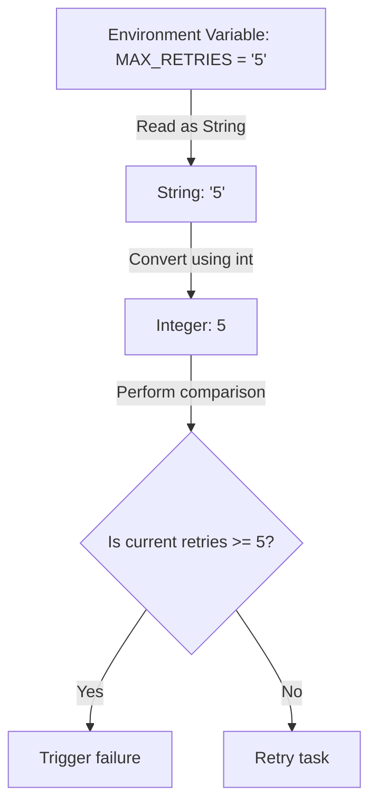

# Converting Data Types

When you write scripts, data often arrives in formats you did not choose. For example, when you read an environment variable or a configuration file, the values are always read as strings. If you want to use those values to perform math or make logical decisions, you must convert them to the correct data type. This process is called type casting.

In this guide, we will look at how to convert data types in Python. We will learn about built-in conversion functions, how Python handles conversion automatically, and how to write safety checks to prevent crashes.

## Implicit vs Explicit Conversion

Python sometimes converts data types automatically (implicit conversion). For example, if you add an integer and a float, Python converts the integer to a float first so it does not lose decimal accuracy. However, if you try to add a string and a number, Python will not perform automatic conversion; you must convert the values manually (explicit conversion).

Let's look at a comparison of conversion functions and how they transform different inputs.

| Function | Input Value | Converted Result | Why it is Used |
| :--- | :--- | :--- | :--- |
| `int()` | `"8080"` | `8080` (Integer) | Converting string ports to numbers |
| `float()` | `"95.5"` | `95.5` (Float) | Converting string metrics to decimals |
| `str()` | `80` | `"80"` (String) | Merging port numbers into log messages |
| `bool()` | `"production"` | `True` (Boolean) | Checking if configuration strings exist |
| `bool()` | `""` (Empty) | `False` (Boolean) | Checking if a setting was left blank |

Here is a diagram showing how a script converts string input from an environment variable to evaluate a system metric:



## Performing Type Conversion

You use Python's built-in functions to convert values explicitly. Let's look at how to convert strings to numbers and numbers to strings.

Create a file named `conversions.py` and write the code below.

```python
# Values loaded as text
port_text = "80"
limit_text = "95.5"

# Convert to numbers
port_num = int(port_text)
limit_num = float(limit_text)

# Perform math and print results
next_port = port_num + 1
print(f"Listening on port: {next_port} (Type: {type(next_port).__name__})")
print(f"Limit threshold: {limit_num} (Type: {type(limit_num).__name__})")

# Convert numbers back to text for simple logs
log_message = "Port configured: " + str(port_num)
print(log_message)
```

Run this file in your terminal.

```bash
python3 conversions.py
```

Expected output:
```text
Listening on port: 81 (Type: int)
Limit threshold: 95.5 (Type: float)
Port configured: 80
```

## Boolean Evaluations (Truthy and Falsy)

When you convert a variable to a Boolean using `bool()`, Python evaluates it as either `True` or `False`. Values that convert to `False` are called Falsy, and values that convert to `True` are called Truthy.

```python
# Falsy values
print("Empty string: " + str(bool("")))
print("Zero integer: " + str(bool(0)))
print("None object:  " + str(bool(None)))

# Truthy values
print("Normal string: " + str(bool("10.0.0.1")))
print("Active integer: " + str(bool(8080)))
```

Run the script.

```bash
python3 truthy.py
```

Expected output:
```text
Empty string: False
Zero integer: False
None object:  False
Normal string: True
Active integer: True
```

## Real-World Example: Metric Alert Auditor

Let's write a script that reads server statistics from an environment variable simulator. Since environment data always arrives as string text, our script will clean up the input, convert it to floats, and audit if the server is healthy.

Create a file named `audit_metrics.py` and write the code below.

```python
# Simulated environment variables loaded as strings
env_cpu_usage = " 84.6 \n" 
env_max_threshold = "80.0"

print("=== Starting Metric Audit ===")

try:
    # 1. Clean up and convert metrics
    cpu_value = float(env_cpu_usage.strip())
    threshold_value = float(env_max_threshold.strip())
    
    print(f"Current CPU Usage: {cpu_value}%")
    print(f"Max Safe Limit:    {threshold_value}%")
    
    # 2. Perform comparison check
    if cpu_value > threshold_value:
        print(" ❌ ALERT: CPU usage exceeds safe threshold limits!")
    else:
        print(" ✅ SUCCESS: CPU usage is within safe limits.")
        
except ValueError as error:
    print(" ❌ ERROR: Could not parse metric values. Details: " + str(error))
```

Run the script.

```bash
python3 audit_metrics.py
```

Expected output:
```text
=== Starting Metric Audit ===
Current CPU Usage: 84.6%
Max Safe Limit:    80.0%
 ❌ ALERT: CPU usage exceeds safe threshold limits!
```

## Common Mistakes

### Casting Strings with Letters to Integers
If you try to convert a string that contains letters, symbols, or spaces to an integer, Python will crash with a `ValueError`. Always clean up whitespace first or use error handling.

* **The Bad Way:**
```python
# This raises a ValueError
port = int("port-80")
```

* **The Good Way:**
```python
raw_port = "port-80"
# Strip characters or check if digit before casting
clean_port = raw_port.replace("port-", "")
if clean_port.isdigit():
    port = int(clean_port)
    print(f"Active Port: {port}")
```

### Casting Float Strings Directly to Integers
If a string contains a decimal point (like `"99.5"`), you cannot convert it directly to an integer using `int()`. You must convert it to a float first, and then convert the float to an integer.

* **The Bad Way:**
```python
# This raises a ValueError: invalid literal for int() with base 10: '99.5'
usage = int("99.5")
```

* **The Good Way:**
```python
# Convert to float first, then cast to integer
usage = int(float("99.5"))
print(f"Usage: {usage}")
```

### Confusing Truncation with Rounding
When you convert a float to an integer using `int()`, Python does not round the number. Instead, it chops off the decimal part entirely. For example, `9.9` becomes `9`.

* **The Bad Way:**
```python
# You might expect this to round up to 10
rounded_value = int(9.9)
print(rounded_value) # Prints 9
```

* **The Good Way:**
Use the built-in `round()` function before converting to an integer.
```python
rounded_value = int(round(9.9))
print(rounded_value) # Prints 10
```

## Summary

* Explicit type conversion (type casting) is required when working with mixed data types.
* Environment variables and file lines are always read into scripts as strings.
* Use `int()` to convert text numbers to whole numbers.
* Use `float()` to convert decimal strings to decimal numbers.
* Use `str()` to convert numbers or Booleans to text when building log files.
* Boolean conversion using `bool()` evaluates empty objects, zero, and `None` as `False`.
* Strings containing letters or symbols will cause a `ValueError` if passed to `int()`.
* Convert decimal strings to floats first before trying to cast them to integers.
* Casting a float to an integer discards the decimal values instead of rounding them.
* Handling type conversion errors prevents scripts from crashing when reading corrupt config files.
