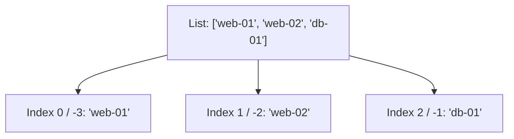

# Working with Lists

When automating systems, you will often work with groups of similar items. You might have a list of five target IP addresses, a collection of running services, or a list of log directories to scan. In Python, we store ordered collections of items in a list. Lists are mutable, which means you can add, remove, or modify items after they are created.

In this guide, we will learn how to work with lists in Python. We will look at indexing, slicing, adding and removing items, and managing lists inside automation tasks.

## What is a List?

A list is created by placing items inside square brackets `[]` and separating them with commas. You can read items from a list using their index position. In Python, indexes start at `0` for the first item, and negative indexes count backward from the end.

Let's compare common list operations.

| Method | What it Does | Example | Modifies Original? | DevOps Use Case |
| :--- | :--- | :--- | :--- | :--- |
| `.append()` | Adds an item to the end of the list | `list.append("item")` | Yes | Appending a new server to a scan target list |
| `.insert()` | Inserts an item at a specific index | `list.insert(0, "item")` | Yes | Adding a high-priority task to the front of a queue |
| `.pop()` | Removes and returns an item by index | `list.pop(0)` | Yes | Removing the oldest task from a processing queue |
| `.remove()` | Removes the first occurrence of a value | `list.remove("web")` | Yes | Deleting a server from active monitoring |
| `len()` | Returns the number of items in the list | `len(list)` | No | Counting how many nodes are configured |

Here is a diagram showing how list indexing works in Python:



## Creating and Indexing Lists

Let's look at how to create a list of IP addresses and read specific values using positive and negative indexes.

Create a file named `list_basics.py` and write the code below.

```python
# Create a list of target IPs
ip_list = ["192.168.1.10", "192.168.1.11", "192.168.1.12"]

# Read items using index numbers
first_ip = ip_list[0]
last_ip = ip_list[-1]

print("First Target: " + first_ip)
print("Last Target:  " + last_ip)
print("Total targets: " + str(len(ip_list)))
```

Run this file in your terminal.

```bash
python3 list_basics.py
```

Expected output:
```text
First Target: 192.168.1.10
Last Target:  192.168.1.12
Total targets: 3
```

## Adding and Removing Items

You can modify lists dynamically as your scripts run. Let's write a script that updates a list of active web servers.

```python
active_servers = ["web-01", "web-02"]
print("Initial servers: " + str(active_servers))

# Add a server to the end
active_servers.append("web-03")
print("After append:    " + str(active_servers))

# Insert a server at the beginning
active_servers.insert(0, "proxy-01")
print("After insert:    " + str(active_servers))

# Remove a specific server by name
active_servers.remove("web-02")
print("After remove:    " + str(active_servers))

# Pop the last server off the list
removed_server = active_servers.pop()
print("Popped server:   " + removed_server)
print("Final servers:   " + str(active_servers))
```

Run the script.

```bash
python3 update_lists.py
```

Expected output:
```text
Initial servers: ['web-01', 'web-02']
After append:    ['web-01', 'web-02', 'web-03']
After insert:    ['proxy-01', 'web-01', 'web-02', 'web-03']
After remove:    ['proxy-01', 'web-01', 'web-03']
Popped server:   web-03
Final servers:   ['proxy-01', 'web-01']
```

## Slicing Lists

Slicing allows you to copy a portion of a list. You specify a range using a colon `[start:end]`. The start index is included, but the end index is excluded.

```python
servers = ["web-01", "web-02", "web-03", "db-01", "db-02"]

# Slice the first three items (index 0, 1, 2)
web_pool = servers[0:3]

# Slice from index 3 to the end
database_pool = servers[3:]

print("Web pool:      " + str(web_pool))
print("Database pool: " + str(database_pool))
```

Run the script.

```bash
python3 list_slicing.py
```

Expected output:
```text
Web pool:      ['web-01', 'web-02', 'web-03']
Database pool: ['db-01', 'db-02']
```

## Real-World Example: Task Queue Worker

Let's write a script that processes a queue of deployment tasks. We will add new deployments to the end of our list, process them from the front of the list, and log the status.

Create a file named `queue_worker.py` and write the code below.

```python
# Initial deployment task queue
tasks = ["deploy_web", "update_schema", "restart_nginx"]

print("=== Deployment Queue Monitor ===")
print("Pending tasks: " + str(tasks))

# Admin adds a manual task
tasks.append("backup_database")
print("New task added. Current queue: " + str(tasks))
print("-" * 40)

# Process tasks in order (First In, First Out)
while len(tasks) > 0:
    # Pop from index 0 to get the oldest task
    current_task = tasks.pop(0)
    print(f"🔧 Starting Task: {current_task}")
    print(f"  [Progress] Performing operations for {current_task}...")
    print(f"✅ Finished: {current_task} complete.")
    print(f"Remaining tasks in queue: {len(tasks)}")
    print("-" * 40)

print("Scan complete. Task queue is empty.")
```

Run the script.

```bash
python3 queue_worker.py
```

Expected output:
```text
=== Deployment Queue Monitor ===
Pending tasks: ['deploy_web', 'update_schema', 'restart_nginx']
New task added. Current queue: ['deploy_web', 'update_schema', 'restart_nginx', 'backup_database']
----------------------------------------
🔧 Starting Task: deploy_web
  [Progress] Performing operations for deploy_web...
✅ Finished: deploy_web complete.
Remaining tasks in queue: 3
----------------------------------------
🔧 Starting Task: update_schema
  [Progress] Performing operations for update_schema...
✅ Finished: update_schema complete.
Remaining tasks in queue: 2
----------------------------------------
🔧 Starting Task: restart_nginx
  [Progress] Performing operations for restart_nginx...
✅ Finished: restart_nginx complete.
Remaining tasks in queue: 1
----------------------------------------
🔧 Starting Task: backup_database
  [Progress] Performing operations for backup_database...
✅ Finished: backup_database complete.
Remaining tasks in queue: 0
----------------------------------------
Scan complete. Task queue is empty.
```

## Common Mistakes

### Index Out of Range Error
If you try to read an index that does not exist in the list, Python will crash with an `IndexError`.

* **The Bad Way:**
```python
servers = ["web-01", "web-02"]
# This raises an IndexError because there are only 2 items
print(servers[2])
```

* **The Good Way:**
```python
servers = ["web-01", "web-02"]
# Always check list length or handle index access carefully
if len(servers) > 2:
    print(servers[2])
else:
    print("Index not found.")
```

### Modifying a List While Looping Over It
If you remove items from a list while you are iterating over it using a loop, you will skip items or cause runtime bugs because the indexes shift.

* **The Bad Way:**
```python
servers = ["web-01", "web-02", "db-01"]
for s in servers:
    if "web" in s:
        # Modifying the list during loop causes bugs
        servers.remove(s)
```

* **The Good Way:**
Loop over a copy of the list or use list comprehensions to build a new list.
```python
servers = ["web-01", "web-02", "db-01"]
# Loop over a copy of the list using slice notation [:]
for s in servers[:]:
    if "web" in s:
        servers.remove(s)
print(servers) # Prints ['db-01']
```

### Confusing `.append()` with `.extend()`
If you append a list to another list, Python inserts the second list as a single nested item rather than joining the values. Use `.extend()` to join lists.

* **The Bad Way:**
```python
list_a = ["web-01"]
list_b = ["db-01", "db-02"]
# This results in: ['web-01', ['db-01', 'db-02']]
list_a.append(list_b)
```

* **The Good Way:**
```python
list_a = ["web-01"]
list_b = ["db-01", "db-02"]
# This results in: ['web-01', 'db-01', 'db-02']
list_a.extend(list_b)
```

## Summary

* Lists are ordered, mutable collections of items enclosed in square brackets `[]`.
* Read list items using zero-indexed positions or negative indexes to count from the end.
* Use `.append()` to add new items to the end of a list.
* Use `.insert(index, value)` to add an item at a specific location.
* Use `.pop(index)` to remove and retrieve an item from a list.
* Slicing (`list[start:end]`) lets you copy parts of a list into a new list.
* Avoid index errors by checking the length of a list with `len()`.
* Do not modify lists directly while iterating over them in loops.
* Use `.extend()` to merge the items of one list into another.
* Lists are useful for managing task queues, server inventories, and filepath lists.
