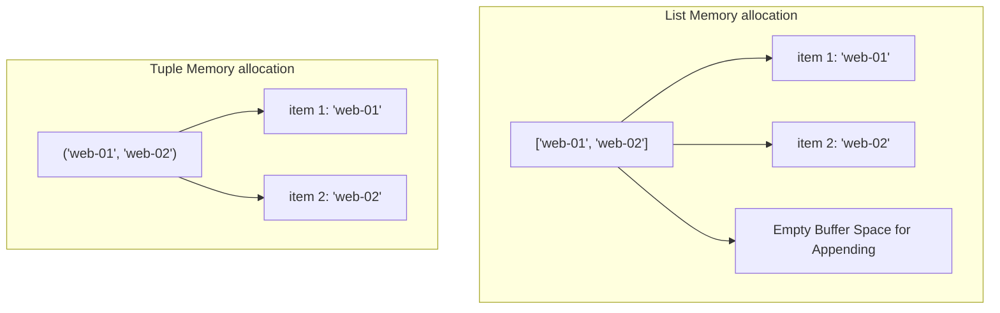

# Working with Tuples

When writing automation scripts, you will often need to group related values that should never change. This could be a server's hostname and its static IP address, or a set of database connection parameters. In Python, we store immutable (read-only) ordered collections of items in a tuple. Once you create a tuple, you cannot add, remove, or modify its values.

In this guide, we will learn how to use tuples in Python. We will look at how they differ from lists, how to read their values, and how to unpack them into variables.

## What is a Tuple?

A tuple is created by placing items inside parentheses `()` and separating them with commas. Because tuples are immutable, they do not support methods like `.append()`, `.insert()`, or `.remove()`. This makes them faster and uses less system memory than lists.

Let's look at a comparison between lists and tuples.

| Aspect | Lists | Tuples |
| :--- | :--- | :--- |
| **Syntax** | Enclosed in brackets: `[1, 2]` | Enclosed in parentheses: `(1, 2)` |
| **Mutability** | Mutable (Can be modified) | Immutable (Cannot be modified) |
| **Performance** | Slower (Requires memory allocations for resizing) | Faster (Static memory allocation) |
| **Size** | Takes up more RAM | Uses minimal RAM |
| **Use Case** | Collections of items that change over time | Fixed records, coordinates, or configurations |

Here is a diagram showing how Python allocates memory for a list (with empty buffer space for resizing) compared to a static tuple:



## Creating and Unpacking Tuples

You can read tuple items using index positions, just like lists. You can also extract all the items in a tuple into individual variables in a single line. This is called tuple unpacking.

Create a file named `tuple_basics.py` and write the code below.

```python
# Create a database connection record
db_connection = ("db-server-01", 5432, "postgres")

# Read using indexes
host = db_connection[0]
port = db_connection[1]

print("Host: " + host)
print("Port: " + str(port))

# Unpack the entire tuple in one line
db_host, db_port, db_user = db_connection
print(f"Unpacked connection: User '{db_user}' connecting to '{db_host}' on port {db_port}")
```

Run this file in your terminal.

```bash
python3 tuple_basics.py
```

Expected output:
```text
Host: db-server-01
Port: 5432
Unpacked connection: User 'postgres' connecting to 'db-server-01' on port 5432
```

## Returning Multiple Values from Functions

In Python, functions can only return a single value. However, you can return a tuple containing multiple items. This is a common pattern in system checks where you want to return both a success status and a detail message.

```python
def check_service_status():
    # Simulate checking a service status
    # Returns (is_healthy, status_code, response_time_ms)
    return True, 200, 45

# Call function and unpack the tuple results
healthy, code, latency = check_service_status()

print(f"Service healthy: {healthy}")
print(f"Status Code:     {code}")
print(f"Latency:         {latency}ms")
```

Run the script.

```bash
python3 tuple_return.py
```

Expected output:
```text
Service healthy: True
Status Code:     200
Latency:         45ms
```

## Real-World Example: Server Configuration Loader

Let's write a script that processes a list of fixed server configuration records. Since these records represent immutable infrastructure profiles, we store them as tuples inside a list to protect the data from accidental modifications.

Create a file named `profile_loader.py` and write the code below.

```python
# A list of server profile records (Host, Environment, CPU Cores, Memory GB)
server_profiles = [
    ("web-prod-01", "Production", 4, 16),
    ("web-prod-02", "Production", 4, 16),
    ("staging-db-01", "Staging", 2, 8)
]

print("=== Server Configuration Audit ===")

for profile in server_profiles:
    # Unpack the tuple details
    host, env, cores, ram = profile
    
    # Calculate virtual node capacity
    containers_allowed = cores * 2
    
    print(f"Host: {host}")
    print(f"  Environment:       {env}")
    print(f"  Hardware Config:   {cores} Cores, {ram} GB RAM")
    print(f"  Allowed Workloads: {containers_allowed} Containers")
    print("-" * 40)
```

Run the script.

```bash
python3 profile_loader.py
```

Expected output:
```text
=== Server Configuration Audit ===
Host: web-prod-01
  Environment:       Production
  Hardware Config:   4 Cores, 16 GB RAM
  Allowed Workloads: 8 Containers
----------------------------------------
Host: web-prod-02
  Environment:       Production
  Hardware Config:   4 Cores, 16 GB RAM
  Allowed Workloads: 8 Containers
----------------------------------------
Host: staging-db-01
  Environment:       Staging
  Hardware Config:   2 Cores, 8 GB RAM
  Allowed Workloads: 4 Containers
----------------------------------------
```

## Common Mistakes

### Trying to Modify Tuple Items
If you try to assign a new value to a tuple index or use list methods on it, Python will crash with a `TypeError`.

* **The Bad Way:**
```python
settings = ("192.168.1.1", 80)
# This will raise a TypeError: 'tuple' object does not support item assignment
settings[1] = 8080
```

* **The Good Way:**
If you need to change settings, you must create a new tuple containing the updated values.
```python
settings = ("192.168.1.1", 80)
# Replace the old tuple entirely
settings = (settings[0], 8080)
print(settings) # Prints ('192.168.1.1', 8080)
```

### Creating Single-Element Tuples Without a Comma
If you wrap a single value in parentheses without a trailing comma, Python treats it as a standard grouped expression, not a tuple.

* **The Bad Way:**
```python
# Python treats this as a plain string
server = ("web-01")
print(type(server).__name__) # Prints 'str'
```

* **The Good Way:**
Always add a trailing comma when creating a single-element tuple.
```python
# The trailing comma tells Python to create a tuple
server = ("web-01",)
print(type(server).__name__) # Prints 'tuple'
```

### Unpacking the Wrong Number of Variables
When unpacking a tuple, you must provide the exact number of variables to match the items in the tuple. If you provide too many or too few variables, the script will crash.

* **The Bad Way:**
```python
config = ("db-server", 5432)
# This raises a ValueError: not enough values to unpack (expected 3, got 2)
host, port, user = config
```

* **The Good Way:**
```python
config = ("db-server", 5432)
host, port = config
print(f"Host: {host}, Port: {port}")
```

## Summary

* Tuples are ordered, immutable collections of items enclosed in parentheses `()`.
* Once created, a tuple's values cannot be modified, added to, or deleted.
* Tuples use less memory and perform faster than lists because their size is static.
* You can read tuple values using standard index numbers.
* Tuple unpacking allows you to assign all tuple items to individual variables in one line.
* Functions can return multiple values by grouping them into a returned tuple.
* Always add a trailing comma when creating a tuple containing only one item.
* Do not try to modify a tuple; create a new tuple if configurations need updating.
* Tuples are excellent for protecting configuration profiles and server details.
* Grouping tuples inside lists is a common pattern for managing fixed system databases.
