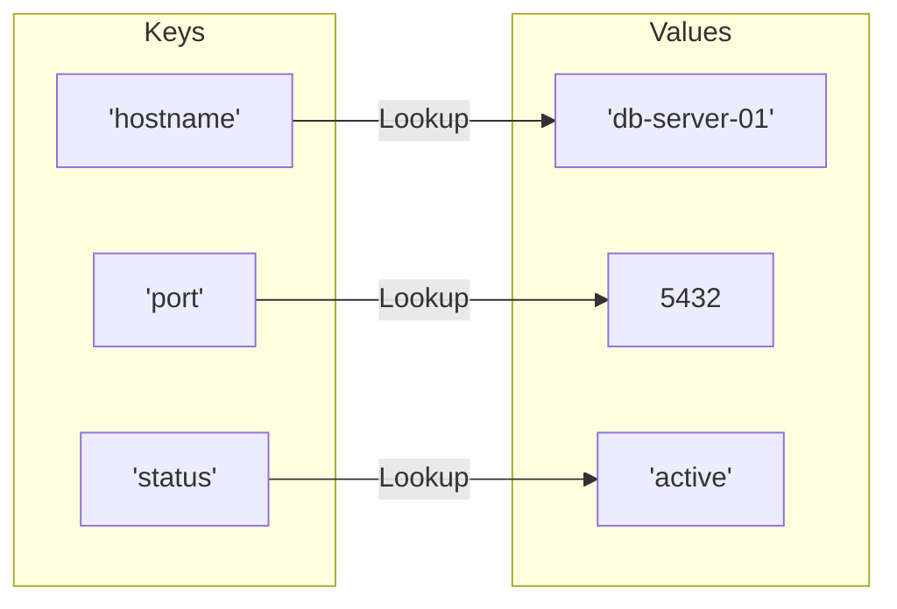

# Working with Dictionaries

When managing systems, you often need to store settings that are linked together as pairs. For example, you might want to map a server name to its IP address, or group details like status, port, and region for a single service. In Python, we store key-value pairs in a dictionary. Dictionaries let you search for a specific key and retrieve its value instantly.

In this guide, we will learn how to use dictionaries in Python. We will look at how to read and write keys, how to access values safely, and how to loop through your settings.

## What is a Dictionary?

A dictionary is created by placing key-value pairs inside curly braces `{}`. Each pair is separated by a colon `:`, and the pairs are separated by commas. Keys must be unique and must be immutable objects (like strings, numbers, or tuples). Values can be any data type, including lists or other dictionaries.

Let's look at a comparison of ways to retrieve values from a dictionary.

| Access Method | Example Code | What Happens if Key is Missing? | Best Use Case |
| :--- | :--- | :--- | :--- |
| **Bracket Access** | `config["ip"]` | Script crashes with a `KeyError` | When you are certain the key must exist |
| **Safe Get Method** | `config.get("ip")` | Returns `None` (Does not crash) | Optional configurations |
| **Get with Default** | `config.get("port", 80)`| Returns default value (e.g. `80`) | Setting fallback configurations |

Here is a diagram showing how Python matches keys to values in a dictionary structure:



## Creating and Modifying Dictionaries

You can add new keys or update existing ones by assigning a value to a key using brackets. Let's write a script that updates a server configuration dictionary.

Create a file named `dict_basics.py` and write the code below.

```python
# Create a server details dictionary
server = {
    "name": "web-prod-01",
    "ip": "192.168.1.50",
    "status": "online"
}

# Read values
print("Server Name: " + server["name"])

# Update an existing key
server["status"] = "offline"

# Add a new key-value pair
server["environment"] = "Production"

print("Updated server details:")
print(server)
```

Run this file in your terminal.

```bash
python3 dict_basics.py
```

Expected output:
```text
Server Name: web-prod-01
Updated server details:
{'name': 'web-prod-01', 'ip': '192.168.1.50', 'status': 'offline', 'environment': 'Production'}
```

## Safe Access and Deleting Keys

To prevent crashes when a configuration setting is missing, use the `.get()` method. You can delete keys using `.pop()` or the `del` keyword.

```python
config = {
    "host": "10.0.0.5",
    "port": 8080
}

# Safe access with get
ssl_enabled = config.get("ssl", False)
print("Is SSL active? " + str(ssl_enabled))

# Remove a key using pop
removed_value = config.pop("port")
print("Removed port:   " + str(removed_value))
print("Current config: " + str(config))
```

Run the script.

```bash
python3 dict_safe.py
```

Expected output:
```text
Is SSL active? False
Removed port:   8080
Current config: {'host': '10.0.0.5'}
```

## Looping Through Dictionaries

You can iterate through a dictionary in three ways: looping over the keys, the values, or both at the same time using the `.items()` method.

```python
services = {
    "nginx": "running",
    "postgresql": "stopped",
    "redis": "running"
}

print("=== Service Diagnostics ===")
# Loop over keys and values together
for service_name, status in services.items():
    print(f"Service: {service_name.upper()} | Status: {status}")
```

Run the script.

```bash
python3 dict_loops.py
```

Expected output:
```text
=== Service Diagnostics ===
Service: NGINX | Status: running
Service: POSTGRESQL | Status: stopped
Service: REDIS | Status: running
```

## Real-World Example: Server Health Checker

Let's write a script that audits server resources. The script takes database configuration values, resolves connection settings, checks if health limits are exceeded, and prints warnings.

Create a file named `health_checker.py` and write the code below.

```python
# Server health metrics dictionary
metrics = {
    "hostname": "staging-app-02",
    "cpu_percent": 82.5,
    "memory_free_gb": 1.2,
    "disk_usage_percent": 65.0
}

def audit_server_health(data):
    print("=== Auditing Health Metrics ===")
    print("Server Target: " + data["hostname"])
    print("-" * 40)
    
    # Check CPU
    cpu = data.get("cpu_percent", 0.0)
    if cpu > 80.0:
        print(f" ⚠️ WARNING: High CPU utilization detected: {cpu}%")
        
    # Check Memory
    memory = data.get("memory_free_gb", 8.0)
    if memory < 2.0:
        print(f" ⚠️ WARNING: Low free memory available: {memory} GB")
        
    # Check Disk (set a high default check if key is missing)
    disk = data.get("disk_usage_percent", 0.0)
    if disk > 90.0:
        print(f" ⚠️ WARNING: Critical disk space utilization: {disk}%")
    else:
        print(f"  Disk usage normal: {disk}%")

audit_server_health(metrics)
```

Run the script.

```bash
python3 health_checker.py
```

Expected output:
```text
=== Auditing Health Metrics ===
Server Target: staging-app-02
----------------------------------------
 ⚠️ WARNING: High CPU utilization detected: 82.5%
 ⚠️ WARNING: Low free memory available: 1.2 GB
  Disk usage normal: 65.0%
```

## Common Mistakes

### KeyError Crash on Missing Keys
If you try to read a key using bracket notation and the key is not present in the dictionary, your script will crash immediately.

* **The Bad Way:**
```python
settings = {"env": "prod"}
# This raises a KeyError: 'port'
active_port = settings["port"]
```

* **The Good Way:**
```python
settings = {"env": "prod"}
# Use the .get() method to specify a safe fallback value
active_port = settings.get("port", 80)
print(f"Port: {active_port}")
```

### Using Mutable Keys
You cannot use lists as dictionary keys because lists are mutable (can change). Dictionary keys must be immutable (hashable) so Python can look them up quickly.

* **The Bad Way:**
```python
# This raises a TypeError: unhashable type: 'list'
config = {
    ["192.168.1.1", "web"]: "active"
}
```

* **The Good Way:**
Use a tuple as the key instead, since tuples are immutable.
```python
config = {
    ("192.168.1.1", "web"): "active"
}
print(config[("192.168.1.1", "web")]) # Prints 'active'
```

### Modifying Dictionary Size During a Loop
If you add or remove keys from a dictionary while you are looping over it, Python will raise a runtime error.

* **The Bad Way:**
```python
servers = {"web1": "active", "web2": "inactive"}
for name, status in servers.items():
    if status == "inactive":
        # This raises a RuntimeError: dictionary changed size during iteration
        del servers[name]
```

* **The Good Way:**
Build a list of keys to delete first, and then loop over that list to remove them.
```python
servers = {"web1": "active", "web2": "inactive"}
keys_to_remove = []

for name, status in servers.items():
    if status == "inactive":
        keys_to_remove.append(name)

for name in keys_to_remove:
    servers.pop(name)
    
print(servers) # Prints {'web1': 'active'}
```

## Summary

* Dictionaries store data as unique key-value pairs inside curly braces `{}`.
* Keys in a dictionary must be unique and immutable (like strings, numbers, or tuples).
* Accessing missing keys with brackets `[]` causes a `KeyError` crash.
* Use the `.get(key, default)` method to access values safely and prevent crashes.
* Use `.pop(key)` to remove a key-value pair and retrieve its value.
* You can check if a key exists in a dictionary using the `in` operator.
* Use `.items()` in a loop to extract both keys and values together.
* Never add or remove keys from a dictionary while iterating over it.
* Tuples are excellent keys when you need compound index mapping (like IP and port).
* Dictionaries are the standard format for representing configuration parameters and system JSON data.
