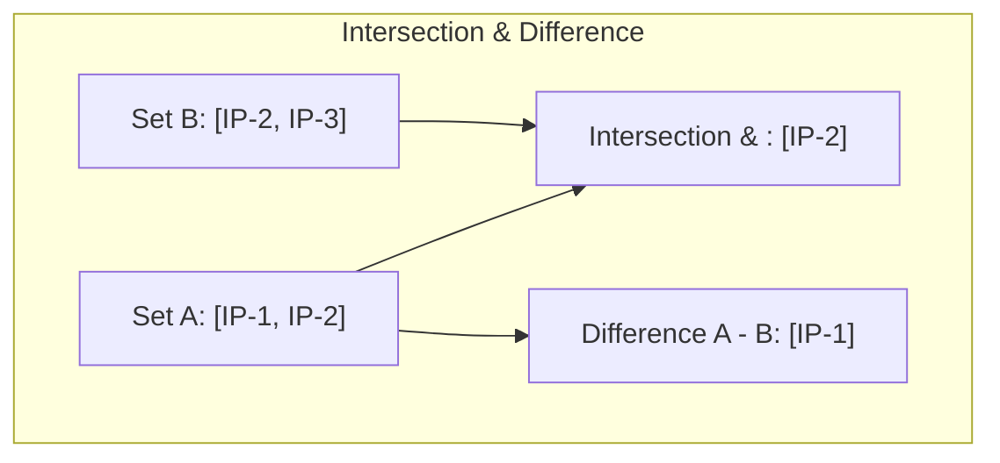

# Working with Sets

When managing servers, you will often need to compare collections of items. You might need to find which IP addresses are common between two lists, identify which security groups are missing from a server, or remove duplicate logs. In Python, we store unique, unordered collections of items in a set. Sets are useful because they prevent duplicate entries and allow you to perform mathematical comparisons quickly.

In this guide, we will learn how to use sets in Python. We will look at adding and removing items, checking membership, and comparing sets using union and intersection.

## What is a Set?

A set is created by placing items inside curly braces `{}` separated by commas, or by converting an existing list using the `set()` function. Unlike lists, sets cannot contain duplicate items. If you add the same item twice, the set will ignore the second entry.

Let's look at a comparison of set operations used to compare collections.

| Operation | Symbol | Example | What it Does | DevOps Use Case |
| :--- | :--- | :--- | :--- | :--- |
| **Union** | `\|` | `set_a \| set_b` | Combines all unique items from both sets | Merging target IP lists from multiple sources |
| **Intersection** | `&` | `set_a & set_b` | Returns only items present in both sets | Finding shared open ports across servers |
| **Difference** | `-` | `set_a - set_b` | Returns items in set A but not in set B | Finding servers that are not yet configured |
| **Sym. Difference** | `^` | `set_a ^ set_b` | Returns items in only one of the sets | Identifying mismatched settings between systems |

Here is a diagram showing the difference between set intersection and set difference:



## Creating Sets and Removing Duplicates

The most common use case for sets is removing duplicate values from a list.

Create a file named `set_basics.py` and write the code below.

```python
# A list of server logs containing duplicate IP addresses
duplicate_ips = ["192.168.1.1", "192.168.1.2", "192.168.1.1", "192.168.1.3", "192.168.1.2"]
print("Original list size: " + str(len(duplicate_ips)))

# Convert list to set to remove duplicates
unique_ips = set(duplicate_ips)
print("Unique IPs: " + str(unique_ips))
print("Unique list size:   " + str(len(unique_ips)))

# Add a new IP to the set
unique_ips.add("192.168.1.4")
print("After adding: " + str(unique_ips))
```

Run this file in your terminal.

```bash
python3 set_basics.py
```

Expected output:
```text
Original list size: 5
Unique IPs: {'192.168.1.1', '192.168.1.2', '192.168.1.3'}
Unique list size:   3
After adding: {'192.168.1.1', '192.168.1.2', '192.168.1.3', '192.168.1.4'}
```

## Set Comparison Operations

Let's look at how to compare sets using mathematical symbols.

```python
active_ports_server1 = {80, 443, 22, 3306}
active_ports_server2 = {80, 443, 8080}

# 1. Intersection: Ports open on BOTH servers
shared_ports = active_ports_server1 & active_ports_server2
print("Shared ports (web): " + str(shared_ports))

# 2. Difference: Ports open on Server 1 but NOT on Server 2
unique_server1 = active_ports_server1 - active_ports_server2
print("Unique to Server 1:  " + str(unique_server1))

# 3. Union: All active ports across both servers
all_ports = active_ports_server1 | active_ports_server2
print("All open ports:      " + str(all_ports))
```

Run the script.

```bash
python3 set_math.py
```

Expected output:
```text
Shared ports (web): {80, 443}
Unique to Server 1:  {3306, 22}
All open ports:      {80, 8080, 443, 22, 3306}
```

## Real-World Example: Server Patching Audit

Let's write a script that audits package deployment states. We have a set of packages that must be installed on all web servers. We check the active packages on a target server and identify which packages are missing, and which extra packages are installed that should not be there.

Create a file named `patch_audit.py` and write the code below.

```python
# Required baseline packages for all servers
required_packages = {"nginx", "python3", "ufw", "fail2ban", "git"}

# Packages actually found on server-web-01
installed_packages = {"nginx", "python3", "git", "docker", "tmux"}

print("=== Running Package Audit ===")

# Find missing packages (Required but not Installed)
missing_packages = required_packages - installed_packages

# Find unauthorized packages (Installed but not in baseline)
extra_packages = installed_packages - required_packages

print(f"Missing baseline tools: {missing_packages}")
print(f"Extra tools installed:  {extra_packages}")

# Check audit state
if len(missing_packages) > 0:
    print("\n ❌ AUDIT FAILED: Server is missing required baseline packages!")
    for package in missing_packages:
        print(f"   -> Action Required: Install {package}")
else:
    print("\n ✅ AUDIT PASSED: Baseline packages are healthy.")
```

Run the script.

```bash
python3 patch_audit.py
```

Expected output:
```text
=== Running Package Audit ===
Missing baseline tools: {'ufw', 'fail2ban'}
Extra tools installed:  {'tmux', 'docker'}

 ❌ AUDIT FAILED: Server is missing required baseline packages!
   -> Action Required: Install ufw
   -> Action Required: Install fail2ban
```

## Common Mistakes

### Creating an Empty Set with Braces
If you try to create an empty set using `{}`, Python will create an empty dictionary instead. You must use the `set()` function.

* **The Bad Way:**
```python
# This creates an empty dictionary, not a set!
my_set = {}
print(type(my_set).__name__) # Prints 'dict'
```

* **The Good Way:**
```python
# Use set() to initialize an empty set
my_set = set()
print(type(my_set).__name__) # Prints 'set'
```

### Expecting Sets to Maintain Order
Sets are unordered. You cannot access items using index brackets or expect items to remain in the order you added them.

* **The Bad Way:**
```python
servers = {"web01", "web02"}
# This raises a TypeError: 'set' object is not subscriptable
first_server = servers[0]
```

* **The Good Way:**
Use the `in` operator to check if an item exists, or loop over the set items one by one.
```python
servers = {"web01", "web02"}
if "web01" in servers:
    print("web01 is present")
```

### Adding Mutable Items to a Set
Sets can only contain immutable (hashable) items. You cannot add a list or a dictionary to a set.

* **The Bad Way:**
```python
# This raises a TypeError: unhashable type: 'list'
server_groups = {["web-01", "web-02"], "db-01"}
```

* **The Good Way:**
Use tuples instead of lists for compound set items.
```python
server_groups = {("web-01", "web-02"), "db-01"}
```

## Summary

* Sets are unordered collections of unique, immutable elements enclosed in braces `{}`.
* Sets automatically filter out duplicate values.
* You can check membership in a set instantly using the `in` operator.
* Use `.add(value)` to insert new items and `.remove(value)` or `.discard(value)` to delete them.
* Use union (`|`) to combine all unique items across two sets.
* Use intersection (`&`) to find shared items between two sets.
* Use difference (`-`) to find items present in one set but not in another.
* Always initialize empty sets using `set()` instead of `{}`.
* Sets cannot contain mutable objects like lists.
* Set comparisons are ideal for security audits, dependency checks, and firewall rules comparison.
