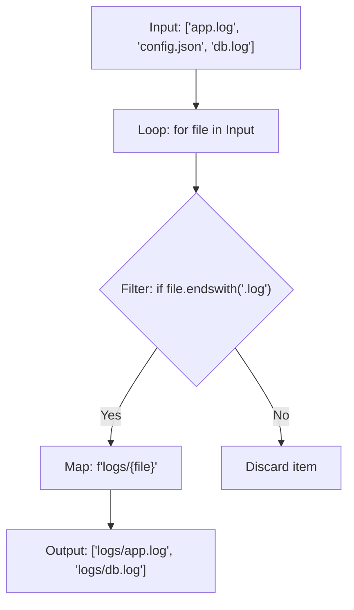

# Using List Comprehensions

When writing scripts, you will frequently need to transform one list of items into another. For example, you might want to convert a list of server hostnames to lowercase, filter out inactive IPs, or prepend a log folder path to a list of file names. In Python, you can write these loops in a single, clean line of code using list comprehensions.

In this guide, we will learn how to write list comprehensions. We will break down the syntax, compare them to standard loops, and write filters for system files.

## What is a List Comprehension?

A list comprehension is a shorthand way to build a new list from an existing collection. It combines a `for` loop and an optional `if` condition inside square brackets `[]`.

Let's look at a comparison between standard loops and list comprehensions.

| Feature | Standard For Loop | List Comprehension |
| :--- | :--- | :--- |
| **Syntax Length** | 4 to 6 lines | 1 line |
| **Readability** | High for complex logic | High for simple maps and filters |
| **Execution Speed** | Slightly slower (overhead of repeated append calls) | Slightly faster (built-in C implementation) |
| **Creates New List?** | Yes, must initialize empty list first | Yes, returned automatically |
| **Best Use Case** | Loops with complex nested decisions | Simple mapping or filtering of lists |

Here is a diagram showing how Python processes items through a list comprehension:



## Basic Mapping and Filtering

Let's look at how to convert a list of server names to lowercase, first using a standard loop and then using a list comprehension.

Create a file named `comprehension_basics.py` and write the code below.

```python
hosts = ["WEB-01", "DB-01", "PROXY-01"]

# 1. The Standard Way
lowercase_hosts = []
for host in hosts:
    lowercase_hosts.append(host.lower())
print("Standard Loop:       " + str(lowercase_hosts))

# 2. The List Comprehension Way
# syntax: [expression for item in iterable]
quick_hosts = [host.lower() for host in hosts]
print("List Comprehension:  " + str(quick_hosts))
```

Run this file in your terminal.

```bash
python3 comprehension_basics.py
```

Expected output:
```text
Standard Loop:       ['web-01', 'db-01', 'proxy-01']
List Comprehension:  ['web-01', 'db-01', 'proxy-01']
```

## Adding Filters (If Statements)

You can append an `if` statement to the end of your list comprehension to filter out items that do not meet your conditions.

```python
port_states = [
    ("ssh", 22, True),
    ("http", 80, True),
    ("ftp", 21, False),
    ("https", 443, True)
]

# Extract ports only if the service is active (True)
# syntax: [expression for item in iterable if condition]
active_ports = [port[1] for port in port_states if port[2] is True]

print("Active service ports: " + str(active_ports))
```

Run the script.

```bash
python3 comprehension_filter.py
```

Expected output:
```text
Active service ports: [22, 80, 443]
```

## Real-World Example: Log File Path Generator

Let's write a script that scans a directory structure template. We have a list of raw filenames. We want to identify only the files that end with `.log` (filtering out json and markdown configuration files) and prepend our active logs directory path `/var/log/app/` to each file.

Create a file named `log_paths.py` and write the code below.

```python
# Raw directory scanner outputs
raw_files = ["access.log", "config.json", "errors.log", "README.md", "audit.log"]
log_directory = "/var/log/app"

print("=== Generating Active Log Targets ===")
print("Found files: " + str(raw_files))

# Generate absolute paths in one line
# 1. Check if file ends with '.log'
# 2. Join the log directory prefix to the filename
absolute_log_paths = [f"{log_directory}/{file}" for file in raw_files if file.endswith(".log")]

print("\nResolved Log Paths:")
for path in absolute_log_paths:
    print(" - " + path)
```

Run the script.

```bash
python3 log_paths.py
```

Expected output:
```text
=== Generating Active Log Targets ===
Found files: ['access.log', 'config.json', 'errors.log', 'README.md', 'audit.log']

Resolved Log Paths:
 - /var/log/app/access.log
 - /var/log/app/errors.log
 - /var/log/app/audit.log
```

## Common Mistakes

### Writing Overly Complex Comprehensions
If you nesting multiple loops or if-else statements inside a single list comprehension, the code becomes impossible to read. If it takes longer than five seconds to understand, rewrite it as a standard for loop.

* **The Bad Way (Unreadable):**
```python
# Mappings containing nested checks are hard to follow
servers = [[("web-01", "active")], [("db-01", "inactive")]]
active_names = [s[0] for pool in servers for s in pool if s[1] == "active"]
```

* **The Good Way:**
Use standard loops with proper indentation so the structure is clear.
```python
servers = [[("web-01", "active")], [("db-01", "inactive")]]
active_names = []

for pool in servers:
    for s in pool:
        if s[1] == "active":
            active_names.append(s[0])
```

### Using List Comprehensions for Side Effects
List comprehensions are designed to create new list objects. Do not use them just to run actions, like printing logs or writing files, without returning data. This makes your code clunky.

* **The Bad Way:**
```python
# Using list comprehension just to print items returns a list of None values
[print(host) for host in ["web-01", "web-02"]]
```

* **The Good Way:**
Use standard for loops when you want to execute actions (side effects).
```python
for host in ["web-01", "web-02"]:
    print(host)
```

### High Memory Utilization on Large Iterators
List comprehensions create the entire new list in memory at once. If you are processing millions of log rows, this can exhaust your server's RAM.

* **The Bad Way:**
Use list comprehensions to read millions of lines.

* **The Good Way:**
Use generator expressions (which use parentheses `()` instead of brackets `[]`) to process items one by one without loading them all into memory.

## Summary

* List comprehensions provide a clean, single-line syntax to build new lists.
* The basic syntax is `[expression for item in iterable]`.
* You can filter items by appending an `if` condition to the end of the brackets.
* List comprehensions are slightly faster than standard loops because they run in optimized C bytecode.
* Do not write nested list comprehensions because they are hard for other developers to read.
* Avoid using list comprehensions for side-effect actions like printing or writing files.
* Use standard for loops for tasks that require complex, multi-line logic.
* Use generator expressions if you are iterating over millions of items to save RAM.
* List comprehensions are ideal for cleaning up list strings and formatting file paths.
* Transforming configuration arrays into clean lists is easy with comprehensions.
