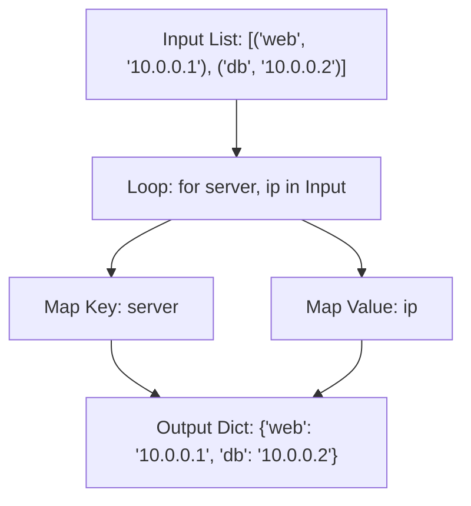

# Using Dictionary Comprehensions

When automating infrastructure, you often need to transform list collections into lookup dictionaries, or modify existing settings. For example, you might have a list of server host records and want to build a quick-lookup map of hostname to IP address. In Python, you can build new dictionaries in a single, readable line of code using dictionary comprehensions.

In this guide, we will learn how to write dictionary comprehensions. We will look at key-value mapping, filtering values, and building configurations.

## What is a Dictionary Comprehension?

A dictionary comprehension is similar to a list comprehension, but it uses curly braces `{}` and requires you to define both a key expression and a value expression separated by a colon `:`. 

Let's compare standard loops and dictionary comprehensions.

| Feature | Standard For Loop | Dictionary Comprehension |
| :--- | :--- | :--- |
| **Syntax** | Loops and sets keys: `dict[k] = v` | Single expression: `{k: v for ...}` |
| **Readability** | High for complex mappings | High for transforming pairs or filtering |
| **Creates New Dict?** | Yes, must initialize empty dict first | Yes, returned automatically |
| **Key Collision** | Overwrites keys sequentially | Overwrites keys sequentially |
| **Use Case** | Complex parsing from multiple inputs | Swapping keys/values or building indexes |

Here is a diagram showing how Python builds a lookup dictionary from a list of tuples:



## Basic Key-Value Mapping

Let's look at how to build a lookup dictionary from a list of server tuples. We want to map hostnames to IP addresses.

Create a file named `dict_comp_basics.py` and write the code below.

```python
server_tuples = [
    ("web-01", "192.168.1.10"),
    ("web-02", "192.168.1.11"),
    ("db-01", "192.168.1.50")
]

# 1. The Standard Way
ip_map = {}
for host, ip in server_tuples:
    ip_map[host] = ip
print("Standard Loop: " + str(ip_map))

# 2. The Dictionary Comprehension Way
# syntax: {key_expr: val_expr for item in iterable}
quick_map = {host: ip for host, ip in server_tuples}
print("Dict Comp:     " + str(quick_map))
```

Run this file in your terminal.

```bash
python3 dict_comp_basics.py
```

Expected output:
```text
Standard Loop: {'web-01': '192.168.1.10', 'web-02': '192.168.1.11', 'db-01': '192.168.1.50'}
Dict Comp:     {'web-01': '192.168.1.10', 'web-02': '192.168.1.11', 'db-01': '192.168.1.50'}
```

## Swapping Keys and Values

Sometimes you receive a map from an API and need to invert it. For example, you might want to switch a mapping of `ServerName -> IP` to `IP -> ServerName` to perform a reverse DNS lookup check.

```python
dns_records = {
    "web-server": "10.0.0.50",
    "db-server": "10.0.0.60"
}

# Swap keys and values in one line
# syntax: {value: key for key, value in dict.items()}
reverse_dns = {ip: host for host, ip in dns_records.items()}

print(reverse_dns)
print("Owner of 10.0.0.50: " + reverse_dns["10.0.0.50"])
```

Run the script.

```bash
python3 swap_dict.py
```

Expected output:
```text
{'10.0.0.50': 'web-server', '10.0.0.60': 'db-server'}
Owner of 10.0.0.50: web-server
```

## Real-World Example: Status Filter

Let's write a script that processes an inventory of running microservices. We have a dictionary containing service names and their active statuses. We want to filter out healthy services and build a new dictionary containing only services that require attention (status is not "running").

Create a file named `service_filter.py` and write the code below.

```python
service_status = {
    "nginx": "running",
    "postgresql": "failed",
    "redis": "running",
    "celery-worker": "degraded",
    "rabbitmq": "running"
}

print("=== Scanning Service Grid ===")

# Filter out running services and keep failures
# 1. Loop through items
# 2. Add if status is not 'running'
unhealthy_services = {name: status for name, status in service_status.items() if status != "running"}

print("\nResolved alert targets:")
print(unhealthy_services)

# Generate quick summary
for name, status in unhealthy_services.items():
    print(f" ⚠️  Alert: Service [{name}] status is: {status.upper()}")
```

Run the script.

```bash
python3 service_filter.py
```

Expected output:
```text
=== Scanning Service Grid ===

Resolved alert targets:
{'postgresql': 'failed', 'celery-worker': 'degraded'}
 ⚠️  Alert: Service [postgresql] status is: FAILED
 ⚠️  Alert: Service [celery-worker] status is: DEGRADED
```

## Common Mistakes

### Key Collisions Overwriting Data
If the key expression in your dictionary comprehension generates duplicate values, Python will overwrite older entries silently. Only the last processed value will remain.

* **The Bad Way:**
```python
# Multiple servers are in the same region
servers = [("web-01", "us-east"), ("web-02", "us-east"), ("db-01", "us-west")]
# This maps region to host, but duplicates overwrite each other!
# Result will be: {'us-east': 'web-02', 'us-west': 'db-01'} (web-01 is lost)
region_map = {region: host for host, region in servers}
```

* **The Good Way:**
If keys can repeat, group values in a list using a standard loop first.
```python
servers = [("web-01", "us-east"), ("web-02", "us-east"), ("db-01", "us-west")]
region_map = {}
for host, region in servers:
    if region not in region_map:
        region_map[region] = []
    region_map[region].append(host)
print(region_map) # Prints {'us-east': ['web-01', 'web-02'], 'us-west': ['db-01']}
```

### KeyError When Mapping Fields
When looping over raw dictionaries, trying to access sub-keys that are missing on some items will crash the comprehension.

* **The Bad Way:**
```python
nodes = [
    {"name": "node1", "env": "prod"},
    {"name": "node2"} # Missing 'env' key
]
# This raises a KeyError: 'env'
env_map = {n["name"]: n["env"] for n in nodes}
```

* **The Good Way:**
Use the `.get()` method to specify a default fallback when mapping.
```python
nodes = [
    {"name": "node1", "env": "prod"},
    {"name": "node2"}
]
env_map = {n["name"]: n.get("env", "unknown") for n in nodes}
print(env_map) # Prints {'node1': 'prod', 'node2': 'unknown'}
```

## Summary

* Dictionary comprehensions let you build dictionaries in a single line of code.
* The basic syntax is `{key_expression: value_expression for item in iterable}`.
* You can add an `if` filter to the end to selectively map keys and values.
* Use dictionary comprehensions to swap keys and values for reverse lookup maps.
* When keys duplicate during a comprehension, later values overwrite earlier ones.
* Use safe `.get()` calls to prevent key errors when parsing inconsistent list structures.
* Avoid writing nested dictionary comprehensions because they are hard to read.
* Standard loops are better when you need to group duplicate keys into lists.
* Dictionary comprehensions are ideal for filtering service states.
* Building connection maps from raw API lists is clean using comprehensions.
