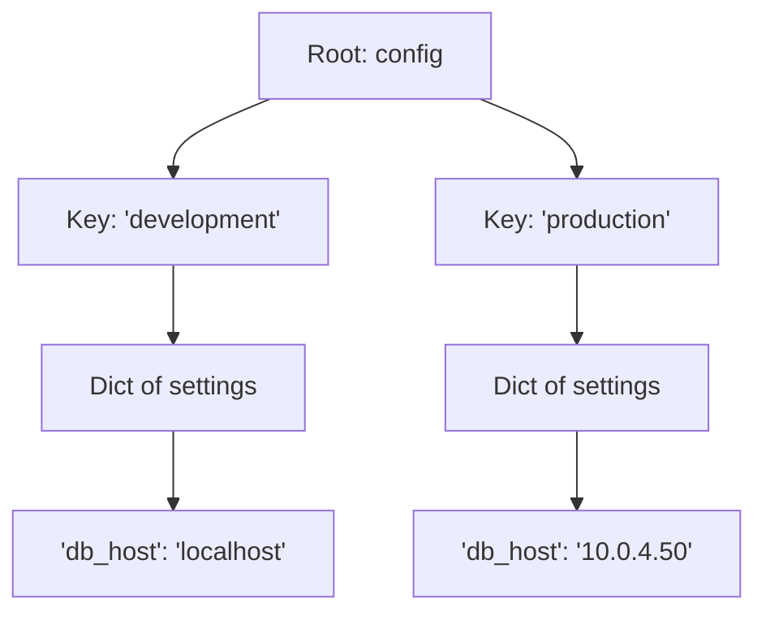

# Working with Nested Structures

In production environments, data is rarely flat. When you read server lists from a cloud provider API or load configurations from a JSON file, you will receive complex structures. This could be a list containing dictionaries of server details, or a dictionary containing nested lists of ports. In Python, you can nest data structures inside each other to represent complex relationships.

In this guide, we will learn how to work with nested data structures in Python. We will look at accessing values deep inside structures, updating nested entries, and parsing complex configurations.

## What is a Nested Structure?

A nested structure is a collection that contains other collections. The two most common forms are:
1. **List of Dictionaries**: Good for representing lists of objects, like a list of servers where each server has a name, IP, and status.
2. **Dictionary of Dictionaries**: Good for configuration trees, like dividing settings by environment (development vs production).

Let's compare these two structures.

| Structure Type | Example Syntax | Best Use Case | Lookup Speed |
| :--- | :--- | :--- | :--- |
| **List of Dictionaries** | `[{"name": "web"}, {"name": "db"}]` | Iterating through an inventory | Slow (Must scan list line-by-line) |
| **Dictionary of Dictionaries**| `{"web": {"ip": "10.0.0.1"}}` | Direct lookup of a specific host | Fast (Instant lookup by key) |

Here is a diagram showing the hierarchy of a nested configuration tree:



## Accessing Nested Values

To access a value deep inside a nested structure, you chain indexing brackets together. Each set of brackets resolves one level of the structure.

Create a file named `nested_basics.py` and write the code below.

```python
# A dictionary representing environments
infrastructure = {
    "production": {
        "servers": ["prod-web-01", "prod-db-01"],
        "replicas": 3
    },
    "staging": {
        "servers": ["stage-web-01"],
        "replicas": 1
    }
}

# 1. Accessing production replicas
prod_replicas = infrastructure["production"]["replicas"]
print("Production replicas: " + str(prod_replicas))

# 2. Accessing the first production server
first_prod_server = infrastructure["production"]["servers"][0]
print("First Prod Server:   " + first_prod_server)
```

Run this file in your terminal.

```bash
python3 nested_basics.py
```

Expected output:
```text
Production replicas: 3
First Prod Server:   prod-web-01
```

## Updating Nested Structures

When updating nested structures, you must navigate to the target list or dictionary before adding or modifying values.

```python
cluster = {
    "nodes": {
        "node-01": {"status": "active"},
        "node-02": {"status": "active"}
    }
}

# Update a value inside node-02
cluster["nodes"]["node-02"]["status"] = "offline"

# Add a new node detail
cluster["nodes"]["node-01"]["ip"] = "192.168.1.10"

print(cluster)
```

Run the script.

```bash
python3 update_nested.py
```

Expected output:
```text
{'nodes': {'node-01': {'status': 'active', 'ip': '192.168.1.10'}, 'node-02': {'status': 'offline'}}}
```

## Real-World Example: Multi-Environment Config Auditor

Let's write a script that processes a simulated cloud configuration. The configuration tree contains multiple environments, active ports, and database credentials. Our auditor will check if the production environment database uses the correct port and warn us if any settings are insecure.

Create a file named `audit_config.py` and write the code below.

```python
# Complex configuration dictionary representing a real setup
app_config = {
    "global_timeout": 30,
    "environments": {
        "development": {
            "allowed_hosts": ["localhost", "127.0.0.1"],
            "database": {
                "host": "127.0.0.1",
                "port": 5432,
                "ssl_required": False
            }
        },
        "production": {
            "allowed_hosts": ["app.company.com"],
            "database": {
                "host": "10.0.5.22",
                "port": 5432,
                "ssl_required": True
            }
        }
    }
}

print("=== Starting Configuration Audit ===")

# Navigate to the production database settings
prod_db_settings = app_config["environments"]["production"]["database"]

db_host = prod_db_settings["host"]
db_ssl = prod_db_settings["ssl_required"]

print(f"Production Database Target: {db_host}")

# Audit SSL settings
if db_ssl is False:
    print(" ❌ SECURITY ALERT: Production database connection does not require SSL!")
else:
    print(" ✅ Security Check Passed: Production database connection requires SSL.")
```

Run the script.

```bash
python3 audit_config.py
```

Expected output:
```text
=== Starting Configuration Audit ===
Production Database Target: 10.0.5.22
 ✅ Security Check Passed: Production database connection requires SSL.
```

## Common Mistakes

### Chaining Brackets blindly without checks
If you try to read deep inside a structure and a key in the middle of the chain is missing, the script will crash.

* **The Bad Way:**
```python
config = {"dev": {"port": 80}}
# This crashes with a KeyError: 'prod' because 'prod' is missing
prod_port = config["prod"]["port"]
```

* **The Good Way:**
Use safe `.get()` calls or check keys before diving into nested levels.
```python
config = {"dev": {"port": 80}}

# Get the nested dict safely first, default to an empty dict
prod_settings = config.get("prod", {})
prod_port = prod_settings.get("port", 80)
print(f"Prod Port: {prod_port}") # Prints 80
```

### Shallow Copy Incompatibilities
If you duplicate a nested dictionary using `.copy()`, Python only copies the top-level keys. The nested lists or dictionaries are still shared between the original and the copy. Modifying the copy will modify the original.

* **The Bad Way:**
```python
original = {"db": {"host": "localhost"}}
# Shallow copy
duplicate = original.copy()
# Modifying duplicate changes original!
duplicate["db"]["host"] = "10.0.0.1"
print(original["db"]["host"]) # Prints '10.0.0.1'
```

* **The Good Way:**
Use the `copy` module's `deepcopy()` function to clone the entire structure safely.
```python
import copy
original = {"db": {"host": "localhost"}}
# Deep copy
duplicate = copy.deepcopy(original)
duplicate["db"]["host"] = "10.0.0.1"
print(original["db"]["host"]) # Prints 'localhost'
```

## Summary

* Nested structures allow you to represent complex hierarchies like lists of servers or configuration trees.
* Access nested values by chaining indexing brackets together (e.g., `structure[key][index]`).
* Navigating to nested objects is required before modifying values inside them.
* Lists of dictionaries are ideal for lists of entities, while dictionaries of dictionaries are best for quick configurations lookup.
* A `KeyError` will occur if any key in the access chain is missing.
* Use `.get()` returning default empty objects `{}` to avoid crashes during nested lookups.
* Standard copy methods (`.copy()`) perform shallow copies, leaving nested structures linked.
* Use `copy.deepcopy()` to fully duplicate a nested dictionary.
* Nested configurations are the standard output format when parsing JSON files.
* Organizing infrastructure profiles as nested schemas helps keep settings separated.
