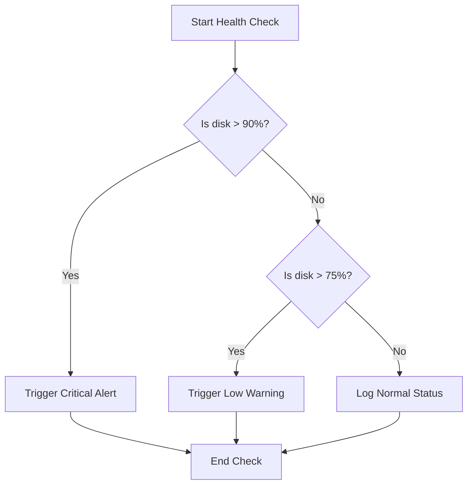

# Making Decisions with if, elif, and else

When writing automation scripts, your code needs to respond to different system conditions. If a backup fails, you want to log an error. If the hard drive is 95% full, you want to trigger a cleanup script. If the service is running normally, you just want to print a success message. In Python, you write these rules using `if`, `elif`, and `else` statements.

In this guide, we will look at how Python makes decisions. We will learn about code indentation, check multiple conditions, and write health check logic.

## Deciding the Branching Path

An `if` statement checks a condition. If the condition is `True`, Python runs the indented code directly below it. If it is `False`, Python skips it and checks the next block (`elif`) or falls back to the default block (`else`).

Let's compare the three decision statements in Python.

| Statement | Purpose | When is it Executed? | Can you have more than one? |
| :--- | :--- | :--- | :--- |
| **`if`** | Starts the check | Always evaluated at the beginning | No (Only one per decision chain) |
| **`elif`** | Adds another check | Evaluated only if previous checks were False | Yes (You can stack multiple `elif` checks) |
| **`else`** | Default fallback | Evaluated only if all previous checks were False | No (Only one at the end of the chain) |

Here is a diagram showing how Python branches when checking system disk space:



## Indentation Rules in Python

Unlike other languages that use curly braces `{}` to group code blocks, Python uses indentation (spaces at the start of a line). The standard rule is to use four spaces. If you mix tabs and spaces, or do not indent your code correctly, your script will crash.

Create a file named `decision_basics.py` and write the code below.

```python
service_active = True

if service_active:
    # This block is indented by 4 spaces
    print("Checking web service...")
    print("Database connection is healthy.")
else:
    # This block runs only if service_active is False
    print("Web service is offline!")
```

Run this file in your terminal.

```bash
python3 decision_basics.py
```

Expected output:
```text
Checking web service...
Database connection is healthy.
```

## Chaining Multiple Checks

You use `elif` to add extra checks when you have more than two possible options.

```python
memory_usage = 78

if memory_usage > 90:
    print("CRITICAL: Out of memory alert!")
elif memory_usage > 75:
    print("WARNING: High memory usage detected.")
elif memory_usage > 50:
    print("INFO: Memory utilization is moderate.")
else:
    print("SUCCESS: Memory utilization is normal.")
```

Run the script.

```bash
python3 chain_checks.py
```

Expected output:
```text
WARNING: High memory usage detected.
```

## Real-World Example: Server Scale Evaluator

Let's write a script that helps autoscaling groups determine if they should adjust their server pool size. The script checks a pool's average connection rate and decides whether to provision more nodes, terminate idle nodes, or keep the cluster configuration unchanged.

Create a file named `scale_check.py` and write the code below.

```python
# System state metrics
average_connections_per_node = 142
max_connections_limit = 150
scale_up_threshold = 120
scale_down_threshold = 40

print("=== Running Scale Evaluation ===")
print("Current Connections: " + str(average_connections_per_node))

# Make scaling decision
if average_connections_per_node > max_connections_limit:
    print(" ⚠️  CRITICAL: Pool is overloaded! Block new connections.")
    print(" Action: Scale up immediately (+2 Nodes).")
elif average_connections_per_node > scale_up_threshold:
    print(" ⚠️  WARNING: High load detected.")
    print(" Action: Scale up cluster pool (+1 Node).")
elif average_connections_per_node < scale_down_threshold:
    print(" Info: Load is very low.")
    print(" Action: Terminate idle nodes to save costs (-1 Node).")
else:
    print(" ✅ SUCCESS: Cluster load is normal.")
    print(" Action: Keep active nodes unchanged.")
```

Run the script.

```bash
python3 scale_check.py
```

Expected output:
```text
=== Running Scale Evaluation ===
Current Connections: 142
 ⚠️  WARNING: High load detected.
 Action: Scale up cluster pool (+1 Node).
```

## Common Mistakes

### Missing Colons in Statements
It is easy to forget to add a colon (`:`) to the end of your `if`, `elif`, or `else` lines. Python requires these colons to know that an indented block follows.

* **The Bad Way:**
```python
is_healthy = True
# This raises a SyntaxError because the colon is missing
if is_healthy
    print("Healthy")
```

* **The Good Way:**
```python
is_healthy = True
if is_healthy:
    print("Healthy")
```

### Indentation Mismatch Errors
If you write code blocks with different amounts of spacing inside the same branch, Python will crash with an `IndentationError`.

* **The Bad Way:**
```python
is_active = True
if is_active:
    print("Checking system status...")
      print("Active") # Crashes because of 6 spaces instead of 4
```

* **The Good Way:**
```python
is_active = True
if is_active:
    print("Checking system status...")
    print("Active") # Clean 4 spaces alignment
```

### Using Multiple Ifs instead of Elif
If you use multiple `if` statements instead of `elif`, Python will check every single condition independently, even if one of the earlier checks already matched. This is slow and can trigger unexpected blocks.

* **The Bad Way:**
```python
score = 85
# This prints BOTH messages because both conditions are True!
if score > 80:
    print("A Grade")
if score > 70:
    print("B Grade")
```

* **The Good Way:**
```python
score = 85
# This matches the first block and skips the rest
if score > 80:
    print("A Grade")
elif score > 70:
    print("B Grade")
```

## Summary

* Conditional statements let you control the execution path of your scripts.
* Use `if` to evaluate a condition and run a block if it is True.
* Use `elif` to add extra conditional checks to your decision tree.
* Use `else` to define a default fallback block when no other checks match.
* Python uses 4-space indentation to define the boundaries of your code blocks.
* Always add a colon (`:`) to the end of your conditional lines.
* Avoid mixing spaces and tabs when writing indented blocks.
* Use `elif` instead of multiple independent `if` statements to prevent multiple blocks from running.
* Combining comparison checks with logical operators builds flexible automation policies.
* Automating decisions based on system load metrics keeps your infrastructure healthy.
