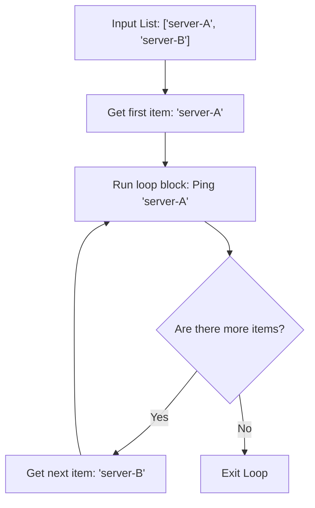

# Iterating with For Loops

When you write scripts, you will frequently need to repeat the same action across a collection of items. You might need to check the status of ten different servers, iterate through a list of file paths to find logs, or check a list of database users. In Python, you write these repetition rules using `for` loops.

In this guide, we will look at how `for` loops work in Python. We will learn how to iterate over lists and dictionaries, how to use the `range()` function, and how to write loops to check system statuses.

## What is a For Loop?

A `for` loop executes a block of code once for each item in a collection. It automatically handles moving to the next item until it reaches the end of the collection.

Let's compare common ways to loop in Python.

| Loop Type | Code Example | What it Iterates Over | Best Use Case |
| :--- | :--- | :--- | :--- |
| **List Loop** | `for host in hosts:` | Items inside a list | Processing lists of servers or file paths |
| **Range Loop** | `for i in range(5):` | A sequence of numbers | Running a task a specific number of times |
| **Dict Loop** | `for k, v in dict.items():` | Key-value pairs | Processing configurations or service states |

Here is a diagram showing how a `for` loop processes a list of targets:



## Basic List Iteration

Let's look at a simple example of looping over a list of hostnames to print status logs.

Create a file named `loop_basics.py` and write the code below.

```python
servers = ["web-01", "web-02", "db-01"]

print("Starting server check status...")
for server in servers:
    # This block runs once for each server in the list
    print("Checking connection to target: " + server)
    
print("All checks completed.")
```

Run this file in your terminal.

```bash
python3 loop_basics.py
```

Expected output:
```text
Starting server check status...
Checking connection to target: web-01
Checking connection to target: web-02
Checking connection to target: db-01
All checks completed.
```

## Using the Range Function

If you want to run a task a specific number of times, you can use the built-in `range()` function. `range(start, stop)` generates numbers starting from `start` up to (but not including) `stop`.

```python
# Retrying an action 3 times
# range(1, 4) generates: 1, 2, 3
for attempt in range(1, 4):
    print("Connecting to endpoint. Attempt number: " + str(attempt))
```

Run the script.

```bash
python3 loop_range.py
```

Expected output:
```text
Connecting to endpoint. Attempt number: 1
Connecting to endpoint. Attempt number: 2
Connecting to endpoint. Attempt number: 3
```

## Real-World Example: Node Metric Audit

Let's write a script that processes server resource allocations. We have a dictionary containing hostnames and their CPU usage percentages. Our loop will iterate through the nodes, audit the CPU usage, and output a detailed status report.

Create a file named `nodes_audit.py` and write the code below.

```python
# Hostname and CPU utilization metrics
cluster_status = {
    "app-server-01": 42.1,
    "app-server-02": 89.5,
    "database-01": 56.0,
    "cache-01": 91.2
}

print("=== Running Cluster Resource Audit ===")
overloaded_nodes_count = 0

# Loop through keys and values together
for node, cpu in cluster_status.items():
    if cpu > 80.0:
        print(f" ⚠️  ALERT: Node [{node}] has high CPU load: {cpu}%")
        overloaded_nodes_count += 1
    else:
        print(f"  Node [{node}] load normal: {cpu}%")

print("-" * 38)
print(f"Audit Finished. Overloaded nodes: {overloaded_nodes_count}")
```

Run the script.

```bash
python3 nodes_audit.py
```

Expected output:
```text
=== Running Cluster Resource Audit ===
  Node [app-server-01] load normal: 42.1%
 ⚠️  ALERT: Node [app-server-02] has high CPU load: 89.5%
  Node [database-01] load normal: 56.0%
 ⚠️  ALERT: Node [cache-01] has high CPU load: 91.2%
--------------------------------------
Audit Finished. Overloaded nodes: 2
```

## Common Mistakes

### Confusing the Item with the Index
A common mistake is trying to use the loop item as an index number. The loop variable holds the actual item itself, not its index position.

* **The Bad Way:**
```python
servers = ["web-01", "web-02"]
for s in servers:
    # This crashes because 's' holds the string 'web-01', not the number 0
    print(servers[s])
```

* **The Good Way:**
```python
servers = ["web-01", "web-02"]
for s in servers:
    # Access the item directly
    print(s)
```

### Modifying the Loop Variable Inside the Block
If you modify the loop variable inside the loop block, it will not change the next value that the loop retrieves from the list.

* **The Bad Way:**
```python
# Trying to update the list values by changing the loop variable
numbers = [1, 2, 3]
for num in numbers:
    num = num * 10
print(numbers) # Prints [1, 2, 3] - values are unchanged!
```

* **The Good Way:**
Update values using indexes or use list comprehensions instead.
```python
numbers = [1, 2, 3]
numbers = [num * 10 for num in numbers]
print(numbers) # Prints [10, 20, 30]
```

### Off-by-One Errors in Range Stop Bounds
Remember that `range(0, 5)` generates numbers up to 4. It does not include 5. This can lead to missing the last item if you configure boundaries incorrectly.

* **The Bad Way:**
```python
# If you want to check ports 80, 81, 82
# range(80, 82) only checks 80 and 81
for port in range(80, 82):
    print(f"Checking port {port}")
```

* **The Good Way:**
```python
# Include the stop bound offset
for port in range(80, 83):
    print(f"Checking port {port}")
```

## Summary

* `for` loops are used to repeat actions across a collection of items.
* Iterating over a list yields each list item sequentially.
* Use `range(start, stop)` to generate sequences of numbers for loops.
* `range()` excludes the final stop boundary value you specify.
* Iterate over dictionaries using `.items()` to get keys and values together.
* The loop variable holds the item value directly, not its index number.
* Changing the loop variable value inside the block does not modify the source list.
* Use loops to process multi-server checks and log details systematically.
* Standardize loop boundaries to prevent off-by-one index errors.
* Running nested loops is useful when checking multiple ports on multiple servers.
