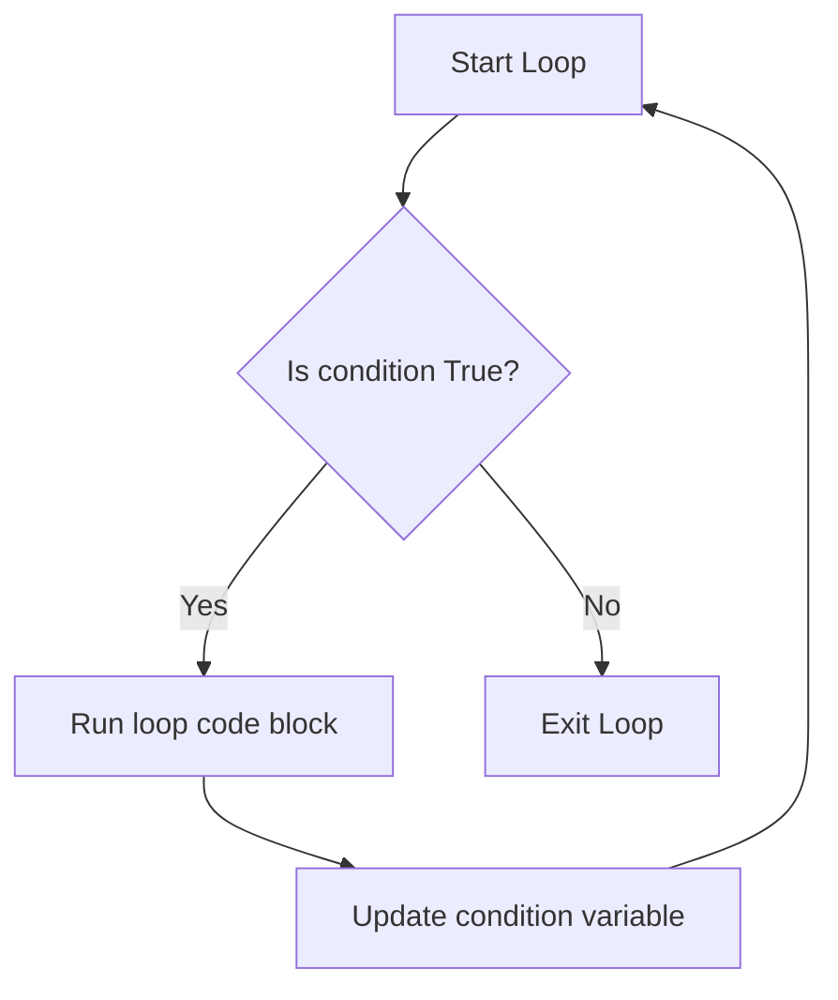

# Iterating with While Loops

When automating tasks, you will not always know how many times you need to repeat an action. For example, you might need to wait for a virtual server to start up, poll an API until it returns a success message, or retry a failed database connection. In Python, you write these conditional loops using `while` loops.

In this guide, we will look at how `while` loops work in Python. We will learn about condition variables, how to avoid infinite loops, and how to write polling checks.

## What is a While Loop?

A `while` loop keeps running as long as a specified condition remains `True`. Before running the code block, Python checks the condition. If it is `True`, the code runs. If it evaluates to `False`, Python exits the loop.

Let's compare `for` loops and `while` loops.

| Feature | For Loops | While Loops |
| :--- | :--- | :--- |
| **Control Structure** | Runs once for each item in a collection | Runs as long as a condition is True |
| **Iteration Count** | Known before the loop starts | Unknown before the loop starts |
| **Infinite Loop Risk** | Very low (Ends when collection is exhausted) | High (If condition never becomes False) |
| **Best Use Case** | Checking a list of servers or files | Retrying connections or polling statuses |

Here is a diagram showing the flow of a `while` loop:



## Basic Conditional Iteration

Let's write a script that retry-checks a connection up to three times.

Create a file named `retry_check.py` and write the code below.

```python
attempts = 1
max_attempts = 3

print("Connecting to database...")

while attempts <= max_attempts:
    # Print the current attempt number
    print(f"Connection attempt {attempts} of {max_attempts}...")
    
    # Increment our counter so the loop eventually ends
    attempts = attempts + 1

print("Failed to connect after max attempts. Aborting.")
```

Run this file in your terminal.

```bash
python3 retry_check.py
```

Expected output:
```text
Connecting to database...
Connection attempt 1 of 3...
Connection attempt 2 of 3...
Connection attempt 3 of 3...
Failed to connect after max attempts. Aborting.
```

## Stopping Infinite Loops

If your loop condition never becomes `False`, the loop will run forever. This is called an infinite loop and it will use 100% of your CPU cores. You must make sure that the code inside the loop updates a variable that eventually changes the condition check.

```python
# To stop a script stuck in an infinite loop, press Ctrl+C in your terminal
counter = 5

while counter > 0:
    print("Countdown: " + str(counter))
    # If you forget this line, the countdown runs forever!
    counter -= 1

print("Blastoff!")
```

Run the script.

```bash
python3 countdown.py
```

Expected output:
```text
Countdown: 5
Countdown: 4
Countdown: 3
Countdown: 2
Countdown: 1
Blastoff!
```

## Real-World Example: Server Boot Polling

Let's write a script that simulates waiting for a server to change its state from "starting" to "running". The script polls a status variable. To prevent waiting forever, we will include a timeout limit.

Create a file named `wait_for_server.py` and write the code below.

```python
import time

# Simulated server state details
server_status = "starting"
poll_count = 0
max_polls = 5

print("=== Server Boot Monitor ===")
print("Target Server status: " + server_status)

# Keep polling until status is 'running' or we exceed max polls
while server_status != "running" and poll_count < max_polls:
    poll_count += 1
    print(f"Poll #{poll_count}: Server is still booting. Waiting...")
    
    # Sleep to simulate waiting (use 1 second for testing speed)
    time.sleep(1)
    
    # Simulate the server finishing its boot on the 3rd poll
    if poll_count == 3:
        server_status = "running"

# Evaluate final state
if server_status == "running":
    print(f"\n✅ SUCCESS: Server booted successfully after {poll_count} poll(s).")
else:
    print("\n ❌ ERROR: Server boot timeout exceeded!")
```

Run the script.

```bash
python3 wait_for_server.py
```

Expected output:
```text
=== Server Boot Monitor ===
Target Server status: starting
Poll #1: Server is still booting. Waiting...
Poll #2: Server is still booting. Waiting...
Poll #3: Server is still booting. Waiting...

✅ SUCCESS: Server booted successfully after 3 poll(s).
```

## Common Mistakes

### Creating Infinite Loops by Accident
If you forget to increment your loop variable, or if you write a condition that can never be met, your script will run forever.

* **The Bad Way:**
```python
attempts = 0
while attempts < 3:
    print("Retrying connection...")
    # This loop runs forever because 'attempts' stays 0
```

* **The Good Way:**
```python
attempts = 0
while attempts < 3:
    print("Retrying connection...")
    attempts += 1
```

### Missing Time Delay in Polling Loops
If you write a `while` loop to poll a service status but do not include a time delay (`time.sleep`), your script will send thousands of requests per second, overloading the server and hogging your CPU.

* **The Bad Way:**
```python
while check_status() == "offline":
    # This runs thousands of times a second without pausing
    pass
```

* **The Good Way:**
```python
import time
while check_status() == "offline":
    # Wait 5 seconds before checking again
    time.sleep(5)
```

### Confusing While Loops with If Statements
Beginners sometimes write `while` when they only want to run a check once. A `while` loop will repeat the code block until the condition becomes False, whereas `if` only checks it once.

* **The Bad Way:**
```python
is_prod = True
# This loops print('Production') infinitely because is_prod never changes!
while is_prod:
    print("Production")
```

* **The Good Way:**
```python
is_prod = True
if is_prod:
    print("Production")
```

## Summary

* `while` loops repeat a block of code as long as a condition is `True`.
* Before running the loop block, Python checks the condition.
* Use `while` loops when you do not know how many iterations are required beforehand.
* Make sure your loop code updates a variable that eventually changes the condition check.
* Press `Ctrl + C` in your terminal to force-stop an infinite loop.
* Use `time.sleep()` in polling loops to prevent CPU overload.
* A timeout limit is required in polling loops to prevent hanging scripts.
* Do not confuse `while` statements with `if` checks.
* Managing connection retry logic is a common use case for `while` loops.
* Polling database startup status can be automated using conditional checks.
