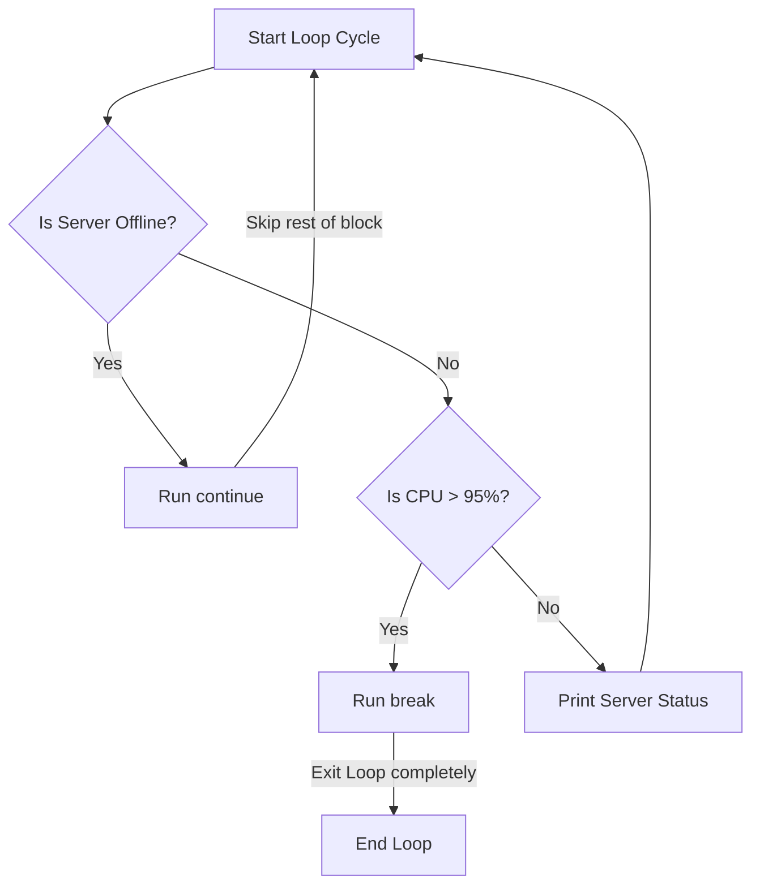

# Controlling Loops with break, continue, and pass

When writing loops, you will sometimes need to change the loop's execution path dynamically. You might want to exit a loop early once you find the server you are looking for, skip the current iteration if a server is offline, or create a placeholder block for a check you will write later. In Python, you control this behavior using `break`, `continue`, and `pass`.

In this guide, we will learn how to use these three loop control statements. We will look at how they redirect code execution, compare their behaviors, and write log filters.

## redirecting Loop Execution

Python provides three statements to modify loop execution on the fly. 

Let's look at a comparison of their actions.

| Statement | What it Does | Does it Exit the Loop? | DevOps Use Case |
| :--- | :--- | :--- | :--- |
| **`break`** | Stops the loop immediately | Yes (Jumps to the first line after the loop) | Stopping a scan once a critical bug is found |
| **`continue`** | Skips the rest of the current cycle | No (Jumps back to the top of the loop for next item) | Skipping inactive servers in a check loop |
| **`pass`** | Does nothing (a blank placeholder) | No (Script continues running normally) | Creating draft structures for functions |

Here is a diagram showing how `break` and `continue` redirect the loop execution path:



## Using Break to Exit Early

You use `break` to exit a loop instantly. This is useful when searching a list for a single item. Once you find it, you do not need to check the remaining items.

Create a file named `search_break.py` and write the code below.

```python
servers = ["web-01", "db-01", "cache-01", "web-02"]

target = "db-01"
print("Searching for database server...")

for server in servers:
    print("Checking: " + server)
    if server == target:
        print("Success: Found database node!")
        # Stop checking the rest of the list
        break
        
print("Search execution finished.")
```

Run this file in your terminal.

```bash
python3 search_break.py
```

Expected output:
```text
Searching for database server...
Checking: web-01
Checking: db-01
Success: Found database node!
Search execution finished.
```

## Using Continue to Skip Iterations

You use `continue` to skip the remaining lines inside the current loop cycle and move to the next item immediately. This is useful for filtering out healthy items or skipping offline nodes.

```python
nodes = [
    {"name": "node-01", "active": True},
    {"name": "node-02", "active": False},
    {"name": "node-03", "active": True}
]

for node in nodes:
    if not node["active"]:
        print(f"Skipping offline node: {node['name']}")
        continue
        
    # This line runs only if the node is active
    print(f"Provisioning updates on node: {node['name']}")
```

Run the script.

```bash
python3 filter_continue.py
```

Expected output:
```text
Provisioning updates on node: node-01
Skipping offline node: node-02
Provisioning updates on node: node-03
```

## Using Pass as a Placeholder

In Python, empty blocks are syntax errors. If you write an `if` block or a function but do not write any code inside it, Python will crash. You can use the `pass` statement as a temporary placeholder that does nothing.

```python
is_healthy = True

if is_healthy:
    # We will write metric tracking here later
    pass
else:
    print("Warning: System is unhealthy!")
```

Expected output:
No output is printed to the screen, and the script runs without errors.

## Real-World Example: Log Analyzer with Loop Controls

Let's write a script that processes a stream of system log lines. The script will skip normal "DEBUG" lines using `continue`, process warning messages normally, and stop parsing entirely using `break` if it encounters a critical "CRITICAL" system error.

Create a file named `log_analyzer.py` and write the code below.

```python
# Simulated stream of system logs
logs = [
    "INFO | User authentication success",
    "DEBUG | Query latency: 12ms",
    "WARNING | High memory usage limit",
    "DEBUG | Connection pool size check",
    "CRITICAL | Database connection failure!",
    "INFO | Closing inactive sockets"
]

print("=== Starting Log Analysis ===")

for log in logs:
    parts = log.split(" | ")
    level = parts[0]
    message = parts[1]
    
    # 1. Skip debug logs
    if level == "DEBUG":
        continue
        
    # 2. Stop parsing if critical failure happens
    if level == "CRITICAL":
        print(f" ❌ CRITICAL HALT: {message}")
        print("Stopping log scanner to prevent alert floods.")
        break
        
    # 3. Process normal log lines
    print(f"Processed [{level}]: {message}")

print("=== Log Analysis Terminated ===")
```

Run the script.

```bash
python3 log_analyzer.py
```

Expected output:
```text
=== Starting Log Analysis ===
Processed [INFO]: User authentication success
Processed [WARNING]: High memory usage limit
 ❌ CRITICAL HALT: Database connection failure!
Stopping log scanner to prevent alert floods.
=== Log Analysis Terminated ===
```

## Common Mistakes

### Writing Unreachable Code After Break or Continue
If you write lines of code inside a loop block *after* a `break` or `continue` statement without wrapping them in an `if` check, those lines will never run.

* **The Bad Way:**
```python
for item in [1, 2]:
    continue
    # This print statement is unreachable and will never run
    print("Item: " + str(item))
```

* **The Good Way:**
```python
for item in [1, 2]:
    if item == 1:
        continue
    print("Item: " + str(item))
```

### Confusing Break with Exit
The `break` statement only exits the active loop. It does not exit your entire script. If you have code written after the loop, it will run normally. If you want to stop the script entirely, use `sys.exit()`.

* **The Bad Way:**
```python
for i in [1, 2]:
    if i == 1:
        break # Exits the loop, but runs the next lines
print("Script finished successfully") # This still runs!
```

* **The Good Way:**
```python
import sys
for i in [1, 2]:
    if i == 1:
        print("Fatal error. Exiting.")
        sys.exit(1) # Stops the entire script
```

## Summary

* `break` exits the active loop immediately, jumping to the first line after the loop.
* `continue` skips the rest of the current loop iteration and starts the next cycle.
* `pass` is a blank placeholder statement used to satisfy Python's indentation syntax.
* Use `break` when searching lists to avoid wasting CPU cycles once a match is found.
* Use `continue` to filter and skip items like offline servers.
* Use `pass` as a draft placeholder for functions or branches.
* Code written directly after a `break` or `continue` block is unreachable.
* The `break` statement exits the loop, but does not terminate the script.
* Use `sys.exit()` when you need to stop the entire automation script.
* Loop control statements are ideal for building custom log filters and monitoring scripts.
