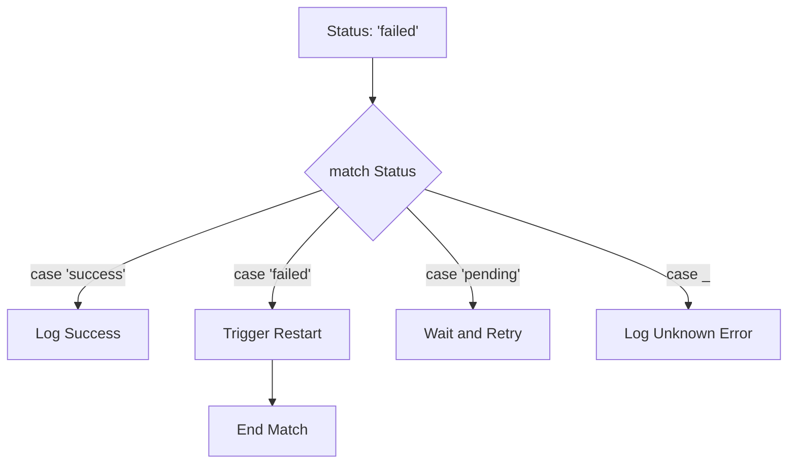

# Matching Patterns with match case

When writing automation scripts, you will often need to take different actions based on a single value, like a status code or a command argument. While you can write this using multiple `if-elif-else` statements, Python 3.10 introduced a cleaner way called structural pattern matching using `match` and `case`.

In this guide, we will look at how `match-case` works. We will learn the basic syntax, see how to write fallback cases, and compare it to standard conditional checks.

## What is a Match Statement?

The `match` statement takes a variable and compares its value against multiple patterns defined in `case` blocks. When it finds a match, it runs the code inside that case block. You can also use a wildcard character `_` as a default case that runs if no other patterns match.

Let's compare `if-elif-else` blocks and `match-case` statements.

| Feature | If-Elif-Else Blocks | Match-Case Statements |
| :--- | :--- | :--- |
| **Readability** | Messy when checking a single variable against many values | Clean because it separates each value check |
| **Wildcard Fallback** | Handled by the final `else:` block | Handled by `case _:` wildcard block |
| **Python Version** | Works on all Python versions | Requires Python 3.10 or newer |
| **Complex Patterns** | Hard to match complex nested structures | Easy to match lists or dictionaries natively |

Here is a diagram showing how Python routes a status code through a `match` statement:



## Basic Match Case Syntax

Let's write a script that processes HTTP status codes from a web check, returning different messages.

Create a file named `http_match.py` and write the code below.

```python
status_code = 404

print("Parsing web service response...")

match status_code:
    case 200:
        print("Success: Web service is active.")
    case 404:
        print("Warning: Page not found. Check URL settings.")
    case 500:
        print("Error: Internal server error detected.")
    case _:
        # The wildcard case acts like 'else'
        print(f"Unknown status code received: {status_code}")
```

Run this file in your terminal. Note that you must be running Python 3.10 or newer.

```bash
python3 http_match.py
```

Expected output:
```text
Parsing web service response...
Warning: Page not found. Check URL settings.
```

## Matching Multiple Patterns

You can combine multiple values in a single `case` check using the pipe symbol `|`. This is useful when different statuses should trigger the exact same action.

```python
event_type = "login_failed"

match event_type:
    case "login_success" | "logout":
        print("Info: User session event logged.")
    case "login_failed" | "account_locked":
        print("Warning: Security alert sent to monitoring channel.")
    case _:
        print("Info: Generic audit event.")
```

Run the script.

```bash
python3 multi_match.py
```

Expected output:
```text
Warning: Security alert sent to monitoring channel.
```

## Real-World Example: Alert Dispatcher System

Let's write a script that parses alert dictionaries from a monitoring grid. The script matches the alert's severity level, formats a clean message, and routes the action accordingly.

Create a file named `alert_dispatcher.py` and write the code below.

```python
# Simulated alert payload
alert = {
    "source": "database-server-01",
    "severity": "CRITICAL",
    "message": "Disk space utilized is at 98%"
}

def dispatch_alert(event):
    severity = event.get("severity", "INFO")
    source = event.get("source", "unknown")
    msg = event.get("message", "")
    
    print(f"Dispatching alert from {source}...")
    
    match severity:
        case "INFO" | "DEBUG":
            print(f"  [Log File] {severity}: {msg}")
        case "WARNING":
            print(f"  [Slack Message] Sending warning notification to team channel: {msg}")
        case "CRITICAL" | "EMERGENCY":
            print(f"  [SMS Alert] Paging on-call engineer immediately!")
            print(f"  [Alert Details] {msg}")
        case _:
            print(f"  [Warning] Unrecognized severity level '{severity}'. Routing to general queue.")

dispatch_alert(alert)
```

Run the script.

```bash
python3 alert_dispatcher.py
```

Expected output:
```text
Dispatching alert from database-server-01...
  [SMS Alert] Paging on-call engineer immediately!
  [Alert Details] Disk space utilized is at 98%
```

## Common Mistakes

### Running Match Case on Outdated Runtimes
If you run a script containing a `match` statement on a server that has an older version of Python (like 3.8 or 3.9), the script will fail instantly with a syntax error.

* **The Bad Way:**
Running match case scripts on legacy enterprise Linux servers (like RHEL 8) that ship with Python 3.6 or 3.8 by default.

* **The Good Way:**
Use the version checking patterns we learned in Chapter 2 to verify that your Python runtime is at least 3.10 before executing match case scripts, or use standard `if-elif-else` blocks for maximum backward compatibility.

### Forgetting the Wildcard Case
If you do not define a default wildcard `case _` block, and the value you are matching does not match any of your case options, Python will exit the match statement silently without warning.

* **The Bad Way:**
```python
role = "developer"
match role:
    case "admin":
        print("Granted Access")
# If role is 'developer', nothing happens and no warning is printed
```

* **The Good Way:**
```python
role = "developer"
match role:
    case "admin":
        print("Granted Access")
    case _:
        print(f"Access Denied: Unrecognized system role '{role}'.")
```

## Summary

* The `match` statement provides structural pattern matching, introduced in Python 3.10.
* Match-case is a cleaner alternative to chaining many `if-elif-else` checks.
* Each check is defined inside a `case` block.
* Use the wildcard character `_` as a default fallback case when no other matches exist.
* Use the pipe operator `|` to check for multiple values in a single `case` block.
* Match statement syntax will raise a syntax error on Python versions older than 3.10.
* Match case is ideal for processing API response status codes.
* Routing alert events based on severity is clean and readable using match statements.
* Checking Python version before running modern scripts prevents unexpected syntax crashes.
* Designing clear fallback pathways ensures your scripts handle unknown inputs safely.
