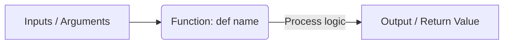

# Defining and Calling Functions

When writing scripts, you will often need to run the same tasks in multiple places. You might need to check system health, write to log files, or formatting path strings. Instead of copying and pasting the same lines of code, you can group them into a single, reusable block called a function.

In this guide, we will learn how to define and use functions in Python. We will look at naming rules, scoping, and how to write basic helper functions.

## What is a Function?

A function is a block of organized, reusable code that performs a single action. You define a function using the keyword `def` followed by a name, parentheses `()`, and a colon `:`. The code inside the function is indented.

Let's look at how using functions compares to writing scripts line-by-line.

| Aspect | Writing Scripts Line-by-Line | Using Functions |
| :--- | :--- | :--- |
| **Code Size** | Large (Code is duplicated) | Small (Write once, call many times) |
| **Maintenance** | Hard (Must edit every copy of the code) | Easy (Change code in one place) |
| **Readability** | Messy (Hard to follow the main flow) | Clean (Helper steps are hidden inside functions) |
| **Testing** | Difficult (Must run the entire script) | Easy (Test each function independently) |
| **Input Flexibility**| Fixed values at runtime | Dynamic values passed as arguments |

Here is a diagram showing how data flows through a function block:



## Creating Your First Function

Let's write a simple function that logs status messages to the screen.

Create a file named `func_basics.py` and write the code below.

```python
# Define the function
def log_status():
    print("--- System Diagnostics ---")
    print("Database Connection: Online")
    print("API Listener:        Online")
    print("-" * 26)

# Call the function to run the code
log_status()
log_status()
```

Run this file in your terminal.

```bash
python3 func_basics.py
```

Expected output:
```text
--- System Diagnostics ---
Database Connection: Online
API Listener:        Online
--------------------------
--- System Diagnostics ---
Database Connection: Online
API Listener:        Online
--------------------------
```

## Understanding Variables Scope

Variables created inside a function are local to that function. This means you cannot access them outside the function. Variables created in the main script are global and can be read anywhere.

```python
# Global variable
global_server = "prod-db-01"

def print_details():
    # Local variable
    local_port = 5432
    print("Inside function: Reading global server: " + global_server)
    print("Inside function: Local port:            " + str(local_port))

print_details()

print("Outside function: Reading global server: " + global_server)
# Trying to print local_port here will cause a NameError
```

Run the script.

```bash
python3 scope_check.py
```

Expected output:
```text
Inside function: Reading global server: prod-db-01
Inside function: Local port:            5432
Outside function: Reading global server: prod-db-01
```

## Real-World Example: Memory Auditor Helper

Let's write a helper function that calculates memory usage. The function will accept the total memory and used memory of a system, calculate the free percentage, and return a clean status text.

Create a file named `memory_auditor.py` and write the code below.

```python
def check_memory_usage(total_mb, used_mb):
    free_mb = total_mb - used_mb
    free_percent = (free_mb / total_mb) * 100
    
    # Return a formatted string
    if free_percent < 15.0:
        return f"CRITICAL: Low free memory available ({free_percent:.1f}%)"
    else:
        return f"NORMAL: Memory health is good ({free_percent:.1f}%)"

# Test our function with production values
result_prod = check_memory_usage(16384, 15000)
# Test with staging values
result_stage = check_memory_usage(8192, 4000)

print("=== Memory Check Results ===")
print("Production Node: " + result_prod)
print("Staging Node:    " + result_stage)
```

Run the script.

```bash
python3 memory_auditor.py
```

Expected output:
```text
=== Memory Check Results ===
Production Node: CRITICAL: Low free memory available (8.4%)
Staging Node:    NORMAL: Memory health is good (51.2%)
```

## Common Mistakes

### Calling a Function Before Defining It
Python reads files from top to bottom. If you try to call a function before you write the `def` block, Python will crash with a `NameError`.

* **The Bad Way:**
```python
# This raises a NameError: name 'check_dns' is not defined
check_dns()

def check_dns():
    print("DNS Online")
```

* **The Good Way:**
```python
def check_dns():
    print("DNS Online")

# Call the function after it has been defined
check_dns()
```

### Forgetting to Return Values
If you want your function to calculate a value and send it back to your main script, you must use the `return` statement. If you forget `return`, the function returns `None` silently.

* **The Bad Way:**
```python
def add_nodes(active, new):
    total = active + new
    # Forgot return!

count = add_nodes(5, 2)
# Prints None instead of 7
print("Total nodes: " + str(count))
```

* **The Good Way:**
```python
def add_nodes(active, new):
    total = active + new
    return total

count = add_nodes(5, 2)
print("Total nodes: " + str(count)) # Prints 7
```

### Modifying Global Variables Directly
If you try to assign a new value to a global variable inside a function without the `global` keyword, Python will create a new local variable with the same name instead of updating the global one.

* **The Bad Way:**
```python
status = "healthy"
def set_offline():
    status = "offline" # Creates a local variable 'status'

set_offline()
print(status) # Prints 'healthy' (not modified!)
```

* **The Good Way:**
Use return values to update global variables cleanly.
```python
status = "healthy"
def set_offline():
    return "offline"

status = set_offline()
print(status) # Prints 'offline'
```

## Summary

* Functions group related code blocks together so they can be reused.
* You define a function using the keyword `def` followed by a name, parameters, and a colon `:`.
* Call a function by writing its name followed by parentheses (e.g. `log_status()`).
* Variables defined inside a function are local to that function and cannot be read outside.
* Global variables are defined in the main script and can be read inside functions.
* Use the `return` statement to send calculation results back to the main script.
* Functions must be defined in your script before you try to call them.
* Forgetting to write `return` results in the function returning `None` by default.
* Avoid modifying global variables directly inside functions; use return values instead.
* Splitting script logic into small, focused functions makes debugging much easier.
