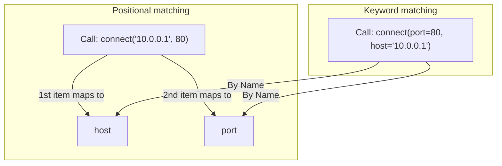

# Working with Function Arguments

When writing helper functions, you need a way to pass data into them. For example, if you write a function to ping a server, you need to tell it which host to ping. If you write a function to clean up logs, you need to specify the path. In Python, you pass these details into functions as arguments.

In this guide, we will learn how to use function arguments. We will look at positional arguments, keyword arguments, and setting default values for parameters.

## Parameters vs Arguments

Although these words are often used interchangeably, they mean slightly different things:
* **Parameters**: The variable names listed in the function definition (the placeholders).
* **Arguments**: The actual values passed into the function when you call it.

Let's compare positional and keyword arguments.

| Argument Type | How it Works | Example Code | Best Use Case |
| :--- | :--- | :--- | :--- |
| **Positional** | Matched by order of values | `connect("10.0.0.1", 80)` | Standard, short inputs |
| **Keyword** | Matched by parameter name | `connect(port=80, host="10.0.0.1")`| When order is hard to remember |
| **Default** | Uses fallback if argument is missing | `def connect(host, port=80):` | Optional settings |

Here is a diagram showing how arguments are mapped to parameters by position or key:



## Using Positional and Keyword Arguments

Let's look at how to define parameters and pass values.

Create a file named `arguments.py` and write the code below.

```python
def configure_service(service_name, port, protocol):
    print(f"Service Configured: {service_name}")
    print(f"  Connection: {protocol}://localhost:{port}")
    print("-" * 30)

# 1. Calling using Positional Arguments (Order matters)
configure_service("nginx", 80, "http")

# 2. Calling using Keyword Arguments (Order does not matter)
configure_service(protocol="https", service_name="postgresql", port=5432)
```

Run this file in your terminal.

```bash
python3 arguments.py
```

Expected output:
```text
Service Configured: nginx
  Connection: http://localhost:80
------------------------------
Service Configured: postgresql
  Connection: https://localhost:5432
------------------------------
```

## Setting Default Parameters

You can give parameters default values. If the caller does not provide an argument for that parameter, Python will load the default value. This is useful for settings like timeouts or environments where you usually use the same value.

```python
# 'timeout' has a default value of 5 seconds
def ping_server(host, timeout=5):
    print(f"Pinging host: {host} (Timeout setting: {timeout}s)...")

# Call using default
ping_server("192.168.1.100")

# Call with override
ping_server("192.168.1.100", timeout=10)
```

Run the script.

```bash
python3 default_args.py
```

Expected output:
```text
Pinging host: 192.168.1.100 (Timeout setting: 5s)...
Pinging host: 192.168.1.100 (Timeout setting: 10s)...
```

## Real-World Example: HTTP Request Helper

Let's write a helper function that logs requests to a server. The function will accept a mandatory path, and optional settings for request method, timeout, and authorization status.

Create a file named `request_helper.py` and write the code below.

```python
def log_http_request(url_path, method="GET", timeout_sec=10, auth_required=False):
    print("--- Dispaching Request Details ---")
    print(f"Target Path:    {url_path}")
    print(f"HTTP Method:    {method}")
    print(f"Timeout:        {timeout_sec} seconds")
    print(f"Requires Auth:  {auth_required}")
    print("-" * 34)

# 1. Trigger request using default settings
log_http_request("/api/v1/health")

# 2. Trigger custom request overriding specific options using keywords
log_http_request(
    "/api/v1/users", 
    method="POST", 
    auth_required=True
)
```

Run the script.

```bash
python3 request_helper.py
```

Expected output:
```text
--- Dispaching Request Details ---
Target Path:    /api/v1/health
HTTP Method:    GET
Timeout:        10 seconds
Requires Auth:  False
----------------------------------
--- Dispaching Request Details ---
Target Path:    /api/v1/users
HTTP Method:    POST
Timeout:        10 seconds
Requires Auth:  True
----------------------------------
```

## Common Mistakes

### Placing Positional Arguments After Keyword Arguments
When calling a function, you must write all positional arguments *before* you write any keyword arguments. If you mix them up, Python will fail with a syntax error.

* **The Bad Way:**
```python
def configure(host, port):
    pass

# This raises a SyntaxError: positional argument follows keyword argument
configure(host="10.0.0.1", 80)
```

* **The Good Way:**
```python
def configure(host, port):
    pass

# Write positional first
configure("10.0.0.1", port=80)
```

### Using Mutable Default Arguments (like lists)
Never use mutable objects (like an empty list `[]` or dictionary `{}`) as default values in function definitions. Python creates the default object once when it reads the file. If you modify the list, it will keep changes across calls, causing bugs.

* **The Bad Way:**
```python
# The list default is shared across all function calls!
def add_server(host, host_list=[]):
    host_list.append(host)
    return host_list

list_a = add_server("web-01")
# You expect list_b to only hold 'web-02', but it holds BOTH!
list_b = add_server("web-02")
print(list_b) # Prints ['web-01', 'web-02']
```

* **The Good Way:**
Use `None` as the default value and initialize the list inside the function.
```python
def add_server(host, host_list=None):
    if host_list is None:
        host_list = []
    host_list.append(host)
    return host_list

list_a = add_server("web-01")
list_b = add_server("web-02")
print(list_b) # Prints ['web-02']
```

## Summary

* Parameters act as placeholders in function definitions, while arguments are the actual values passed.
* Positional arguments map to parameters based on their order in the function call.
* Keyword arguments map to parameters by matching names explicitly.
* You can define optional settings by assigning default values to parameters.
* Positional arguments must always be written before keyword arguments in calls.
* Never use mutable structures like lists `[]` as default parameters in definitions.
* Set default parameters to `None` and initialize them inside the function block instead.
* Keyword arguments make your code self-documenting and easier for teammates to read.
* Overriding default parameters lets you customize connection settings dynamically.
* Building flexible function signatures saves you from writing duplicate code block chains.
