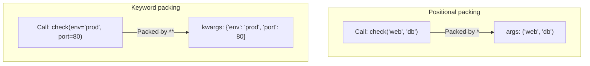

# Using args and kwargs for Flexible Functions

When writing automation scripts, you will sometimes need to create functions that accept a variable number of inputs. For example, you might want to write a function that deletes an arbitrary list of backup files, or a log function that accepts any number of custom metadata parameters (like environment, host, and port). In Python, you handle these flexible inputs using `*args` and `**kwargs`.

In this guide, we will learn how to write functions using variable-length arguments. We will look at packing parameters, comparing list vs dictionary arguments, and writing metadata logs.

## Variable-Length Arguments

Python uses the asterisk symbols `*` and `**` to pack multiple arguments into a single parameter:
* **`*args`**: Packs multiple positional arguments into a single **tuple**.
* **`**kwargs`**: Packs multiple keyword arguments into a single **dictionary**.

Let's compare `*args` and `**kwargs`.

| Syntax | Parameter Name | Collected As | Example Call | Inside Function |
| :--- | :--- | :--- | :--- | :--- |
| `*` | `*args` | Tuple | `delete_files("a.txt", "b.txt")` | `("a.txt", "b.txt")` |
| `**` | `**kwargs` | Dictionary | `set_tags(env="prod", owner="db")`| `{"env": "prod", "owner": "db"}` |

Here is a diagram showing how Python packs arguments when calling a flexible function:



## Using args to Accept List Arguments

You use `*args` when you want to pass any number of positional arguments. The name `args` is a standard naming convention, but the magic is actually the single asterisk `*`.

Create a file named `args_basics.py` and write the code below.

```python
def check_nodes(*nodes):
    # 'nodes' is collected as a tuple
    print(f"Nodes type: {type(nodes).__name__}")
    print(f"Starting status audit for {len(nodes)} servers:")
    
    for node in nodes:
        print(" -> Checking: " + node)
    print("-" * 34)

# Call with 2 arguments
check_nodes("web-01", "web-02")

# Call with 3 arguments
check_nodes("proxy-01", "db-01", "cache-01")
```

Run this file in your terminal.

```bash
python3 args_basics.py
```

Expected output:
```text
Nodes type: tuple
Starting status audit for 2 servers:
 -> Checking: web-01
 -> Checking: web-02
----------------------------------
Nodes type: tuple
Starting status audit for 3 servers:
 -> Checking: proxy-01
 -> Checking: db-01
 -> Checking: cache-01
----------------------------------
```

## Using kwargs to Accept Custom Dictionary Settings

You use `**kwargs` (keyword arguments) when you want to pass any number of named parameters. These are packed into a standard dictionary.

```python
def log_metadata(message, **tags):
    # 'tags' is collected as a dictionary
    print("Log Message: " + message)
    
    if len(tags) > 0:
        print("Metadata Tags:")
        for key, value in tags.items():
            print(f"  [{key}] {value}")
    print("-" * 30)

# Call with no tags
log_metadata("Backup started")

# Call with custom tags
log_metadata("Database backup finished", environment="Production", target="db-01", status="success")
```

Run the script.

```bash
python3 kwargs_basics.py
```

Expected output:
```text
Log Message: Backup started
------------------------------
Log Message: Database backup finished
Metadata Tags:
  [environment] Production
  [target] db-01
  [status] success
------------------------------
```

## Real-World Example: Flexible Alerts Dispatcher

Let's write a script that acts as an alert routing coordinator. The function will accept a mandatory status level, a variable list of target contact groups (using `*args`), and an arbitrary set of system tagging details (using `**kwargs`) to include in the notification payload.

Create a file named `args_router.py` and write the code below.

```python
def dispatch_alert(level, *contacts, **details):
    print(f"=== Dispatched Alert [{level}] ===")
    
    # Print target groups
    print("Notify channels:")
    for contact in contacts:
        print(f" - Sending message to: {contact}")
        
    # Print metadata detail tags
    if details:
        print("Alert Details:")
        for key, val in details.items():
            print(f"   * {key.replace('_', ' ').title()}: {val}")
    print("-" * 36)

# Dispatch warning to Slack group
dispatch_alert(
    "WARNING", 
    "slack-alerts", 
    server="web-server-05", 
    load_average=8.5
)

# Dispatch critical alert to PagerDuty and Ops SMS
dispatch_alert(
    "CRITICAL", 
    "pagerduty-sms", 
    "sysops-slack", 
    database="production-core", 
    error_code=500, 
    action_required=True
)
```

Run the script.

```bash
python3 args_router.py
```

Expected output:
```text
=== Dispatched Alert [WARNING] ===
Notify channels:
 - Sending message to: slack-alerts
Alert Details:
   * Server: web-server-05
   * Load Average: 8.5
------------------------------------
=== Dispatched Alert [CRITICAL] ===
Notify channels:
 - Sending message to: pagerduty-sms
 - Sending message to: sysops-slack
Alert Details:
   * Database: production-core
   * Error Code: 500
   * Action Required: True
------------------------------------
```

## Common Mistakes

### Misordering Parameters in Function Definitions
When defining a function that uses standard parameters, `*args`, and `**kwargs`, you must write them in a specific order: standard first, then `*args`, and finally `**kwargs`. If you mix up the order, Python will fail with a syntax error.

* **The Bad Way:**
```python
# This raises a SyntaxError: invalid syntax
def configure(**kwargs, *args):
    pass
```

* **The Good Way:**
```python
# Order is: Positional -> *args -> Keyword-only -> **kwargs
def configure(host, *args, **kwargs):
    pass
```

### Unpacking Mismatches when Passing Collections
If you want to pass an existing list into a function using `*args`, you must prefix the list variable with an asterisk `*`. If you forget the asterisk, Python will pass the entire list as a single argument (a list inside the tuple) instead of unpacking it.

* **The Bad Way:**
```python
def check_servers(*servers):
    print("Checking total count: " + str(len(servers)))

targets = ["web01", "web02"]
# This prints 1 because the tuple holds the list object: (['web01', 'web02'],)
check_servers(targets)
```

* **The Good Way:**
```python
def check_servers(*servers):
    print("Checking total count: " + str(len(servers)))

targets = ["web01", "web02"]
# The * unpacks the list into separate positional arguments
check_servers(*targets) # Prints 2
```

## Summary

* Use `*args` to collect any number of positional arguments into a tuple.
* Use `**kwargs` to collect any number of keyword arguments into a dictionary.
* The names `args` and `kwargs` are conventions; the asterisks `*` and `**` do the packing.
* Standard parameters must be written before `*args` and `**kwargs` in definitions.
* Pass variables prefixed with `*` or `**` to unpack lists or dicts into arguments.
* `*args` is useful for passing lists of servers or file targets to a function.
* `**kwargs` is ideal for adding metadata tags to logging utilities.
* If you pass duplicate keys in `**kwargs`, Python will raise a syntax error.
* Using variable arguments allows you to build generic, reusable framework helpers.
* Dynamic arg routing makes integration with third-party alert channels easy.
