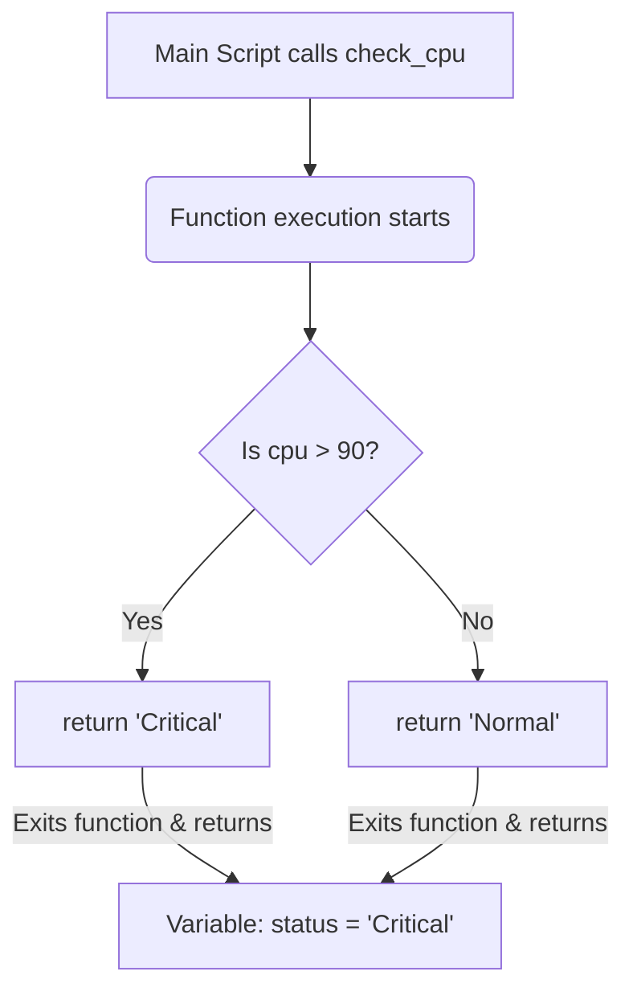

# Working with Return Values

When you call a function, you often expect it to calculate some results and send them back to your main script. You might want a function to calculate memory usage, parse a configuration string, or verify a network connection and return the result. In Python, you send data back from a function using the `return` statement.

In this guide, we will look at how return values work. We will learn how to return single and multiple values, exit functions early, and compare returning against printing.

## What is a Return Value?

A function stops running immediately when it encounters a `return` statement. It passes the value of the expression back to the line of code that called the function. If a function ends without running a return statement, it returns the value `None` by default.

Let's look at the difference between printing inside a function and returning a value.

| Action | Printing Inside a Function | Returning from a Function |
| :--- | :--- | :--- |
| **Output Type** | Text output displayed on screen | Data value passed back in code |
| **Variable Capture** | Cannot capture output in a variable | Can capture and save value to a variable |
| **Reusability** | Low (Only displays text) | High (Data can be used in math or checks) |
| **Execution Impact**| Does not affect execution flow | Exits the function immediately |
| **DevOps Use Case** | Log status messages to terminal | Getting status codes, free RAM, or API dictionaries |

Here is a diagram showing how data passes back when a function returns a value:



## Returning Values Natively

Let's look at how to return a single value and how to capture it in a variable.

Create a file named `returns_basics.py` and write the code below.

```python
def check_disk_limit(used_percent):
    if used_percent > 90:
        return "CRITICAL"
    else:
        return "NORMAL"

# Capture returned value in a variable
status = check_disk_limit(92)
print("Current disk status: " + status)

if status == "CRITICAL":
    print("Action Required: Clean up files!")
```

Run this file in your terminal.

```bash
python3 returns_basics.py
```

Expected output:
```text
Current disk status: CRITICAL
Action Required: Clean up files!
```

## Early Exits Using Return

Because the `return` statement exits the function immediately, you can use it to perform "guard checks" at the beginning of your function. This lets you exit early if parameters are invalid, preventing nested code blocks.

```python
def process_server_logs(file_path):
    if file_path == "":
        print("Error: Empty path specified. Exiting function early.")
        return False
        
    print("Opening file path: " + file_path)
    # Perform file reading logic here...
    return True

# Test early exit
success = process_server_logs("")
print("Execution success status: " + str(success))
```

Run the script.

```bash
python3 early_exit.py
```

Expected output:
```text
Error: Empty path specified. Exiting function early.
Execution success status: False
```

## Real-World Example: Directory Audit statistics

Let's write a helper function that scans a directory and returns detailed statistics. The function will verify if the folder exists, count the files, calculate total bytes, and return these details as a dictionary.

Create a file named `dir_auditor.py` and write the code below.

```python
import os

# Create some test files for audit
os.makedirs("test_logs", exist_ok=True)
with open("test_logs/app.log", "w") as f:
    f.write("Log line entry 1\nLog line entry 2")
with open("test_logs/error.log", "w") as f:
    f.write("Fatal crash dump")

def audit_directory(folder_path):
    # Guard check: Exit early if folder doesn't exist
    if not os.path.exists(folder_path):
        return {"status": "missing", "files": 0, "size_bytes": 0}
        
    files = os.listdir(folder_path)
    total_size = 0
    file_count = 0
    
    for file in files:
        full_path = os.path.join(folder_path, file)
        if os.path.isfile(full_path):
            file_count += 1
            total_size += os.path.getsize(full_path)
            
    # Return all metrics as a single dictionary
    return {
        "status": "healthy",
        "files": file_count,
        "size_bytes": total_size
    }

report = audit_directory("test_logs")
print("=== Directory Audit Summary ===")
print("Scan Status:  " + report["status"])
print("File Count:   " + str(report["files"]))
print("Total Size:   " + str(report["size_bytes"]) + " bytes")
```

Run the script.

```bash
python3 dir_auditor.py
```

Expected output:
```text
=== Directory Audit Summary ===
Scan Status:  healthy
File Count:   2
Total Size:   49 bytes
```

## Common Mistakes

### Writing Code After the Return Statement
Any code written inside a function after the `return` statement is unreachable and will never execute.

* **The Bad Way:**
```python
def check_status():
    return "online"
    # This print statement will never execute!
    print("Database check completed successfully.")
```

* **The Good Way:**
```python
def check_status():
    print("Database check completed successfully.")
    return "online"
```

### Returning the Print Function Directly
If you write `return print("message")`, your function will print the message, but it will return `None` because the `print()` function itself does not return any value.

* **The Bad Way:**
```python
def get_ip():
    # Print displays text but returns None
    return print("10.0.0.1")

active_ip = get_ip()
# Prints: None
print("IP address variable: " + str(active_ip))
```

* **The Good Way:**
```python
def get_ip():
    return "10.0.0.1"

active_ip = get_ip()
print("IP address variable: " + active_ip) # Prints '10.0.0.1'
```

### Forgetting to Return in All Branch Paths
If you write an if-else statement inside a function, make sure both paths contain a `return` statement. If one path is missing it, the function returns `None` when that path is executed.

* **The Bad Way:**
```python
def check_server(is_active):
    if is_active:
        return "running"
    # If is_active is False, this function returns None!
```

* **The Good Way:**
```python
def check_server(is_active):
    if is_active:
        return "running"
    else:
        return "offline"
```

## Summary

* The `return` statement sends data values back from a function to the calling line of code.
* A function stops running immediately when it encounters a `return` statement.
* If a function has no `return` statement, it returns the value `None` by default.
* Use `return` values when you need to capture and process data in variables.
* Use `print()` inside functions only for logging status messages.
* Use early returns as guards to check parameter inputs and exit early.
* You can return multiple values by grouping them into a tuple or dictionary.
* Do not write code inside a function after a `return` statement has run.
* Always define return statements for all branching paths inside your conditional checks.
* Return values allow you to write clean, testable system checker modules.
