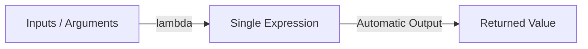

# Using Lambda Functions

When writing scripts, you will occasionally need to write small, simple functions that only do one task. Instead of writing a full `def` block for a one-line action, Python lets you write quick, anonymous functions called lambda functions. Lambda functions are useful when you need to pass a simple operation as an argument to another function, like sorting list data.

In this guide, we will look at how lambda functions work. We will break down their syntax, compare them to standard functions, and write scripts to sort server data.

## What is a Lambda Function?

A lambda function is a small, anonymous function that can have any number of arguments, but can only have a single expression. You define it using the `lambda` keyword. It returns the result of the expression automatically without a `return` statement.

Let's look at a comparison between standard functions and lambda functions.

| Feature | Standard Def Function | Lambda Function |
| :--- | :--- | :--- |
| **Keyword** | `def` | `lambda` |
| **Name** | Named (Required) | Anonymous (Has no name) |
| **Lines of Code** | Multiple lines | Single line only |
| **Return Statement** | Requires `return` | Returns expression automatically |
| **Best Use Case** | Complex, reusable operations | Quick sorting or filtering lists |

Here is a diagram showing how data passes through a lambda function:



## Basic Lambda Syntax

Let's write a simple lambda function that adds port offsets and compare it to a standard function.

Create a file named `lambda_basics.py` and write the code below.

```python
# 1. The Standard Way
def get_port_offset(base_port):
    return base_port + 10

# 2. The Lambda Way
# syntax: lambda arguments: expression
quick_offset = lambda base_port: base_port + 10

print("Standard: " + str(get_port_offset(80)))
print("Lambda:   " + str(quick_offset(80)))
```

Run this file in your terminal.

```bash
python3 lambda_basics.py
```

Expected output:
```text
Standard: 90
Lambda:   90
```

## Sorting Lists with Lambdas

The most common use case for lambda functions in DevOps is sorting list objects. You can pass a lambda function to the `sort()` method or the `sorted()` function to specify which field Python should use to sort the collection.

```python
# A list of server connection records (hostname, latency_ms)
server_connections = [
    ("web-01", 120),
    ("db-01", 15),
    ("cache-01", 5)
]

# Sort the servers by latency (the item at index 1)
# 'x' represents each tuple in the list
server_connections.sort(key=lambda x: x[1])

print("Servers sorted by latency:")
print(server_connections)
```

Run the script.

```bash
python3 lambda_sort.py
```

Expected output:
```text
Servers sorted by latency:
[('cache-01', 5), ('db-01', 15), ('web-01', 120)]
```

## Real-World Example: Server Health Ranking

Let's write a script that processes a list of dictionary metadata representing system nodes. The script will sort the nodes by their active CPU usage in descending order, helping us identify the most heavily loaded server instantly.

Create a file named `nodes_ranking.py` and write the code below.

```python
# Server inventory data
nodes = [
    {"name": "app-01", "cpu": 45.2, "status": "online"},
    {"name": "app-02", "cpu": 89.1, "status": "online"},
    {"name": "database-prod", "cpu": 76.5, "status": "online"},
    {"name": "cache-node", "cpu": 12.0, "status": "online"}
]

print("=== Server Utilization Ranking ===")

# Sort nodes by the 'cpu' key in descending order (reverse=True)
# 'x' holds each dictionary in the nodes list
sorted_nodes = sorted(nodes, key=lambda x: x["cpu"], reverse=True)

# Print the sorted ranking
for index, node in enumerate(sorted_nodes, start=1):
    print(f"Rank #{index}: {node['name']} - CPU load: {node['cpu']}%")
```

Run the script.

```bash
python3 nodes_ranking.py
```

Expected output:
```text
=== Server Utilization Ranking ===
Rank #1: app-02 - CPU load: 89.1%
Rank #2: database-prod - CPU load: 76.5%
Rank #3: app-01 - CPU load: 45.2%
Rank #4: cache-node - CPU load: 12.0%
```

## Common Mistakes

### Trying to Write Multiple Lines Inside Lambda
Lambda functions can only contain a single expression. You cannot write loops, assign variables, or use multiple statements inside a lambda block.

* **The Bad Way:**
```python
# This raises a SyntaxError: invalid syntax
sum_values = lambda a, b:
    total = a + b
    return total
```

* **The Good Way:**
Keep it as a single line, or write a standard `def` block.
```python
sum_values = lambda a, b: a + b
```

### Using Lambdas Unnecessarily
While lambdas are quick, writing a lambda function and saving it to a variable name is generally discouraged. It is better to use standard `def` blocks for named helper functions to keep your code easy to debug.

* **The Bad Way:**
```python
# Avoid assigning lambdas to names
check_ip = lambda ip: "10.0" in ip
```

* **The Good Way:**
```python
# Clearer and supports document string helpers
def check_ip(ip):
    return "10.0" in ip
```

### Forgetting that Lambdas Return Automatically
Do not write the `return` keyword inside a lambda function. Python returns the expression result automatically.

* **The Bad Way:**
```python
# This raises a SyntaxError
offset = lambda x: return x + 10
```

* **The Good Way:**
```python
offset = lambda x: x + 10
```

## Summary

* Lambda functions are small, anonymous single-line functions.
* You define lambda functions using the `lambda` keyword.
* Lambda functions can accept any number of arguments, but can only contain one expression.
* The result of the expression is returned automatically without writing the `return` keyword.
* Use lambda functions when you need to pass a simple operation as an argument.
* Sorting lists of dictionaries or tuples is the most common use case for lambdas in DevOps.
* Do not write multiple statements, variables, or loops inside lambda blocks.
* Avoid assigning lambda functions to variables; write standard `def` blocks instead.
* Lambdas are excellent keys for customized sorting of server metrics list.
* Writing clean sorting operations keeps your monitoring dashboard outputs accurate.
