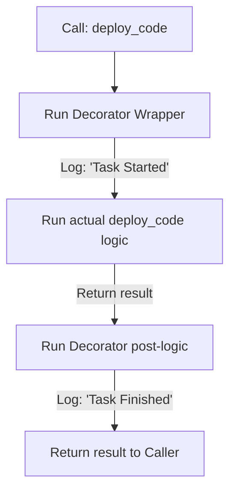

# Modifying Behavior with Decorators

When writing scripts, you will often want to add the same helper features to multiple functions. For example, you might want to log when a function starts and stops, measure how long a backup task takes to run, or check if a user has administrator access before running a command. In Python, you can inject this logic cleanly using decorators.

In this guide, we will look at how decorators work. We will learn about wrapping functions, writing execution timers, and keeping code modular.

## What is a Decorator?

A decorator is a function that takes another function as an argument, adds some execution logic, and returns a modified wrapper function. You apply a decorator by writing the `@` symbol followed by the decorator name directly above the function you want to modify.

Let's compare decorated functions against standard functions.

| Aspect | Standard Function | Decorated Function |
| :--- | :--- | :--- |
| **Declaration** | Standard definition: `def task()` | Has decorator prefix: `@log_run` |
| **Logic Separation**| Helper tasks (like logs) are mixed in code | Helper tasks are isolated in the decorator |
| **Reusability** | Must copy log code to every function | Apply the `@` prefix to any function |
| **Execution Flow** | Runs function code directly | Runs wrapper code first, which calls the function |

Here is a diagram showing the execution path of a decorated function:



## Creating a Logging Decorator

Let's write a decorator that prints a message before and after a function runs.

Create a file named `log_decorator.py` and write the code below.

```python
# 1. Define the decorator
def log_execution(original_function):
    # The wrapper accepts args to pass to the original function
    def wrapper(*args, **kwargs):
        print(f"[Log] Starting task: {original_function.__name__}")
        
        # Run the actual function
        result = original_function(*args, **kwargs)
        
        print(f"[Log] Finished task: {original_function.__name__}")
        return result
    return wrapper

# 2. Apply the decorator
@log_execution
def backup_database():
    print("  -> Writing PostgreSQL dump database records...")

# 3. Call the function
backup_database()
```

Run this file in your terminal.

```bash
python3 log_decorator.py
```

Expected output:
```text
[Log] Starting task: backup_database
  -> Writing PostgreSQL dump database records...
[Log] Finished task: backup_database
```

## Real-World Example: Task Execution Timer

Let's write a decorator that measures how many seconds a system task takes to complete. This is useful for monitoring script performance and detecting network lag in your pipelines.

Create a file named `timer_decorator.py` and write the code below.

```python
import time

def measure_time(original_function):
    def wrapper(*args, **kwargs):
        start_time = time.time()
        
        # Run the actual task
        result = original_function(*args, **kwargs)
        
        end_time = time.time()
        duration = end_time - start_time
        print(f"⏱️  Performance Alert: Task [{original_function.__name__}] took {duration:.4f} seconds to complete.")
        return result
    return wrapper

@measure_time
def download_logs_archive(server_name):
    print(f"Downloading logs from: {server_name}...")
    # Simulate network delay using sleep
    time.sleep(1.5)
    print("Download complete.")

# Trigger the decorated function
download_logs_archive("production-lb-01")
```

Run the script.

```bash
python3 timer_decorator.py
```

Expected output:
```text
Downloading logs from: production-lb-01...
Download complete.
⏱️  Performance Alert: Task [download_logs_archive] took 1.5015 seconds to complete.
```

## Common Mistakes

### Forgetting to Return the Wrapper Function
A decorator must return the nested wrapper function. If you forget to return it, the decorator returns `None`, and calling your function will crash.

* **The Bad Way:**
```python
def my_decorator(func):
    def wrapper():
        func()
    # Forgot return wrapper!

@my_decorator
def run():
    pass

# This raises a TypeError: 'NoneType' object is not callable
run()
```

* **The Good Way:**
```python
def my_decorator(func):
    def wrapper():
        func()
    return wrapper
```

### Forgetting *args and **kwargs in Wrapper
If you do not write `*args` and `**kwargs` in your wrapper function's parameters, you will not be able to pass any arguments to your decorated functions.

* **The Bad Way:**
```python
def log(func):
    def wrapper(): # Missing parameters
        func()
    return wrapper

@log
def greet(name):
    print("Hello " + name)

# This raises a TypeError: wrapper() takes 0 positional arguments but 1 was given
greet("John")
```

* **The Good Way:**
```python
def log(func):
    def wrapper(*args, **kwargs):
        func(*args, **kwargs)
    return wrapper
```

### Losing Original Function Metadata
When you wrap a function, its name (`__name__`) and docstring (`__doc__`) are replaced by the wrapper's details. You can fix this by using the `functools.wraps` decorator inside your decorator.

* **The Bad Way:**
```python
def log(func):
    def wrapper(*args, **kwargs):
        return func(*args, **kwargs)
    return wrapper

@log
def task():
    """This is a task docstring."""
    pass

print(task.__name__) # Prints 'wrapper' instead of 'task'
```

* **The Good Way:**
```python
from functools import wraps

def log(func):
    @wraps(func) # Keeps original metadata
    def wrapper(*args, **kwargs):
        return func(*args, **kwargs)
    return wrapper

@log
def task():
    pass

print(task.__name__) # Prints 'task'
```

## Summary

* Decorators are functions that extend the behavior of other functions without modifying their code.
* You apply decorators using the `@decorator_name` syntax directly above functions.
* The decorator takes the target function as an argument and returns a wrapper function.
* Use `*args` and `**kwargs` in the wrapper definition to pass arguments safely.
* Remember to return the wrapper function from your decorator definition.
* Use `@wraps(original_function)` to keep the original function's name and documentation.
* Execution timers are a common use case for decorators in automated pipelines.
* Decorators keep your codebase modular by separating core task logic from helper tasks.
* Separating logging and auditing into decorators keeps your main scripts clean.
* Building decorator packages allows you to standardize safety checks across server files.
