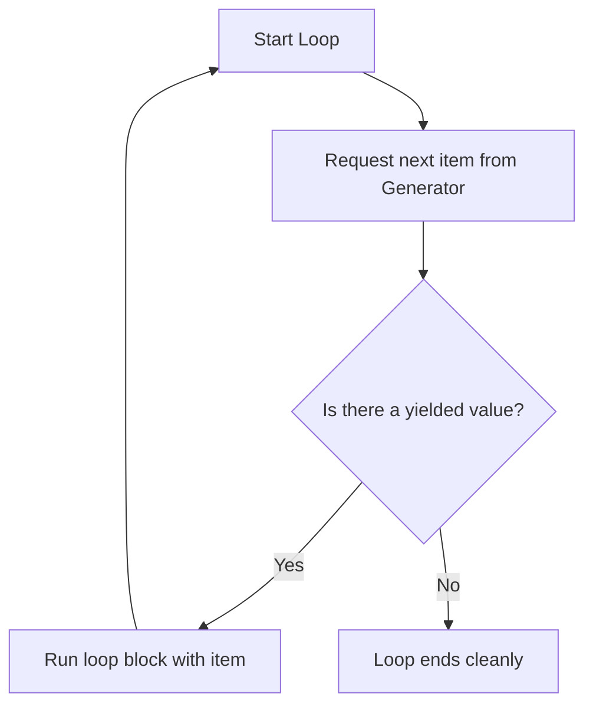

# Generating Values with generators

When automating audits or processing data, you will often deal with large inputs. This could be a web access log file containing millions of rows, or a database index of millions of server checks. If you read all these rows into a list at once, your script will use gigabytes of memory and might crash the server. In Python, you can process large data sets memory-efficiently using generators.

In this guide, we will look at how generators work. We will learn about the `yield` statement, compare lists against iterators, and write a memory-efficient log line parser.

## What is a Generator?

A generator is a function that returns an iterator object. Instead of calculating all values at once and returning them as a list, a generator yields values one by one on demand. When a generator function runs into a `yield` statement, it pauses execution, returns the value, and remembers its state so it can continue from the exact same line next time.

Let's compare standard lists and generators.

| Feature | Standard Lists | Generator Iterators |
| :--- | :--- | :--- |
| **Creation Keyword**| `return` (returns final list) | `yield` (yields values one-by-one) |
| **Evaluation Model** | Eager (Calculates everything immediately) | Lazy (Calculates next item only when asked) |
| **Memory Usage** | High (RAM usage scales with list size) | Low (Uses minimal RAM regardless of data size) |
| **Speed** | Fast for small lists | Fast starting speed (No initial build wait) |
| **Iterate Twice?** | Yes (List remains in memory) | No (Generator is exhausted after one pass) |

Here is a diagram showing how the generator yields values to a loop on-demand instead of loading them all at once:



## Using Yield to Generate Values

Let's write a simple generator function that counts down.

Create a file named `generator_basics.py` and write the code below.

```python
# A generator function uses 'yield' instead of 'return'
def count_down(start):
    print("Generator starting...")
    while start > 0:
        yield start
        start -= 1
    print("Generator finished.")

# Get the generator iterator object
counter = count_down(3)
print("Generator object created: " + str(counter))

# Iterate through the generator
for num in counter:
    print("Received: " + str(num))
```

Run this file in your terminal.

```bash
python3 generator_basics.py
```

Expected output:
```text
Generator object created: <generator object count_down at 0x7ffd>
Generator starting...
Received: 3
Received: 2
Received: 1
Generator finished.
```

## Real-World Example: Memory-Safe Log Parser

Let's write a script that processes a massive simulated web server access log. If this file was 5 GB in size, reading it using `.readlines()` would crash the server. By using a generator, we read and yield the file line-by-line. This keeps our script's memory utilization under 5 MB, no matter how large the log file is.

Create a file named `log_generator.py` and write the code below.

```python
import os

# Create a test log file containing dummy logs
log_file_path = "app_activity.log"
with open(log_file_path, "w") as f:
    f.write("INFO | User dashboard load\n")
    f.write("ERROR | Database connection loss\n")
    f.write("INFO | Static asset loaded\n")
    f.write("ERROR | API connection timeout\n")

def read_log_lines(path):
    """Memory-safe generator that yields lines from a file."""
    if not os.path.exists(path):
        return
        
    with open(path, "r") as file:
        for line in file:
            # Yield the line, pausing execution here until next iteration
            yield line.strip()

print("=== Scanning Log Streams Safely ===")

# Initialize the generator
log_stream = read_log_lines(log_file_path)

# Process only lines that contain "ERROR"
for log in log_stream:
    if "ERROR" in log:
        print("Found Failure: " + log)

print("Scan complete.")
```

Run the script.

```bash
python3 log_generator.py
```

Expected output:
```text
=== Scanning Log Streams Safely ===
Found Failure: ERROR | Database connection loss
Found Failure: ERROR | API connection timeout
Scan complete.
```

## Common Mistakes

### Trying to Reuse an Exhausted Generator
A generator can only be iterated over once. Once it finishes yielding its last value, it becomes exhausted. If you try to loop over it a second time, it will return nothing.

* **The Bad Way:**
```python
def get_numbers():
    yield 1
    yield 2

num_gen = get_numbers()
print(list(num_gen)) # Prints [1, 2]

# Trying to loop again on same generator object
for n in num_gen:
    print(n) # Prints nothing! Generator is empty.
```

* **The Good Way:**
If you need to iterate again, call the generator function to create a fresh generator object.
```python
num_gen = get_numbers()
print(list(num_gen))

# Create a new generator instance
new_gen = get_numbers()
for n in new_gen:
    print(n)
```

### Confusing the Generator Object with Its Output
If you print the generator object, you will see its memory address details, not the values inside it. You must loop over it or convert it to a list to see its values.

* **The Bad Way:**
```python
def my_gen():
    yield "a"

# This prints: <generator object my_gen at 0x7...>
print(my_gen())
```

* **The Good Way:**
```python
# Convert to list or loop
print(list(my_gen())) # Prints ['a']
```

## Summary

* Generators are functions that return an iterator, yielding values one by one on-demand.
* You create a generator by using the `yield` keyword instead of `return`.
* The generator pauses its state at the `yield` line and resumes from there next time.
* Generators are memory-efficient because they do not load the entire collection into memory at once.
* Use generators when processing large text files, database queries, or logs.
* A generator object can only be iterated over once; it is then exhausted.
* Printing a generator prints its object details, not its yielded values.
* Iterate through generator values using `for` loops or the `next()` function.
* Generator expressions use parentheses `()` and provide single-line generator mapping.
* Stream-processing large files with generators keeps server memory usage minimal.
