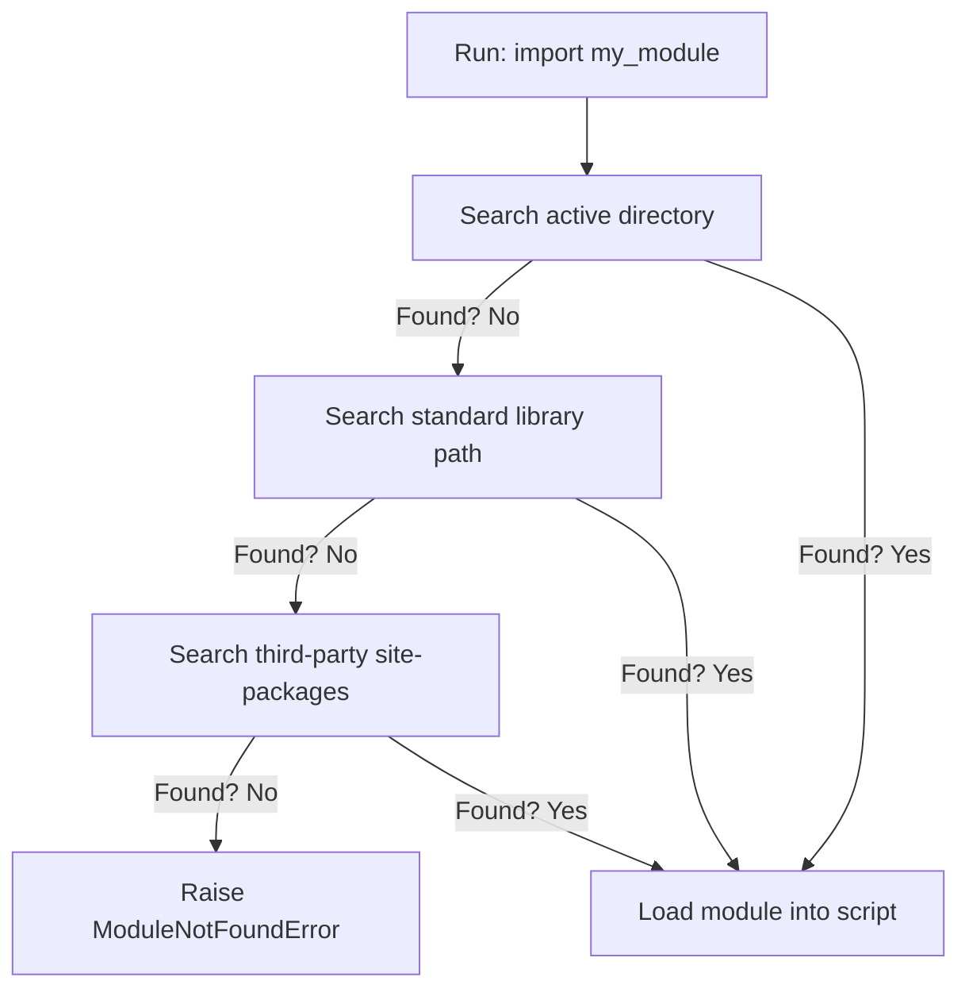

# Importing Modules

As you write larger scripts, you will find that keeping all your code in a single file makes it hard to manage. To solve this, Python lets you split your code into separate files called modules. You can load these modules into your scripts using the `import` statement, allowing you to share code across multiple projects and load built-in features.

In this guide, we will learn how to import modules in Python. We will look at namespace management, using aliases, and resolving import errors.

## What is a Module?

A module is simply a Python file containing code (functions, variables, or classes) that you want to reuse. You load a module by writing `import` followed by the file name (without the `.py` extension).

Let's compare different ways to import code in Python.

| Import Syntax | Example | Namespace Impact | Best Use Case |
| :--- | :--- | :--- | :--- |
| **`import module`** | `import os` | Keeps names under module namespace (`os.path`) | Standard choice, prevents name clashes |
| **`from module import name`** | `from time import sleep`| Loads name directly into local scope (`sleep`) | When calling a specific function many times |
| **`import module as alias`** | `import datetime as dt`| Renames module locally for convenience (`dt.now`)| Shortening long module names |
| **`from module import *`** | `from math import *` | Clutters local scope with all names (Dangerous) | Avoid this in production code |

Here is a diagram showing how Python searches for a module when you run the import command:



## Basic Module Imports

Let's look at how to import built-in modules to check system stats.

Create a file named `import_basics.py` and write the code below.

```python
# Import the sys and platform modules
import sys
import platform

# Use functions under the module namespaces
os_name = platform.system()
python_bin = sys.executable

print("Operating System: " + os_name)
print("Python Executable: " + python_bin)
```

Run this file in your terminal.

```bash
python3 import_basics.py
```

Expected output:
```text
Operating System: Windows
Python Executable: C:\Users\patel\AppData\Local\Programs\Python\Python310\python.exe
```

## Using Import Aliases

If a module name is very long or if you want to prevent a name clash with an existing variable, you can rename the module locally using the `as` keyword.

```python
# Import the time module with an alias 't'
import time as t

print("Starting task delay...")
# Call functions using the alias name
t.sleep(1.5)
print("Task finished.")
```

Run the script.

```bash
python3 import_alias.py
```

Expected output:
```text
Starting task delay...
Task finished.
```

## Real-World Example: Server Performance Timer

Let's write a script that measures the response time of a task using functions from the `time` and `random` modules. We will use the `from time import time` syntax to load only the specific timer function we need.

Create a file named `benchmark.py` and write the code below.

```python
# Import only the time function from time, and the entire random module
from time import time
import random

def run_performance_test():
    print("=== System Latency Test ===")
    
    # Capture start epoch timestamp
    start = time()
    
    # Simulate work with a random delay between 0.5 and 2.0 seconds
    delay = random.uniform(0.5, 2.0)
    print(f" Simulating database latency of {delay:.2f} seconds...")
    
    # Wait for the delay duration
    # We must call random's time helper function or standard time
    import time as system_time
    system_time.sleep(delay)
    
    # Capture end timestamp
    end = time()
    duration = end - start
    
    print(f"✅ Finished: Transaction completed in {duration:.2f} seconds.")

run_performance_test()
```

Run the script.

```bash
python3 benchmark.py
```

Expected output:
```text
=== System Latency Test ===
 Simulating database latency of 1.42 seconds...
✅ Finished: Transaction completed in 1.42 seconds.
```

## Common Mistakes

### Shadowing Library Names (File Name Clashes)
If you name your script file the same as a library you are trying to import (for example, naming your file `time.py` or `random.py`), Python will import your script instead of the official library. This causes name lookup crashes.

* **The Bad Way:**
Create a file named `time.py` containing:
```python
import time
# This causes an AttributeError because Python imports this file itself,
# which has no sleep function!
time.sleep(1)
```

* **The Good Way:**
Never name your script files the same as standard Python libraries. Use descriptive names like `time_checker.py` or `duration_test.py`.

### Using Wildcard Imports (from module import *)
Using the asterisk `*` to import everything from a module clutters your local namespace. It makes it hard to see where variables come from, and can silently overwrite your existing function names.

* **The Bad Way:**
```python
# Avoid this style
from math import *
from my_custom_lib import *
# It is hard to know which library this function belongs to!
result = calculate_value(10)
```

* **The Good Way:**
Import the module name explicitly.
```python
import math
import my_custom_lib

result = my_custom_lib.calculate_value(10)
```

## Summary

* Modules are Python files that contain code meant to be shared and reused.
* Use the `import` statement to load a module into your active script.
* Access module code using its namespace name (e.g. `module.function()`).
* Use `from module import name` to load specific names directly into your namespace.
* Rename modules locally using `as` to shorten long names or prevent clashes.
* Avoid naming your script files the same as standard Python libraries.
* Do not use wildcard imports (`from module import *`) in your production files.
* Python searches for modules in the current directory, standard libraries, and site-packages.
* The `platform` module helps you write scripts that run on both Linux and Windows.
* Splitting automation workflows into modules makes your codebase cleaner.
