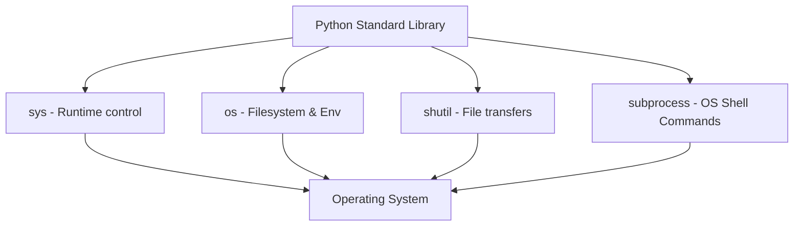

# Using the Standard Library

One of Python's greatest strengths is its "batteries included" philosophy. This means Python comes pre-installed with a large collection of built-in modules called the standard library. As a developer, you can perform tasks like running shell commands, copying files, parsing JSON data, and formatting dates without installing any third-party packages.

In this guide, we will look at the most useful standard library modules for managing systems. We will compare their features, write files copy scripts, and parse JSON configs.

## Essential System Modules

Python's standard library has specific modules designed for system tasks.

Let's look at a summary of the most useful modules for system automation.

| Module | What it is Used For | Key Functions | DevOps Use Case |
| :--- | :--- | :--- | :--- |
| **`os`** | File system and environment keys | `os.mkdir`, `os.environ`, `os.path` | Checking folders and env variables |
| **`sys`** | Python runtime variables | `sys.exit`, `sys.argv`, `sys.executable` | Reading terminal flags, setting exit codes |
| **`shutil`** | High-level file operations | `shutil.copy`, `shutil.disk_usage` | Copying backup archives, checking space |
| **`subprocess`**| Running terminal commands | `subprocess.run` | Running git commands or checking network |
| **`json`** | Parsing JSON data | `json.loads`, `json.dumps` | Parsing config payloads from web APIs |
| **`datetime`** | Date and time calculations | `datetime.now`, `strftime` | Formatting file names with timestamps |

Here is a diagram showing how these standard modules integrate with the operating system:



## Reading Environment Variables and System Information

Let's look at how to use `os` and `sys` to audit runtime environment variables.

Create a file named `sys_audit.py` and write the code below.

```python
import os
import sys

print("=== System Details ===")
print("Python Path: " + sys.executable)
print("Arguments passed: " + str(sys.argv))

# Reading environment variables
# Use os.environ.get to prevent crashes if key is missing
user_home = os.environ.get("USERPROFILE") or os.environ.get("HOME")
print("User Home Directory: " + str(user_home))
```

Run this file in your terminal.

```bash
python3 sys_audit.py test_flag
```

Expected output:
```text
=== System Details ===
Python Path: C:\Users\patel\AppData\Local\Programs\Python\Python310\python.exe
Arguments passed: ['sys_audit.py', 'test_flag']
User Home Directory: C:\Users\patel
```

## Copying Files and checking Disk Space

You can use the `shutil` module to perform high-level file system tasks, like copy operations or checking hard drive usage statistics.

```python
import shutil

# Check disk space usage
usage = shutil.disk_usage(".")
free_gb = usage.free / (2**30)

print(f"Free space in current directory: {free_gb:.2f} GB")

# Create a dummy backup copy
# shutil.copy(source, destination)
with open("source.txt", "w") as f:
    f.write("System config data")
    
shutil.copy("source.txt", "backup_copy.txt")
print("File backup copy created successfully.")
```

Run the script.

```bash
python3 file_ops.py
```

Expected output:
```text
Free space in current directory: 84.52 GB
File backup copy created successfully.
```

## Real-World Example: Timestamped JSON Backup Writer

Let's write a script that packages configuration details into a JSON file, adds a formatted date timestamp to the filename, and saves it. This is a common pattern for backing up system states before running updates.

Create a file named `state_backup.py` and write the code below.

```python
import json
from datetime import datetime

# Server states config metadata
system_state = {
    "version": "v1.2.0",
    "status": "healthy",
    "nodes_count": 3,
    "last_sync": "2026-06-25"
}

def create_json_backup(state):
    print("=== Creating System State Backup ===")
    
    # 1. Format current timestamp
    # Output format: 20260625-084530
    timestamp = datetime.now().strftime("%Y%m%d-%H%M%S")
    backup_filename = f"backup-state-{timestamp}.json"
    
    # 2. Serialize dict to JSON string and write to file
    with open(backup_filename, "w") as file:
        json.dump(state, file, indent=4)
        
    print(f"✅ Success: State saved to: {backup_filename}")

create_json_backup(system_state)
```

Run the script.

```bash
python3 state_backup.py
```

Expected output:
```text
=== Creating System State Backup ===
✅ Success: State saved to: backup-state-20260625-084530.json
```

## Common Mistakes

### Using os.system to Run Shell Commands
The `os.system()` function is outdated and insecure. It runs commands in a subshell, making it hard to capture output and exposing your script to security bugs. Always use `subprocess.run()`.

* **The Bad Way:**
```python
import os
# Outdated: Cannot capture output easily
os.system("ping 127.0.0.1")
```

* **The Good Way:**
```python
import subprocess
# Modern: Safely runs command and captures output
result = subprocess.run(["ping", "127.0.0.1"], capture_output=True, text=True)
print(result.stdout)
```

### Manually Building JSON Strings
Never try to format JSON strings manually using string concatenation. It is easy to make a formatting mistake, resulting in invalid JSON data. Always use the built-in `json` module.

* **The Bad Way:**
```python
host = "10.0.0.1"
# Fragile string manipulation
json_payload = '{"host": "' + host + '"}'
```

* **The Good Way:**
```python
import json
payload = {"host": "10.0.0.1"}
# Clean and automatically checks syntax
json_payload = json.dumps(payload)
```

## Summary

* Python's standard library provides a rich set of built-in modules for managing systems.
* Use `os` to check file paths, list folders, and read environment variables.
* Use `sys` to read terminal argument inputs and manage exit codes.
* Use `shutil` for high-level directory copying and checking disk space limits.
* Use `subprocess` to run shell commands safely and capture their outputs.
* Use `json` to parse and build configuration text payloads.
* Use `datetime` to calculate time differences and format timestamps for logs.
* Avoid using the outdated `os.system()` function; use `subprocess.run()` instead.
* Never build JSON strings manually; serialize dictionaries using `json.dump()`.
* Leveraging standard libraries ensures your scripts run anywhere Python is installed.
