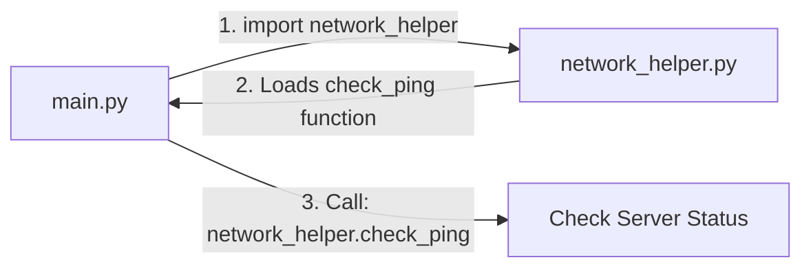

# Creating Custom Modules

When you write scripts, you will find yourself reuse the same functions across different automation tasks. Instead of copying and pasting code, you can save your helper functions in a separate `.py` file and import it as a custom module. This helps you keep your codebase organized, clean, and easy to maintain.

In this guide, we will learn how to create and import custom local modules. We will look at namespace safety, preventing automatic execution, and structuring helper scripts.

## How Local Imports Work

Any Python file you create in your project directory can be imported as a module by another script in the same directory. When you run `import my_helpers`, Python looks for a file named `my_helpers.py` in the current folder and loads its functions.

Let's compare the code inside a module against the code in your main execution script.

| File Type | Purpose | Contains | Executable on Import? |
| :--- | :--- | :--- | :--- |
| **Custom Module** | Stores reusable helper logic | Focused function definitions, constants | Only defined structures are loaded |
| **Main Script** | Coordinates the execution flow | Calls to modules, script controllers | Runs code line-by-line |

Here is a diagram showing how a main script imports a custom network helper module:



## Creating Your Helper Module

Let's write a custom module named `network_helper.py` that contains functions to build URL connection strings and check statuses.

Create a file named `network_helper.py` and write the code below.

```python
# network_helper.py

# A module constant
DEFAULT_TIMEOUT = 10

def build_url(host, port):
    """Formats a host and port into a standard web URL."""
    return f"http://{host}:{port}/health"

def test_ping(host):
    """Simulates checking connectivity to a host."""
    print(f"  [Ping] Sending packet to: {host}...")
    return True
```

Run this file directly.
No output is displayed on the screen because the file only defines constants and functions, but does not run any action commands.

## Importing Your Custom Module

Now, let's write a main script in the same directory that imports `network_helper.py` and calls its functions.

Create a file named `main_app.py` and write the code below.

```python
# main_app.py
import network_helper

print("=== Starting Network Diagnostics ===")

# Read the module constant
timeout = network_helper.DEFAULT_TIMEOUT
print("Configured Timeout limit: " + str(timeout))

# Call the module functions
target_url = network_helper.build_url("192.168.1.15", 8080)
print("Resolved Target Path: " + target_url)

ping_ok = network_helper.test_ping("192.168.1.15")
print("Ping status: " + str(ping_ok))
```

Run this script in your terminal.

```bash
python3 main_app.py
```

Expected output:
```text
=== Starting Network Diagnostics ===
Configured Timeout limit: 10
Resolved Target Path: http://192.168.1.15:8080/health
  [Ping] Sending packet to: 192.168.1.15...
Ping status: True
```

## Real-World Example: Custom Disk Space Auditor

Let's build a custom module that handles disk audits, and call it from a scheduler runner script. This keeps our main script short and focused.

### 1. Create the Module File (`disk_auditor.py`)
```python
# disk_auditor.py
import shutil

def get_disk_health(path="/"):
    """Calculates disk free percentage."""
    usage = shutil.disk_usage(path)
    percent_free = (usage.free / usage.total) * 100
    
    # Return healthy state if free space is over 20%
    is_healthy = percent_free > 20.0
    return is_healthy, percent_free
```

### 2. Create the Runner File (`run_audit.py`)
```python
# run_audit.py
import disk_auditor

print("Checking primary server storage...")

# Call the helper module
healthy, space_left = disk_auditor.get_disk_health()

print(f"Free Storage Space: {space_left:.1f}%")

if not healthy:
    print(" ❌ CRITICAL: Low storage space! Trigger log cleaning task.")
else:
    print(" ✅ SUCCESS: Storage space is healthy.")
```

Run the script.

```bash
python3 run_audit.py
```

Expected output:
```text
Checking primary server storage...
Free Storage Space: 84.5%
 ✅ SUCCESS: Storage space is healthy.
```

## Common Mistakes

### Running Test Code Automatically on Import
If you write test commands in the global scope of your module (outside functions), Python will run those commands automatically when another file imports your module. You should wrap test commands inside an `if __name__ == "__main__":` block so they only run when the module file is executed directly.

* **The Bad Way:**
```python
# network_helper.py
def build_url(host, port):
    return f"http://{host}:{port}/health"

# This runs every time another file imports network_helper!
print(build_url("test-host", 80))
```

* **The Good Way:**
```python
# network_helper.py
def build_url(host, port):
    return f"http://{host}:{port}/health"

# This runs ONLY when network_helper.py is run directly
if __name__ == "__main__":
    print("Running local module self-test...")
    print(build_url("test-host", 80))
```

### Circular Dependency Imports
If `module_a` tries to import `module_b`, and `module_b` tries to import `module_a`, Python will get stuck and crash with an `ImportError`.

* **The Bad Way:**
Designing scripts that require two-way imports.

* **The Good Way:**
Keep your module dependencies flowing in one direction. Move shared functions to a third `common.py` module that both `module_a` and `module_b` can import without cycles.

## Summary

* Creating a custom module is as simple as saving Python code in a `.py` file.
* Import custom local modules using the file name without the `.py` extension.
* Keep module files focused on function definitions and constants.
* Wrap test commands inside `if __name__ == "__main__":` blocks to block automatic execution on import.
* Python imports files from the active directory first.
* Avoid circular dependencies where two modules try to import each other.
* Move shared functions to a common helper module to break import cycles.
* Custom modules allow you to write dry code (Don't Repeat Yourself).
* Separating script logic makes it easy to update helper files independently.
* Custom modules keep your orchestration scripts clean and easy to read.
