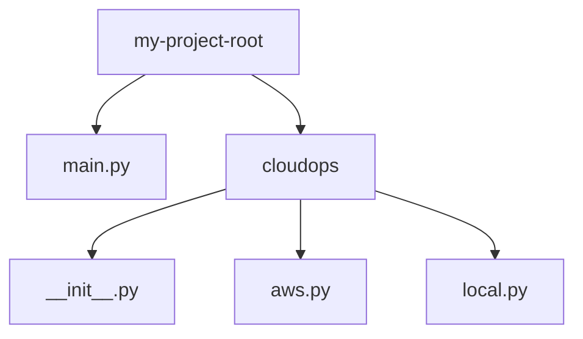

# Creating Packages

As your automation scripts grow, you will find that a flat list of module files in your project folder becomes cluttered. To keep your codebase organized, you can group related modules into directories. In Python, a directory containing multiple module files is called a package. Packages allow you to structure your code using namespaces (like `my_package.module`).

In this guide, we will look at how to build and use packages. We will learn about the role of the initialization file, import syntaxes, and package structure.

## What is a Package?

A package is simply a directory that holds Python modules. To tell Python that a directory should be treated as a package, you place a special file named `__init__.py` inside that folder. Even if `__init__.py` is completely empty, its presence is required (especially on older Python versions) to make the package importable.

Let's compare modules and packages.

| Feature | Module | Package |
| :--- | :--- | :--- |
| **Structure** | A single `.py` file | A directory containing `.py` files and `__init__.py` |
| **Import Syntax** | `import my_module` | `import my_package.my_module` |
| **Code Hierarchy** | Flat (Functions grouped in a file) | Nested (Modules grouped in a directory) |
| **Best Use Case** | Small projects with few helper functions | Large tool suites with distinct categories of tasks |

Here is a diagram showing the directory layout of a custom infrastructure automation package:



## Creating Your First Package

Let's build a package named `cloudops` that contains two modules: `aws.py` for cloud tasks and `local.py` for local server tasks.

### Step 1: Create the directory structure
Create a directory named `cloudops` in your project folder. Inside `cloudops`, create an empty file named `__init__.py`.

### Step 2: Create the submodules
Create `cloudops/aws.py` and write the code below.

```python
# cloudops/aws.py
def deploy_instance(name):
    print(f"  [AWS] Deploying EC2 server profile: {name}...")
    return "i-05fd221876ab3"
```

Create `cloudops/local.py` and write the code below.

```python
# cloudops/local.py
def check_temp_files():
    print("  [Local] Scanning temporary logs directory...")
    return 12 # Found 12 temporary files
```

## Importing Modules from a Package

Now, let's write a main script in the root directory that imports modules from our new `cloudops` package.

Create a file named `deploy_tool.py` and write the code below.

```python
# deploy_tool.py
# Import specific submodules from the package
from cloudops import aws
from cloudops import local

print("=== Starting CloudOps Operations ===")

# Run local checks first
temp_count = local.check_temp_files()
print(f"Status: Found {temp_count} files requiring cleanup.")

# Run cloud deployment
instance_id = aws.deploy_instance("web-server-prod")
print("Deployment completed. Instance ID: " + instance_id)
```

Run this file in your terminal.

```bash
python3 deploy_tool.py
```

Expected output:
```text
=== Starting CloudOps Operations ===
  [Local] Scanning temporary logs directory...
Status: Found 12 files requiring cleanup.
  [AWS] Deploying EC2 server profile: web-server-prod...
Deployment completed. Instance ID: i-05fd221876ab3
```

## Real-World Example: Package-Level Configuration

You can use the `__init__.py` file to perform package initialization tasks or expose clean shortcut imports. If you import submodules in `__init__.py`, callers can access them directly from the package name instead of writing deep import paths.

### 1. Update `cloudops/__init__.py`
```python
# cloudops/__init__.py
print("[Package] Initializing cloudops package framework...")

# Expose functions as package shortcuts
from cloudops.aws import deploy_instance
from cloudops.local import check_temp_files
```

### 2. Create the Shortcut script (`fast_deploy.py`)
```python
# fast_deploy.py
# Import shortcuts directly from the package namespace
import cloudops

print("Triggering quick deployment task...")
# Call functions directly from 'cloudops'
count = cloudops.check_temp_files()
inst = cloudops.deploy_instance("quick-node")

print(f"Check count: {count} | Node: {inst}")
```

Run the script.

```bash
python3 fast_deploy.py
```

Expected output:
```text
Triggering quick deployment task...
[Package] Initializing cloudops package framework...
  [Local] Scanning temporary logs directory...
  [AWS] Deploying EC2 server profile: quick-node...
Check count: 12 | Node: i-05fd221876ab3
```

## Common Mistakes

### Missing `__init__.py` Files
While Python 3.3+ supports "namespace packages" without `__init__.py`, omitting this file is a bad practice. It can cause imports to fail on older Python runtimes or make it hard for testing frameworks and tools to recognize your directories.

* **The Bad Way:**
Leaving package directories containing only module files without an `__init__.py`.

* **The Good Way:**
Always place an empty `__init__.py` in every package directory you create to declare it explicitly.

### Using Absolute Imports Incorrectly inside Submodules
If a submodule inside a package wants to import another module from the same package, hardcoding absolute paths can break if you rename the package. Use relative imports (using the dot `.` syntax) instead.

* **The Bad Way:**
```python
# inside cloudops/local.py
# This breaks if the parent package 'cloudops' is renamed to 'ops_tool'
import cloudops.aws as aws
```

* **The Good Way:**
```python
# inside cloudops/local.py
# The dot means 'import from the current package'
from . import aws
```

## Summary

* A package is a directory containing Python modules and a special `__init__.py` file.
* The presence of `__init__.py` marks the directory as an importable package.
* Import package submodules using the dot syntax (e.g. `from package import submodule`).
* `__init__.py` runs automatically when the package is imported.
* Expose function shortcuts in `__init__.py` to simplify import paths for users.
* Use relative imports (e.g. `from . import module`) to link submodules within a package.
* Namespace packages are supported in Python 3.3+ but omitting `__init__.py` is discouraged.
* Packages help you structure large system utilities into clear directories.
* Standardizing package structures makes sharing tools with your team easy.
* Good package namespaces prevent variable and function name collisions across scripts.
