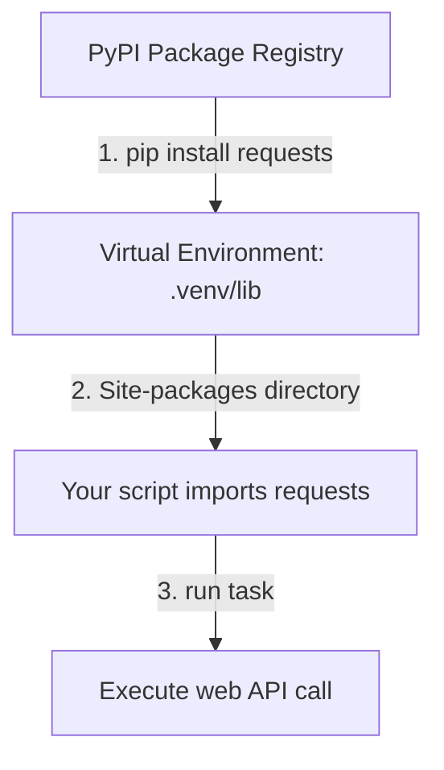

# Using Third Party Packages

While Python's standard library has many useful modules, you will eventually need features that are not built-in. This includes connecting to cloud services (AWS, Azure), talking to databases, or sending API requests. Other developers have already written packages for these tasks. You can download and install these third-party packages using the `pip` tool.

In this guide, we will look at how to download, manage, and use third-party packages. We will write code to request web data and learn how to track project dependencies.

## Standard Library vs Third-Party Packages

Before installing anything, it helps to understand the difference between built-in tools and downloaded tools.

Let's compare standard libraries and third-party packages.

| Feature | Standard Library | Third-Party Packages |
| :--- | :--- | :--- |
| **Installation** | None (Pre-installed with Python) | Required (Installed using `pip`) |
| **Source** | Python Software Foundation | Public PyPI registry (PyPI.org) |
| **Examples** | `os`, `sys`, `json`, `datetime` | `requests`, `boto3`, `pyyaml` |
| **Updating** | Tied to your Python version | Can be updated independently at any time |
| **DevOps Use Case** | Basic file operations, shell runs | Cloud management, API alerts, database connections |

Here is a diagram showing how a third-party package is installed and imported in your workspace:



## Installing and importing requests

One of the most popular third-party libraries in Python is `requests`. It is used to make HTTP requests cleanly, replacing Python's verbose built-in `urllib` library.

First, make sure your virtual environment is active and install `requests`:

```bash
pip install requests
```

Expected output:
```text
Collecting requests
  Downloading requests-2.31.0-py3-none-any.whl (62 kB)
Installing collected packages: requests
Successfully installed requests-2.31.0
```

Now, let's write a script that imports `requests` to test if a website is online.

Create a file named `web_test.py` and write the code below.

```python
# Import the third-party requests module
import requests

url = "https://httpbin.org/get"

print("Sending HTTP GET request using requests library...")

try:
    response = requests.get(url, timeout=5)
    
    # Check status code
    print(f"Response status code: {response.status_code}")
    
    # Read headers
    content_type = response.headers.get("Content-Type")
    print(f"Content Type received: {content_type}")
    
except requests.exceptions.RequestException as error:
    print(" ❌ Connection failed: " + str(error))
```

Run this file in your terminal.

```bash
python3 web_test.py
```

Expected output:
```text
Sending HTTP GET request using requests library...
Response status code: 200
Content Type received: application/json
```

## Real-World Example: Parsing API Configurations

Let's write a script that calls a mock JSON endpoint, parses the returned data, and checks system configuration parameters.

Create a file named `api_config.py` and write the code below.

```python
import requests

# We use httpbin's JSON generator to simulate a configuration API response
config_url = "https://httpbin.org/json"

def fetch_cluster_configuration():
    print("=== Fetching Cluster Configuration ===")
    
    try:
        response = requests.get(config_url, timeout=10)
        
        # Raise an exception for HTTP errors (like 404 or 500)
        response.raise_for_status()
        
        # Parse JSON directly using requests helper method
        config_data = response.json()
        
        # Read nested keys from the mock response
        slideshow = config_data.get("slideshow", {})
        title = slideshow.get("title", "No Title")
        author = slideshow.get("author", "unknown")
        
        print("✅ Configuration loaded successfully.")
        print(f"  Profile Name: {title}")
        print(f"  Owner:        {author}")
        
    except requests.exceptions.HTTPError as err:
        print(f" ❌ HTTP Error occurred: {err}")
    except requests.exceptions.ConnectionError:
        print(" ❌ Error: Connection lost. Check network status.")
    except Exception as err:
        print(f" ❌ Unexpected error: {err}")

fetch_cluster_configuration()
```

Run the script.

```bash
python3 api_config.py
```

Expected output:
```text
=== Fetching Cluster Configuration ===
✅ Configuration loaded successfully.
  Profile Name: Sample Slide Show
  Owner:        Yours Truly
```

## Common Mistakes

### Shadowing Package Names
Do not name your local project script files the same as the third-party libraries you install. If you name your file `requests.py`, Python will import your script instead of the downloaded library, causing name attribute errors.

* **The Bad Way:**
Create a file named `requests.py` to test the library.

* **The Good Way:**
Use names like `api_test.py` or `ping_request.py` for your local files.

### Mismatched Install vs Import Names
Some libraries are registered on PyPI under one name, but you import them inside your scripts using a different name. This is a common point of confusion for beginners.

* **The Bad Way:**
```python
# You run: pip install pyyaml
# Inside your script:
import pyyaml
# This raises a ModuleNotFoundError!
```

* **The Good Way:**
```python
# You run: pip install pyyaml
# Inside your script, you import the module name 'yaml':
import yaml
```

### Forgetting to Save Dependencies to requirements.txt
If you install a library locally but forget to write it down in your project config, other developers will not be able to run your script.

* **The Bad Way:**
Install packages using `pip install` but leave the `requirements.txt` file empty or out of date.

* **The Good Way:**
Always run `pip freeze > requirements.txt` after installing new packages to update the shared dependency list.

## Summary

* Third-party packages extend Python's features for cloud operations and web tasks.
* Download packages from the public PyPI repository using the `pip` tool.
* Always install third-party libraries inside a virtual environment to prevent system conflicts.
* Use the `requests` library to make clean web API connection calls.
* Use `response.json()` to parse JSON data returned from web servers automatically.
* Check if a library's import name differs from its installation package name.
* Run `pip freeze > requirements.txt` to save a list of your project packages.
* Avoid naming your local files the same as installed library packages.
* Chaining exception handlers like `ConnectionError` prevents script crashes.
* Building automated HTTP audits saves time and alerts teams to outages.
