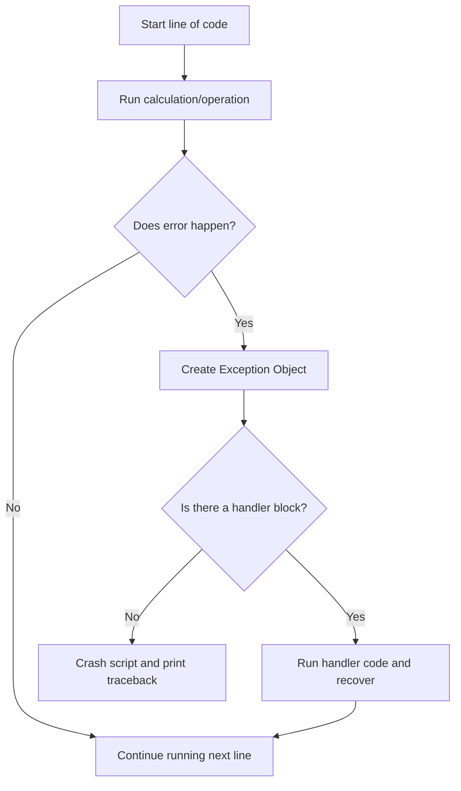

# Understanding Exceptions

When you write scripts, things will eventually go wrong. A server might be offline, a configuration file might be missing, or a user might pass the wrong folder path. In Python, these runtime errors are called exceptions. If your script encounters an exception and you do not handle it, the script will crash and stop running immediately.

In this guide, we will look at how exceptions work in Python. We will learn about common built-in exception types, the difference between syntax errors and exceptions, and how exceptions behave in automation tasks.

## Syntax Errors vs Runtime Exceptions

It is important to separate these two types of errors:
1. **Syntax Errors**: Errors in the structure of your code, like forgetting a colon (`:`) or having mismatched parentheses. Python detects these *before* it runs any code. You cannot catch syntax errors.
2. **Exceptions**: Errors that happen *while* the script is running, even though the syntax is correct. Examples include trying to read a missing file or dividing by zero. You can catch and handle these errors.

Let's look at a comparison of common exceptions you will run into.

| Exception Name | When it Happens | Example Action | DevOps Context |
| :--- | :--- | :--- | :--- |
| **`FileNotFoundError`** | Trying to open a file that does not exist | `open("missing.txt")` | Reading a missing server list file |
| **`ZeroDivisionError`** | Dividing a number by zero | `5 / 0` | Calculating failed request rate when requests are zero |
| **`KeyError`** | Accessing a dictionary key that does not exist | `dict["missing"]` | Reading a missing configuration setting |
| **`IndexError`** | Accessing a list index that is out of range | `list[99]` | Reading server target index when list is empty |
| **`TypeError`** | Mixing incompatible data types | `"port: " + 80` | Joining strings and integers without converting |
| **`ValueError`** | Passing an argument with the wrong value format | `int("letters")` | Parsing a non-numeric port string from env vars |

Here is a diagram showing what happens when a script encounters an exception:



## Triggering Built-In Exceptions

Let's write a script that causes a few standard exceptions so we can see how Python reports them in the terminal.

Create a file named `cause_errors.py` and write the code below.

```python
# 1. Triggering a FileNotFoundError
print("Attempting to open a missing configuration file...")
# This will crash the script instantly
with open("non_existent_config.json", "r") as file:
    content = file.read()
```

Run this file in your terminal.

```bash
python3 cause_errors.py
```

Expected output:
```text
Attempting to open a missing configuration file...
Traceback (most recent call last):
  File "cause_errors.py", line 4, in <module>
    with open("non_existent_config.json", "r") as file:
FileNotFoundError: [Errno 2] No such file or directory: 'non_existent_config.json'
```

Notice that the script printed the `Traceback`, showing the exact line number where the error occurred and the type of exception (`FileNotFoundError`).

## Real-World Example: Port Config Parser

Let's write a script that attempts to read a system port from an environment variable simulator. Since environment data always arrives as string text, we will convert it to an integer. We will inspect how different inputs trigger different exceptions (like `TypeError` vs `ValueError`).

Create a file named `parse_port.py` and write the code below.

```python
# Simulator function representing environment lookup
def get_env_variable(key):
    if key == "PORT":
        return "8080" # Valid integer string
    elif key == "INSECURE_PORT":
        return "port-eighty" # Invalid format string
    elif key == "EMPTY_VAL":
        return None # Missing value
        
print("=== Starting Port Parsing Checks ===")

# Case 1: Valid conversion
port_val = get_env_variable("PORT")
print(f"Loaded raw: {port_val} | Cast: {int(port_val)}")

# Case 2: Causes ValueError
# Uncomment the lines below to see it crash
# port_bad = get_env_variable("INSECURE_PORT")
# print(int(port_bad))

# Case 3: Causes TypeError (trying to cast None)
# Uncomment the lines below to see it crash
# port_none = get_env_variable("EMPTY_VAL")
# print(int(port_none))
```

Run the script.

```bash
python3 parse_port.py
```

Expected output:
```text
=== Starting Port Parsing Checks ===
Loaded raw: 8080 | Cast: 8080
```

## Common Mistakes

### Confusing Syntax Errors with Exceptions
Beginners sometimes try to write error handling blocks to catch syntax errors. This is impossible because Python checks syntax before running the script.

* **The Bad Way:**
```python
try:
    # This syntax error will crash the script during compile,
    # and the try block will never run!
    if true print("Hello")
except Exception:
    print("Caught error")
```

* **The Good Way:**
Fix your code syntax errors in your text editor before executing the file.

### Ignoring Crashes in Production Pipelines
Letting your scripts crash with a full traceback report inside customer production logs looks unprofessional and exposes your internal folder structures.

* **The Bad Way:**
Leaving raw file operations unguarded, allowing scripts to dump stack trace logs when files are missing.

* **The Good Way:**
Always catch known exceptions, print a friendly system message, and exit with a clean exit status code.

## Summary

* Exceptions are errors that happen during script execution, causing immediate crashes if unhandled.
* Syntax errors are checked before running code and cannot be caught using try blocks.
* Python has built-in exceptions for common failures, like `FileNotFoundError` or `KeyError`.
* A `Traceback` shows the history of calls and the exact line number where the script crashed.
* A `ValueError` occurs when you pass a value with the wrong format to a function.
* A `TypeError` occurs when you attempt operations on incompatible data types.
* Reading missing files or directories is the most common cause of exceptions in DevOps.
* Checking variable states before performing calculations prevents exception triggers.
* Understanding exception behaviors allows you to write stable, resilient automation code.
* Proper exit status management ensures deployment pipelines detect script failures accurately.
