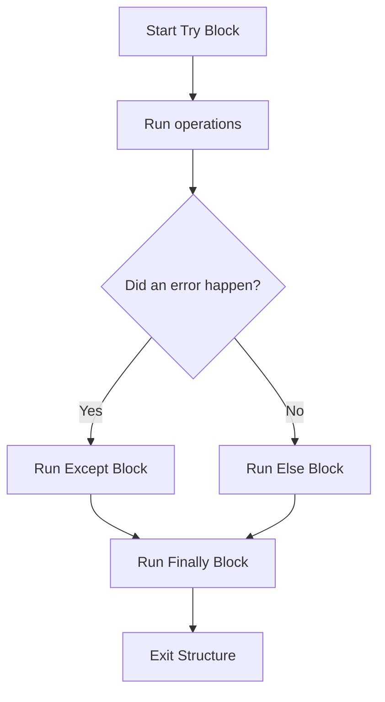

# Handling Errors with try, except, and finally

When you write scripts that interact with databases, web servers, or files, errors will happen. Instead of letting your script crash and leave connections open, you can catch these errors, print friendly warnings, and clean up resources. In Python, you manage this using `try`, `except`, `else`, and `finally` blocks.

In this guide, we will learn how to write error handling blocks. We will break down what each block does, see how they execute, and write a database connection simulator.

## The Error Handling Blocks

Python divides error handling into four separate stages.

Let's look at a comparison of these four blocks.

| Block | Purpose | When does it Run? | Is it Required? |
| :--- | :--- | :--- | :--- |
| **`try`** | Holds code that might cause an error | Always runs first | Yes |
| **`except`** | Handles specific exceptions | Runs only if an error happens inside the `try` block | Yes (Must have at least one) |
| **`else`** | Holds code to run on success | Runs only if NO errors happened inside the `try` block| No |
| **`finally`** | Performs cleanup tasks | Always runs at the end, regardless of errors | No |

Here is a diagram showing the execution path through these blocks:



## Basic Try-Except Syntax

Let's look at how to catch a division error and print a friendly message instead of letting the script crash.

Create a file named `try_basics.py` and write the code below.

```python
failed_jobs = 0

try:
    print("Calculating system success rate...")
    success_rate = 100 / failed_jobs
    print(f"Success rate: {success_rate}%")
except ZeroDivisionError:
    # This block runs only if division by zero occurs
    print(" ⚠️  Warning: Could not calculate success rate because no jobs ran.")
```

Run this file in your terminal.

```bash
python3 try_basics.py
```

Expected output:
```text
Calculating system success rate...
 ⚠️  Warning: Could not calculate success rate because no jobs ran.
```

## Cleaning Up with Finally

When your script opens a file or connects to a network port, it locks that resource. If the script crashes midway, the connection might remain open, locking other scripts out. You use the `finally` block to close files or connections because it is guaranteed to run even if your script crashes.

```python
try:
    print("Opening log file...")
    file = open("sample.log", "r")
    # This raises an exception if the log is empty or corrupted
    data = file.readline()
    print("First line: " + data)
except FileNotFoundError:
    print("Error: Log file not found.")
finally:
    # This always runs, ensuring the file is closed
    print("Cleaning up system resources...")
    # Verify if file was successfully opened before closing
    if 'file' in locals() and not file.closed:
        file.close()
        print("Log file closed safely.")
```

Run the script.

```bash
python3 try_finally.py
```

Expected output:
```text
Opening log file...
Error: Log file not found.
Cleaning up system resources...
```

## Real-World Example: Database Transaction Simulator

Let's write a script that simulates connecting to a database, executing a query, and closing the connection. We will use the `else` block to log successful queries and the `finally` block to make sure the database connection is closed.

Create a file named `db_simulator.py` and write the code below.

```python
# Database connection state simulation
db_is_locked = True

def run_db_query():
    print("=== Starting Database Transaction ===")
    
    try:
        print(" Connecting to database pool...")
        if db_is_locked:
            # Trigger a connection error
            raise ConnectionError("Database is currently locked by a backup job!")
        print(" Running user sync query...")
        
    except ConnectionError as err:
        print(f" ❌ TRANSACTION FAILED: {err}")
        return False
        
    else:
        # Runs only if no exceptions occur
        print(" ✅ Query executed successfully. Writing transaction commits.")
        return True
        
    finally:
        # Always executes, keeping resources clean
        print(" Disconnecting database pool connection...")
        print("=== Transaction Completed ===")

run_db_query()
```

Run the script.

```bash
python3 db_simulator.py
```

Expected output:
```text
=== Starting Database Transaction ===
 Connecting to database pool...
 ❌ TRANSACTION FAILED: Database is currently locked by a backup job!
 Disconnecting database pool connection...
=== Transaction Completed ===
```

## Common Mistakes

### Catching All Exceptions Blindly
If you catch the generic `Exception` class without specifying the error type, you will hide coding syntax errors, making debugging difficult.

* **The Bad Way:**
```python
try:
    # Typo: 'prnt' instead of 'print'
    prnt("Hello")
except Exception:
    # This catches the NameError and prints this message, hiding the typo!
    print("Something went wrong")
```

* **The Good Way:**
Always catch specific exceptions first, and only use general exceptions as a last fallback check.
```python
try:
    print("Hello")
except NameError as err:
    print(f"Syntax/Name Error: {err}")
except Exception as err:
    print(f"Unexpected error: {err}")
```

### Accessing Variables Created Inside Try That Failed
If an exception happens on line 1 of your `try` block, any variables created on line 2 will not exist. Trying to read them in `except` or `finally` will cause another crash.

* **The Bad Way:**
```python
try:
    # This line fails
    open("missing.txt", "r")
    # This line is skipped, so 'conn' is never created
    conn = "database_connection"
except FileNotFoundError:
    # This crashes the script with a NameError because 'conn' doesn't exist!
    print("Failed: " + conn)
```

* **The Good Way:**
Initialize your variables with default values before starting the `try` block.
```python
conn = None
try:
    open("missing.txt", "r")
    conn = "database_connection"
except FileNotFoundError:
    print("Failed. Connection status: " + str(conn))
```

## Summary

* The `try` block holds code that has a risk of failing.
* The `except` block catches and handles specific exceptions.
* The `else` block runs only if no errors occur in the `try` block.
* The `finally` block is guaranteed to run, making it ideal for cleaning up resources.
* Always release files or network connections inside a `finally` block or context manager.
* Avoid catching generic exceptions blindly to prevent hiding syntax typos.
* Initialize variables with default values before entering try blocks.
* Chaining specific except blocks allows you to handle different errors individually.
* Catching connection issues keeps your scripts running when services go offline.
* Safe transaction management prevents script crashes in automated pipelines.
