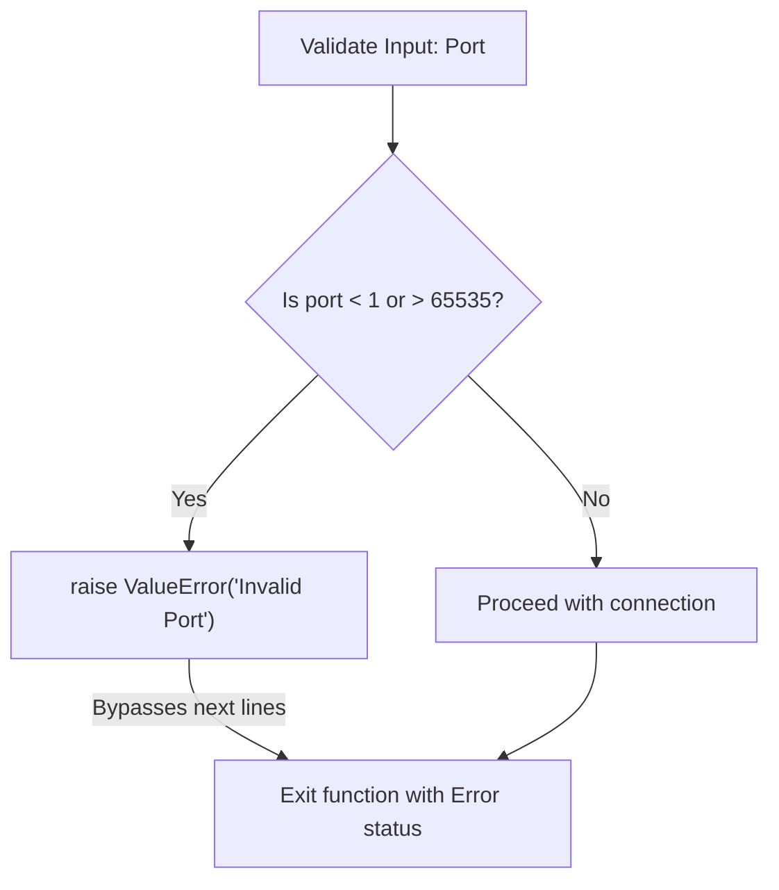

# Triggering Errors with raise

When writing automation scripts, you will occasionally need to trigger an error manually. For example, if a user passes an IP address with the wrong format, or a configuration file contains an invalid port number (like `-80`), Python will not raise an error automatically because the syntax is correct. However, these values will break your systems. You can stop execution and flag these issues by raising exceptions yourself.

In this guide, we will learn how to use the `raise` statement. We will look at validation rules, triggering built-in errors, and writing configuration checks.

## Why Raise Exceptions?

Raising an exception stops the flow of your script immediately and sends an error signal up the call stack. This prevents your code from running commands with corrupted inputs (like trying to deploy to an empty server name).

Let's compare catching exceptions and raising exceptions.

| Action | Catching Exceptions | Raising Exceptions |
| :--- | :--- | :--- |
| **Keyword** | `try` / `except` | `raise` |
| **Direction** | Handles an error coming up the stack | Sends a new error up the stack |
| **Purpose** | Recovers from a failure to keep running | Stops execution when a validation rule is broken |
| **DevOps Context** | Silencing file missing warnings | Aborting deployment if the target IP is blank |

Here is a diagram showing how raising an exception redirects execution:



## Basic Raise Syntax

You raise exceptions by creating an instance of an exception class and passing a helpful description message.

Create a file named `raise_basics.py` and write the code below.

```python
def validate_ip(ip):
    # If the IP doesn't contain dots, it is invalid
    if "." not in ip:
        # Trigger a ValueError manually
        raise ValueError(f"Invalid IP address format: '{ip}'")
    print(f"IP address '{ip}' is valid.")

try:
    print("Testing connection...")
    validate_ip("192.168.1") # Validates fine
    validate_ip("localhost") # Triggers error
except ValueError as error:
    print(" ❌ Validation Failed: " + str(error))
```

Run this file in your terminal.

```bash
python3 raise_basics.py
```

Expected output:
```text
Testing connection...
IP address '192.168.1' is valid.
 ❌ Validation Failed: Invalid IP address format: 'localhost'
```

## Real-World Example: Server Configuration Validator

Let's write a configuration validation script. The validator will check a dictionary of database settings. If the database hostname is blank, or the port is outside the valid range of `1` to `65535`, the script raises specific errors to stop the setup.

Create a file named `validate_config.py` and write the code below.

```python
# Simulated invalid configuration settings
config = {
    "db_host": "db-server-01",
    "db_port": 99999, # Invalid port number!
    "db_user": "admin"
}

def validate_db_settings(settings):
    print("=== Auditing Configuration Profiles ===")
    
    host = settings.get("db_host")
    port = settings.get("db_port")
    
    # 1. Validate hostname
    if not host:
        raise ValueError("Configuration Error: 'db_host' setting cannot be empty!")
        
    # 2. Validate port range
    if port < 1 or port > 65535:
        # Raise value error for out of bounds numbers
        raise ValueError(f"Configuration Error: Port '{port}' is out of range (1 - 65535)!")
        
    print("✅ Configuration is valid. Saving to disk...")
    return True

try:
    validate_db_settings(config)
except ValueError as err:
    print(" ❌ AUDIT SHUTDOWN: " + str(err))
```

Run the script.

```bash
python3 validate_config.py
```

Expected output:
```text
=== Auditing Configuration Profiles ===
 ❌ AUDIT SHUTDOWN: Configuration Error: Port '99999' is out of range (1 - 65535)!
```

## Common Mistakes

### Raising the Base Exception Class
Avoid raising the generic `Exception` class. It makes it difficult for the calling code to catch specific errors and act differently based on the failure type.

* **The Bad Way:**
```python
# Generic exception makes it hard to distinguish error type
raise Exception("Port is invalid")
```

* **The Good Way:**
Use the most specific built-in exception class that matches the error.
```python
# Much better for error routing
raise ValueError("Port is invalid")
```

### Forgetting to Include Description Messages
If you raise an exception without a message, the person reading the error log will not know *why* the script failed.

* **The Bad Way:**
```python
# Hard to debug why this failed in logs
raise FileNotFoundError
```

* **The Good Way:**
```python
# Explains what path caused the issue
raise FileNotFoundError("Could not find baseline inventory file: hosts.txt")
```

## Summary

* The `raise` statement triggers an exception manually when a validation check fails.
* Raising an exception stops the script's execution immediately.
* Use the `raise` keyword followed by an exception object and a descriptive message.
* Raising exceptions prevents your scripts from executing commands with invalid values.
* Always select the most specific built-in exception class that fits the error.
* Include detailed error descriptions to help other developers troubleshoot logs.
* Catch raised exceptions in your calling code using `try-except` blocks to recover.
* Validating ports and IP addresses is a common use case for raising errors.
* Aborting deployments early on validation errors prevents corrupted server states.
* Writing clean validation helper functions keeps your main code reliable.
