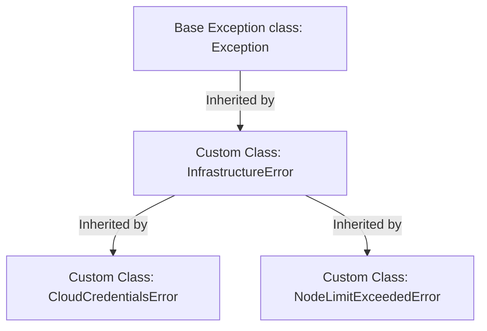

# Creating Custom Exceptions

When building complex automation tools, built-in Python exceptions like `ValueError` or `TypeError` are sometimes too generic. For example, if a deployment fails because a cloud server runs out of IP addresses, raising a `ValueError` does not explain the problem. In Python, you can define your own domain-specific errors by creating custom exception classes.

In this guide, we will learn how to create and use custom exceptions. We will look at class inheritance, defining custom error classes, and writing self-documenting error handlers.

## Why Use Custom Exceptions?

Custom exceptions make your code self-documenting. When another developer reads your code and sees `raise DatabaseConnectionError`, they know exactly what category of problem occurred without parsing the error message string.

Let's compare built-in exceptions with custom exceptions.

| Aspect | Built-in Exceptions | Custom Exceptions |
| :--- | :--- | :--- |
| **Class Source** | Defined in Python's core library | Created by you in your project code |
| **Inheritance** | Inherits directly from `BaseException` | Inherits from Python's base `Exception` class |
| **Granularity** | Generic (e.g. `ValueError`, `RuntimeError`) | Highly specific (e.g. `OutOfIPAddressesError`) |
| **Name Clarity** | General purpose names | Describes a specific failure in your infrastructure |
| **Usage** | Standard syntax and type checks | Complex application frameworks, custom APIs |

Here is a diagram showing the inheritance structure of custom exceptions:



## Defining a Custom Exception Class

To create a custom exception, you define a new class that inherits from the built-in `Exception` class. You can write `pass` inside the class body if you do not need custom initialization logic.

Create a file named `custom_basics.py` and write the code below.

```python
# Define a custom exception class
class ServiceOfflineError(Exception):
    """Raised when a required network service is offline."""
    pass

def check_status(is_up):
    if not is_up:
        # Trigger our custom exception
        raise ServiceOfflineError("The Nginx gateway is offline!")
    print("Gateway status: Online")

try:
    check_status(False)
except ServiceOfflineError as error:
    print(" ❌ Caught Custom Error: " + str(error))
```

Run this file in your terminal.

```bash
python3 custom_basics.py
```

Expected output:
```text
 ❌ Caught Custom Error: The Nginx gateway is offline!
```

## Real-World Example: API Token Validator

Let's write a script that validates API tokens before pushing configurations. We will define two custom exceptions: `InvalidTokenError` for wrong formats, and `ExpiredTokenError` for outdated tokens. This lets us handle credentials failures separately from network timeouts.

Create a file named `token_validator.py` and write the code below.

```python
# 1. Define custom exceptions
class InvalidTokenError(Exception):
    """Raised when the API token string format is invalid."""
    pass

class ExpiredTokenError(Exception):
    """Raised when the API token has expired."""
    pass

def authenticate_api(token, age_days):
    print("Authenticating connection credentials...")
    
    # Check format length
    if len(token) < 16:
        raise InvalidTokenError("Authentication Failed: Token must be at least 16 characters long!")
        
    # Check age limit (e.g., token expires after 30 days)
    if age_days > 30:
        raise ExpiredTokenError(f"Authentication Failed: Token is {age_days} days old (Limit: 30 days)!")
        
    print("✅ Authentication successful.")
    return True

# Test token audit
try:
    # Attempting to log in with an expired token
    authenticate_api("abcdefgh12345678", age_days=45)
except InvalidTokenError as err:
    print(" ❌ Format Error: " + str(err))
except ExpiredTokenError as err:
    print(" ❌ Expiry Alert: " + str(err))
    print("   Action Required: Rotate credential keys in environment variables!")
```

Run the script.

```bash
python3 token_validator.py
```

Expected output:
```text
Authenticating connection credentials...
 ❌ Expiry Alert: Authentication Failed: Token is 45 days old (Limit: 30 days)!
   Action Required: Rotate credential keys in environment variables!
```

## Common Mistakes

### Inheriting from BaseException Instead of Exception
Always inherit your custom classes from `Exception`, not `BaseException`. The `BaseException` class is reserved for system-level exits (like pressing Ctrl+C). If you inherit from it, your custom exception will bypass standard `except Exception:` blocks.

* **The Bad Way:**
```python
# Bypasses standard try-except blocks
class MyError(BaseException):
    pass
```

* **The Good Way:**
```python
# Correct and safe for custom exceptions
class MyError(Exception):
    pass
```

### Creating Too Many Custom Exception Classes
Do not create a new custom exception class for every single error message. If two errors represent the same type of problem (for example, missing a database IP vs missing a database port), use the same exception class and pass different description strings.

* **The Bad Way:**
```python
class DatabaseIpMissingError(Exception): pass
class DatabasePortMissingError(Exception): pass
```

* **The Good Way:**
```python
class DatabaseConfigError(Exception): pass
# Raise same class with clear messages
# raise DatabaseConfigError("Database IP is missing")
```

## Summary

* Custom exceptions allow you to define project-specific error classes.
* Custom exceptions make your codebase self-documenting and easier to read.
* Create a custom exception by inheriting from Python's base `Exception` class.
* Use `pass` inside the class body if you do not need custom parameters.
* Never inherit from `BaseException` as it overrides system interrupts like Ctrl+C.
* Group related failures into a single custom class rather than creating too many classes.
* Catch custom exceptions explicitly to write target response handlers (like rotating keys).
* Custom exception naming should follow standard CamelCase style (e.g. `FileFormatError`).
* Using custom exceptions prevents generic `ValueError` clashes in large frameworks.
* Structuring clear error trees keeps log tracking clean and organized.
