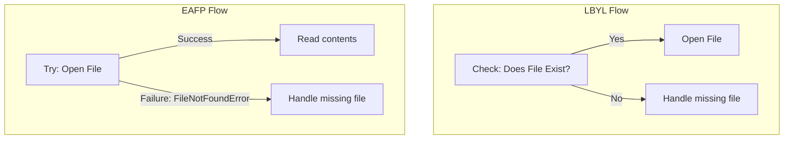

# Error Handling Best Practices

When writing automation scripts, how you handle errors determines how stable your infrastructure is. A poorly written script might fail silently, leaving half-finished configurations on your servers, or it might crash and dump database passwords into public logs. Understanding the industry-standard patterns for managing exceptions ensures your pipelines are safe, readable, and easy to debug.

In this guide, we will look at error handling best practices. We will compare EAFP and LBYL programming styles, discuss log security, and write a robust server auditor.

## LBYL vs EAFP Programming Styles

There are two primary philosophies when dealing with code that might fail:
1. **LBYL (Look Before You Leap)**: You write explicit checks before performing an action (for example, checking if a file exists before trying to open it).
2. **EAFP (Easier to Ask for Forgiveness than Permission)**: You run the action directly inside a `try` block, and catch the error if it fails. This is the standard, preferred style in Python.

Let's compare these two programming styles.

| Style | Syntax Example | Pros | Cons | Python Preference |
| :--- | :--- | :--- | :--- | :--- |
| **LBYL** | `if os.path.exists(f): open(f)` | Straightforward checks | Double operations, race conditions (TOCTOU) | Discouraged for resource checks |
| **EAFP** | `try: open(f) except FileNotFoundError:`| Faster runtime, handles race conditions | Needs clear exception handlers | Strongly Recommended |

Here is a diagram showing the difference in logic flow:



## Comparing LBYL and EAFP Code Patterns

Let's write a script showing both styles.

Create a file named `patterns.py` and write the code below.

```python
import os

target_file = "config_sample.txt"

# 1. The LBYL Way (Look Before You Leap)
print("Running LBYL check...")
if os.path.exists(target_file):
    # What if another process deletes the file right here? (Race condition)
    with open(target_file, "r") as f:
        print(f.read())
else:
    print("  Note: File does not exist (handled via check).")

# 2. The EAFP Way (Easier to Ask Forgiveness)
print("Running EAFP check...")
try:
    with open(target_file, "r") as f:
        print(f.read())
except FileNotFoundError:
    print("  Note: File does not exist (handled via exception).")
```

Run this file in your terminal.

```bash
python3 patterns.py
```

Expected output:
```text
Running LBYL check...
  Note: File does not exist (handled via check).
Running EAFP check...
  Note: File does not exist (handled via exception).
```

## Real-World Example: Safe Server Audit Runner

Let's write a robust audit script that processes a list of nodes. The script must be resilient: if one server config is missing or corrupt, it logs a warning and continues auditing the remaining servers. However, if it runs out of memory or receives a terminal interrupt, it must halt immediately.

Create a file named `resilient_audit.py` and write the code below.

```python
# Simulated server profiles, one of which is corrupt (None)
server_inventory = [
    {"name": "web-01", "cpu": 45},
    None, # Corrupted record
    {"name": "db-01", "cpu": 72}
]

def run_resilient_audit(inventory):
    print("=== Starting Resilient Server Audit ===")
    
    for idx, node in enumerate(inventory):
        try:
            print(f"Auditing node position #{idx}...")
            # This will raise a TypeError if node is None
            name = node["name"]
            cpu = node["cpu"]
            print(f"  Result: Node {name} CPU is {cpu}%")
            
        except TypeError:
            # Handle minor data corruption and keep looping
            print(" ⚠️  WARNING: Skipping corrupted server record at position #" + str(idx))
            continue
            
        except KeyError as err:
            print(f" ⚠️  WARNING: Node profile is missing key: {err}")
            continue
            
        except KeyboardInterrupt:
            # Re-raise terminal interrupts so the user can stop the script
            print("\nAudit halted by user request.")
            raise
            
    print("=== Audit Finished ===")

run_resilient_audit(server_inventory)
```

Run the script.

```bash
python3 resilient_audit.py
```

Expected output:
```text
=== Starting Resilient Server Audit ===
Auditing node position #0...
  Result: Node web-01 CPU is 45%
Auditing node position #1...
 ⚠️  WARNING: Skipping corrupted server record at position #1
Auditing node position #2...
  Result: Node db-01 CPU is 72%
=== Audit Finished ===
```

## Common Mistakes

### Silencing Exceptions Blindly (Swallowing Errors)
Catching an exception and doing nothing (using `pass`) is a dangerous anti-pattern. This hides bugs, making it difficult to find out why your deployments are failing.

* **The Bad Way:**
```python
try:
    run_deployment()
except Exception:
    # Silent failure: script says success but deployment failed!
    pass
```

* **The Good Way:**
If you must catch an error, always write a log message or re-raise it.
```python
try:
    run_deployment()
except Exception as err:
    print(f"Error: Deployment failed: {err}")
    # Exit with failure code
    sys.exit(1)
```

### Logging Sensitive Data inside Exceptions
When printing error details, never log raw connection dictionaries, API keys, or database credentials. If your logs are collected by third-party tools, your secrets will be exposed.

* **The Bad Way:**
```python
# The exception object might contain the database password!
try:
    connect_to_db(user="admin", password="SuperSecretPassword")
except Exception as err:
    print(f"Connection failed details: {err}")
```

* **The Good Way:**
Filter or clean up error logs before printing them.
```python
try:
    connect_to_db(user="admin", password="SuperSecretPassword")
except Exception:
    print("Connection failed: Check database firewall or connection host details.")
```

## Summary

* EAFP (Easier to Ask for Forgiveness than Permission) is the preferred style in Python.
* EAFP prevents race conditions (TOCTOU) by attempting actions directly inside try blocks.
* Never silence exceptions using empty `except: pass` blocks without logging.
* Log clean, friendly error messages to prevent exposing system folder tracebacks.
* Never log sensitive passwords or API keys inside exception logs.
* Always re-raise system-level interrupts (like `KeyboardInterrupt`) so users can exit.
* Use `else` blocks to separate successful code runs from error handling blocks.
* Keep try blocks focused on lines that might fail, rather than wrapping entire scripts.
* Building resilient loops allows your automation to continue on minor node failures.
* Safe exit status management ensures CI/CD tools detect failures correctly.
