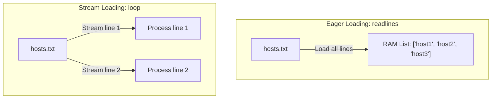

# Reading Files

In system automation, reading files is a daily task. You will need to read server lists, parse application logs, load environment settings, or audit configuration files. Python provides built-in tools to open, read, and parse text files cleanly.

In this guide, we will look at how to read files in Python. We will compare different reading methods, discuss memory utilization, and write a script to load target hostnames.

## Opening and Reading Files

To read a file in Python, you use the built-in `open()` function. By default, `open()` opens files in read-only mode (`"r"`). 

Let's compare different ways to read file data.

| Method | Syntax | Return Type | Memory Impact | Best Use Case |
| :--- | :--- | :--- | :--- | :--- |
| **`.read()`** | `file.read()` | String | High (Loads entire file into RAM) | Small text files |
| **`.readline()`** | `file.readline()` | String | Low (Loads only the next single line) | Parsing files line-by-line |
| **`.readlines()`** | `file.readlines()` | List of strings | High (Loads all lines into a list) | Small files where you need index access |
| **File Loop** | `for line in file:` | Iterated strings | Very Low (Streams line-by-line dynamically) | Large files (logs, big config lists) |

Here is a diagram showing how looping over a file object stream compares to loading all lines into memory:



## Basic File Reading Methods

Let's write a script that reads configuration text using different methods. First, we will create a sample configuration file.

Create a file named `read_demos.py` and write the code below.

```python
# Create a dummy config file for testing
with open("sys_config.txt", "w") as f:
    f.write("environment=production\n")
    f.write("db_connection=active\n")
    f.write("timeout=30\n")

print("=== Reading Entire File ===")
file = open("sys_config.txt", "r")
content = file.read()
print(content)
file.close() # Always close files when not using context managers

print("=== Reading Line by Line ===")
file = open("sys_config.txt", "r")
line1 = file.readline().strip()
line2 = file.readline().strip()
print("Line 1: " + line1)
print("Line 2: " + line2)
file.close()
```

Run this file in your terminal.

```bash
python3 read_demos.py
```

Expected output:
```text
=== Reading Entire File ===
environment=production
db_connection=active
timeout=30

=== Reading Line by Line ===
Line 1: environment=production
Line 2: db_connection=active
```

## Stream Reading Large Files

For large files like web access logs, you should iterate over the file object directly. This streams the file line-by-line, keeping memory usage constant.

```python
# Open the file and stream lines in a loop
file = open("sys_config.txt", "r")

print("Streaming file lines:")
for line in file:
    # Each line contains a newline character at the end; clean it with strip()
    print(" -> Data: " + line.strip())

file.close()
```

Run the script.

```bash
python3 stream_read.py
```

Expected output:
```text
Streaming file lines:
 -> Data: environment=production
 -> Data: db_connection=active
 -> Data: timeout=30
```

## Real-World Example: Server Target Loader

Let's write a script that loads a list of target hostnames from a file named `hosts.txt`. The script will open the file, loop through each line, skip comment lines (starting with `#`) and empty lines, clean up extra spaces, and append the valid hosts to a target list.

Create a file named `load_hosts.py` and write the code below.

```python
# Create a test hosts list
with open("hosts.txt", "w") as f:
    f.write("# Production Server IPs\n")
    f.write("192.168.1.10\n")
    f.write("  \n") # Empty line
    f.write("192.168.1.11\n")
    f.write("# Staging Server\n")
    f.write("192.168.1.50\n")

def load_server_targets(filepath):
    print("=== Loading Target Hostnames ===")
    targets = []
    
    try:
        file = open(filepath, "r")
        for line in file:
            cleaned_line = line.strip()
            
            # Skip empty lines and comment lines
            if not cleaned_line or cleaned_line.startswith("#"):
                continue
                
            targets.append(cleaned_line)
        file.close()
        
    except FileNotFoundError:
        print(f" ❌ ERROR: Target file '{filepath}' was not found!")
        
    return targets

active_targets = load_server_targets("hosts.txt")
print("\nValid Scan Targets Resolved:")
print(active_targets)
```

Run the script.

```bash
python3 load_hosts.py
```

Expected output:
```text
=== Loading Target Hostnames ===

Valid Scan Targets Resolved:
['192.168.1.10', '192.168.1.11', '192.168.1.50']
```

## Common Mistakes

### Forgetting to Close Files
If you open a file but forget to run `.close()`, the operating system keeps a file lock on it. If this happens repeatedly inside loops, your script will eventually run out of system file handles and crash.

* **The Bad Way:**
```python
# File is never closed, locking the resource
file = open("app.log", "r")
data = file.read()
# Missing file.close()
```

* **The Good Way:**
Use the `with` statement, which automatically closes the file even if errors happen inside the block (we will explore context managers in detail in File 4).
```python
with open("app.log", "r") as file:
    data = file.read()
# Closed automatically here!
```

### Reading Huge Files into Memory
Using `.read()` or `.readlines()` on large files (like 1 GB log files) will load the entire dataset into RAM, which can crash low-memory nodes in cloud environments.

* **The Bad Way:**
```python
# Loads 2 GB of logs into RAM
lines = open("huge_access.log").readlines()
```

* **The Good Way:**
```python
# Memory usage remains under 5 MB
for line in open("huge_access.log"):
    process(line)
```

## Summary

* Open files in Python using the built-in `open(path, mode)` function.
* The default mode for `open()` is read-only (`"r"`).
* Always close files using `.close()` if you are not using context managers.
* Use `.read()` to load the entire file content as a single string.
* Use `.readline()` to load only the next single line of text.
* Looping over the file object directly is the most memory-efficient way to parse logs.
* Clean up trailing newlines and spaces using the `.strip()` method.
* Skip comment lines by checking if a string starts with `#`.
* Catch `FileNotFoundError` exceptions to prevent script crashes when loading configs.
* Stream-reading prevents memory exhaustion on lightweight cloud nodes.
