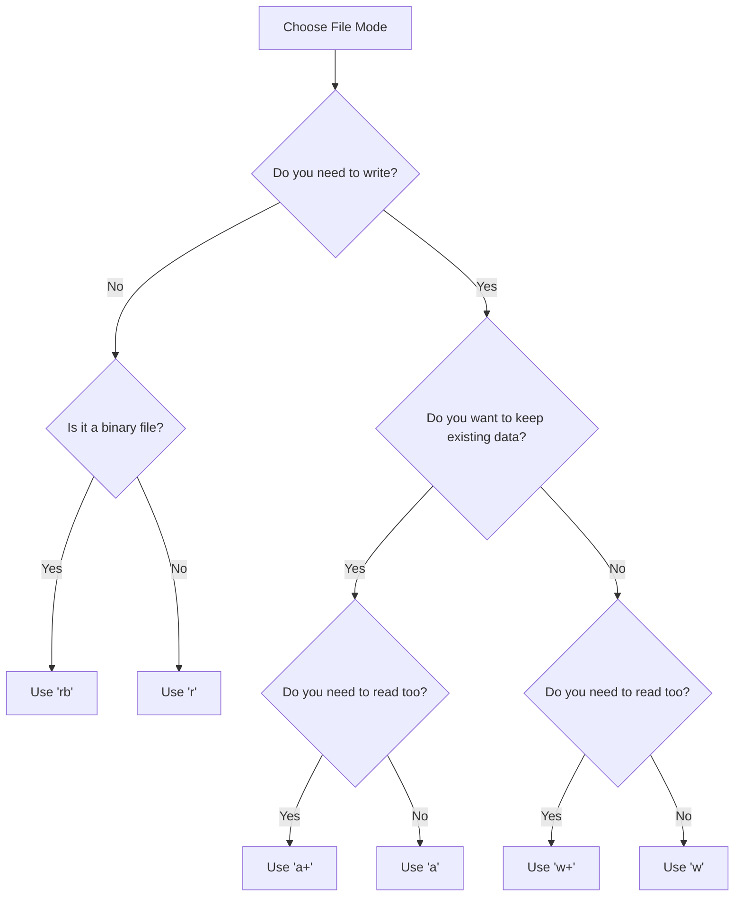

# Understanding File Modes

When opening files in Python, you can specify different file modes depending on what you need to accomplish. You might need to read an image file (binary mode), read and update a configuration file at the same time (update mode), or start writing to a file but fail if it already exists. Python provides multiple file modes to control read, write, and cursor behaviors.

In this guide, we will look at all the available file modes in Python. We will compare their permissions, write update scripts, and look at binary operations.

## The File Mode Options

The file mode is passed as a string as the second parameter to `open()`. For example, `open("config.txt", "r+")`.

Let's compare the different file modes in Python.

| Mode | Name | Read? | Write? | Creates File? | Overwrites? | Use Case |
| :--- | :--- | :--- | :--- | :--- | :--- | :--- |
| **`"r"`** | Read Only | **Yes** | No | No | No | Reading server configs |
| **`"w"`** | Write Only | No | **Yes** | **Yes** | **Yes** | Creating fresh reports |
| **`"a"`** | Append Only | No | **Yes** | **Yes** | No | Writing system logs |
| **`"r+"`**| Read and Write | **Yes** | **Yes** | No | No | Modifying existing files |
| **`"w+"`**| Write and Read | **Yes** | **Yes** | **Yes** | **Yes** | Temporary workspace files |
| **`"a+"`**| Append and Read | **Yes** | **Yes** | **Yes** | No | Reading and logging |
| **`"rb"`**| Read Binary | **Yes** | No | No | No | Reading images or zip files |
| **`"wb"`**| Write Binary | No | **Yes** | **Yes** | **Yes** | Downloading archives |

Here is a diagram showing how to choose the right file mode:



## Using Read and Write Mode (r+)

The `"r+"` mode opens a file for both reading and writing without emptying the file. The file cursor starts at the beginning. If you write immediately, you will overwrite the characters at the start of the file.

Create a file named `update_mode.py` and write the code below.

```python
# Create a test file first
with open("profile.txt", "w") as f:
    f.write("Status: Inactive\n")

print("=== Modifying Profile in r+ Mode ===")
# Open in update mode
file = open("profile.txt", "r+")

# Read the current status
content = file.readline().strip()
print("Current data: " + content)

# Seek back to the beginning to overwrite
file.seek(0)
file.write("Status: Active  \n") # Overwrite

file.close()
print("Profile status updated successfully.")
```

Run this file in your terminal.

```bash
python3 update_mode.py
```

Expected output:
```text
=== Modifying Profile in r+ Mode ===
Current data: Status: Inactive
Profile status updated successfully.
```

Let's read the file to see the updated output:
```bash
cat profile.txt
```

Expected output:
```text
Status: Active  
```

## Working with Binary Files

If you are reading or writing non-text files, like zipped build artifacts, images, or executables, you must append a `"b"` to the mode (for example, `"rb"` or `"wb"`). This tells Python to read the raw bytes without applying any text encoding (like UTF-8).

```python
# Writing bytes to a binary file
# Bytes strings must be prefixed with 'b'
binary_data = b"\x7F\x45\x4C\x46\x02\x01\x01\x00"

file = open("mock_binary.bin", "wb")
file.write(binary_data)
file.close()

# Reading bytes back
file = open("mock_binary.bin", "rb")
content = file.read()
file.close()

print("Bytes read: " + str(content))
```

Run the script.

```bash
python3 binary_ops.py
```

Expected output:
```text
Bytes read: b'\x7fELF\x02\x01\x01\x00'
```

## Common Mistakes

### Confusing r+ with w+
A common mistake is opening an existing file in `"w+"` mode thinking it behaves like `"r+"`. The `"w+"` mode will delete the entire file contents instantly before letting you read or write.

* **The Bad Way:**
```python
# This deletes your config file immediately!
file = open("config.json", "w+")
```

* **The Good Way:**
Use `"r+"` to read and update files without deleting their contents.
```python
file = open("config.json", "r+")
```

### Forgetting to Seek Before Writing in Update Modes
When you read a file in `"r+"` mode, the file cursor moves to the end of the data you read. If you write immediately without calling `.seek(0)`, Python will write at the current cursor position, appending instead of overwriting the start.

* **The Bad Way:**
```python
file = open("status.txt", "r+")
data = file.read()
# Writes at the end of the file instead of the start!
file.write("new_status")
```

* **The Good Way:**
```python
file = open("status.txt", "r+")
data = file.read()
# Reset cursor to the start of the file
file.seek(0)
file.write("new_status")
```

## Summary

* File modes determine read/write permissions and cursor positions when opening files.
* Binary files require the `"b"` suffix (e.g., `"rb"` or `"wb"`) to read raw bytes.
* Update mode `"r+"` allows reading and writing without truncating the file.
* Update mode `"w+"` truncates the file immediately, deleting all existing data.
* The file cursor starts at the beginning in `"r"` and `"w"` modes.
* The file cursor starts at the end in `"a"` mode.
* Use `.seek(offset)` to move the cursor to a specific character index in update modes.
* Overwriting binary files with `"wb"` is a common task when downloading updates.
* Resetting cursors after reading prevents appending errors in `"r+"` mode.
* Choosing the correct file mode prevents accidental data loss during system runs.
