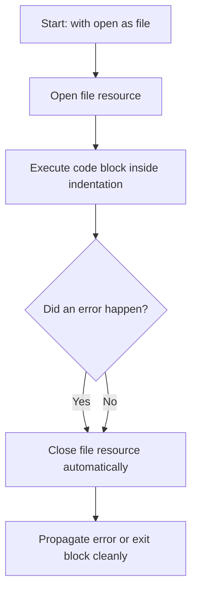

# Using Context Managers

When writing scripts that handle files, the biggest risk is resource leaks. If your script crashes midway or if you forget to call `.close()`, the file remains locked in memory. Python solves this problem using context managers, which are implemented using the `with` statement. Using a context manager guarantees that your files close automatically, even if your script encounters errors.

In this guide, we will look at how context managers work. We will compare manual file closing with the `with` statement and write a log filtering tool.

## What is a Context Manager?

A context manager is a block of code that manages resources. When the script enters the `with` block, the manager opens the file. When the script exits the `with` block (either because it finished or because an error happened), the manager automatically runs cleanup tasks and closes the file.

Let's compare manual file management against using context managers.

| Aspect | Manual File Management (`open`/`close`) | Using Context Managers (`with open`) |
| :--- | :--- | :--- |
| **Syntax** | Requires manual lines: `f = open()` / `f.close()` | Single line setup: `with open() as f:` |
| **Automatic Cleanup** | No (Must remember to call `.close()`) | Yes (Closed automatically when block exits) |
| **Exception Resiliency**| Weak (If script crashes, close is skipped) | Strong (Always closes, even during crashes) |
| **Resource Leaks** | High risk | Zero risk |
| **Code Structure** | Flat | Indented blocks |

Here is a diagram showing the workflow of a context manager:



## Basic Context Manager Syntax

Let's write a script that opens and reads a file using the `with` statement.

Create a file named `context_basics.py` and write the code below.

```python
# Create a test configuration file
with open("app_port.txt", "w") as file:
    file.write("8080")

print("Reading port configuration...")
# Using context manager to read
with open("app_port.txt", "r") as file:
    port = file.read().strip()
    print("Port value read: " + port)
    
# Outside the block, the file is closed automatically
# Verify if the file is closed
print("Is file closed? " + str(file.closed))
```

Run this file in your terminal.

```bash
python3 context_basics.py
```

Expected output:
```text
Reading port configuration...
Port value read: 8080
Is file closed? True
```

## Nesting Multiple Context Managers

Sometimes you need to open two files at the same time. For example, you might want to read configuration parameters from a source file, format them, and write them to a destination file. You can open multiple files in a single `with` statement by separating them with commas.

```python
source_path = "source_logs.txt"
dest_path = "filtered_logs.txt"

# Create dummy source logs
with open(source_path, "w") as f:
    f.write("DEBUG | Connection query\n")
    f.write("ERROR | Sync timeout\n")

# Open both files together
with open(source_path, "r") as source, open(dest_path, "w") as destination:
    for line in source:
        if "ERROR" in line:
            destination.write(line)

print("Filtering finished. Output file written.")
```

Run the script.

```bash
python3 nested_context.py
```

Expected output:
```text
Filtering finished. Output file written.
```

Let's read the filtered logs:
```bash
cat filtered_logs.txt
```

Expected output:
```text
ERROR | Sync timeout
```

## Real-World Example: Log Filter Tool

Let's write an automated log backup script. The script will open a primary server log, stream through the entries, identify only critical warnings, and write them to an active alerts file, ensuring both files are handled safely using nested context managers.

Create a file named `log_filter_tool.py` and write the code below.

```python
# Create test data
with open("server.log", "w") as f:
    f.write("INFO: Gateway started\n")
    f.write("CRITICAL: Out of memory on db node\n")
    f.write("INFO: Sockets refreshed\n")
    f.write("CRITICAL: API timeout on port 443\n")

input_log = "server.log"
output_alerts = "critical_alerts.log"

print("=== Starting Log Parsing Operations ===")

# Stream from source to destination safely
with open(input_log, "r") as log_file, open(output_alerts, "w") as alert_file:
    alert_file.write("=== CRITICAL ALERTS REPORT ===\n")
    
    count = 0
    for line in log_file:
        if "CRITICAL" in line:
            alert_file.write(line)
            count += 1
            print("Found Critial Log: " + line.strip())

print(f"Audit Finished. Dispatched {count} logs to alert file.")
```

Run the script.

```bash
python3 log_filter_tool.py
```

Expected output:
```text
=== Starting Log Parsing Operations ===
Found Critial Log: CRITICAL: Out of memory on db node
Found Critial Log: CRITICAL: API timeout on port 443
Audit Finished. Dispatched 2 logs to alert file.
```

## Common Mistakes

### Performing Heavy Actions Inside Context Blocks
Keep your context blocks short and focused on file operations. Do not run heavy processing tasks, network calls, or long loops inside the `with` block because the file remains locked on the disk while that code runs.

* **The Bad Way:**
```python
with open("hosts.txt", "r") as file:
    hosts = file.readlines()
    # Running a slow network ping block while the file is kept open!
    for host in hosts:
        ping_server_network(host)
```

* **The Good Way:**
Read the file contents first, let the block close the file, and then process the data.
```python
with open("hosts.txt", "r") as file:
    hosts = [line.strip() for line in file]
# File is closed here. Run the slow loop safely.
for host in hosts:
    ping_server_network(host)
```

### Accessing File Data After the Block Closes
If you try to read lines from a file variable after the `with` block has finished, Python will crash with a `ValueError` because the file is closed.

* **The Bad Way:**
```python
with open("data.txt", "r") as file:
    pass

# This raises a ValueError: I/O operation on closed file.
line = file.read()
```

* **The Good Way:**
Save the data to a local variable inside the block before exiting.
```python
with open("data.txt", "r") as file:
    data = file.read()

# Read the variable safely
print(data)
```

## Summary

* Context managers (`with` statement) manage opening and closing files automatically.
* Files are guaranteed to close when the script exits the `with` block.
* Context managers prevent file resource locks on your operating system.
* You can open multiple files in a single context block by separating them with commas.
* Keep context blocks short and focused; avoid running slow operations inside them.
* Do not attempt to perform read/write actions on a file variable after its block closes.
* The `.closed` attribute on file variables helps verify if the file is closed.
* Using context managers is the industry-standard way to handle files in Python.
* Nesting read and write contexts is useful for building log filters.
* Automatic cleanup prevents deployment scripts from locking up system logs.
