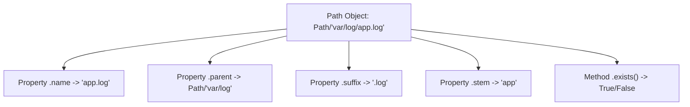

# Using the pathlib Module

While the legacy `os.path` module is widely used, it treats file paths as simple strings. This can lead to verbose, cluttered code when chaining operations together. Python 3.4 introduced a modern, object-oriented replacement called `pathlib`. The `pathlib` module represents paths as rich objects, making path joining, directory creation, and file reading cleaner and more intuitive.

In this guide, we will look at how to use `pathlib` in Python. We will compare it with the legacy `os.path` module, write path joins using the division operator, and search directories for log files.

## Legacy os.path vs Modern pathlib

The `pathlib` module provides a single class called `Path` that replaces multiple functions from `os`, `os.path`, and `glob`.

Let's compare legacy string operations with modern object methods.

| Action | Legacy `os.path` Style | Modern `pathlib` Style |
| :--- | :--- | :--- |
| **Import** | `import os.path` | `from pathlib import Path` |
| **Join Paths** | `os.path.join("var", "log")` | `Path("var") / "log"` |
| **Get Absolute Path** | `os.path.abspath("app.log")` | `Path("app.log").resolve()` |
| **Check Existence** | `os.path.exists("app.log")` | `Path("app.log").exists()` |
| **Get Filename** | `os.path.basename("a/b.txt")` | `Path("a/b.txt").name` |
| **Get File Extension** | `os.path.splitext("a/b.txt")[1]`| `Path("a/b.txt").suffix` |
| **Create Folder** | `os.makedirs("backups")` | `Path("backups").mkdir(parents=True)`|
| **Quick Read** | `open("a.txt").read()` | `Path("a.txt").read_text()` |

Here is a diagram showing the methods and attributes available on a `Path` object:



## Basic Path Operations with pathlib

Let's look at how to create a `Path` object, join folders using the slash (`/`) operator, and read file properties.

Create a file named `pathlib_basics.py` and write the code below.

```python
from pathlib import Path

# Create a Path object pointing to a file
log_path = Path("logs") / "system" / "access.log"

print("Path Object:      " + str(log_path))
print("Filename (.name): " + log_path.name)
print("Name no suffix:   " + log_path.stem)
print("Extension:        " + log_path.suffix)
print("Parent Folder:    " + str(log_path.parent))
```

Run this file in your terminal.

```bash
python3 pathlib_basics.py
```

Expected output:
```text
Path Object:      logs/system/access.log
Filename (.name): access.log
Name no suffix:   access
Extension:        .log
Parent Folder:    logs/system
```

## Quick Read and Write Methods

The `Path` class has built-in helper methods to read or write text directly. These methods automatically handle opening and closing the file for you in a single line, which is useful for small config files.

```python
from pathlib import Path

config_file = Path("settings.conf")

# Write text directly
config_file.write_text("port=8080\nenv=staging\n")
print("Settings file written.")

# Read text directly
config_data = config_file.read_text()
print("Settings contents:")
print(config_data.strip())
```

Run the script.

```bash
python3 pathlib_file.py
```

Expected output:
```text
Settings file written.
Settings contents:
port=8080
env=staging
```

## Real-World Example: Directory Log Searcher

Let's write a script that scans a directory for files. We will use `pathlib`'s `.glob()` method to search for files that end with the `.log` extension, filter out directories, and display their paths and sizes.

Create a file named `log_searcher.py` and write the code below.

```python
from pathlib import Path

# Set up test directories and files
logs_dir = Path("app_logs")
logs_dir.mkdir(exist_ok=True)
(logs_dir / "app.log").write_text("App logs entry")
(logs_dir / "system.log").write_text("System logs entry details")
(logs_dir / "config.json").write_text('{"port": 80}')

print("=== Scanning Directory for Log Files ===")
print("Target Directory: " + str(logs_dir.resolve()))

# Find all files matching *.log in the directory
# glob returns a generator yielding Path objects
log_files = logs_dir.glob("*.log")

for log in log_files:
    # Get file stats
    file_size = log.stat().st_size
    print(f"Found Log File: {log.name}")
    print(f"  Relative Path: {log}")
    print(f"  File Size:     {file_size} bytes")
    print("-" * 34)
```

Run the script.

```bash
python3 log_searcher.py
```

Expected output:
```text
=== Scanning Directory for Log Files ===
Target Directory: C:\Users\patel\Github\devops\devops\app_logs
Found Log File: app.log
  Relative Path: app_logs/app.log
  File Size:     14 bytes
----------------------------------
Found Log File: system.log
  Relative Path: app_logs/system.log
  File Size:     25 bytes
----------------------------------
```

## Common Mistakes

### Joining Strings Directly Using Slash Operator
The slash (`/`) operator only works when at least one of the variables is a `Path` object. If you try to join two strings together using `/`, Python will try to divide them mathematically and raise a `TypeError`.

* **The Bad Way:**
```python
# This raises a TypeError: unsupported operand type(s) for /: 'str' and 'str'
filepath = "logs" / "app.log"
```

* **The Good Way:**
Wrap the first string in `Path()` before using the slash operator.
```python
from pathlib import Path
filepath = Path("logs") / "app.log"
```

### Passing Path Objects to Legacy Libraries
Some older third-party libraries or custom modules only accept strings for file paths. If you pass a `Path` object directly, they might crash. Convert the `Path` object to a string first using `str()`.

* **The Bad Way:**
```python
import legacy_library
log_path = Path("logs/app.log")
# This might crash if legacy_library checks if type is str
legacy_library.read_config(log_path)
```

* **The Good Way:**
```python
import legacy_library
log_path = Path("logs/app.log")
# Convert to string path
legacy_library.read_config(str(log_path))
```

## Summary

* The `pathlib` module represents paths as rich objects rather than raw strings.
* Create path objects by wrapping path strings in the `Path()` constructor class.
* Join paths cleanly using the division (`/`) operator, provided the first variable is a `Path`.
* Use `.resolve()` to get the absolute path to a file or folder.
* Use `.write_text()` and `.read_text()` to read or write small files in a single line.
* The `.glob(pattern)` method searches directory paths for matching files.
* Retrieve file details like size in bytes using the `.stat()` method.
* Convert `Path` objects to strings using `str()` before passing them to legacy libraries.
* Using `pathlib` makes your filesystem automation scripts cleaner and easier to read.
* Safe directory creation using `.mkdir(exist_ok=True)` prevents file folder crashes.
