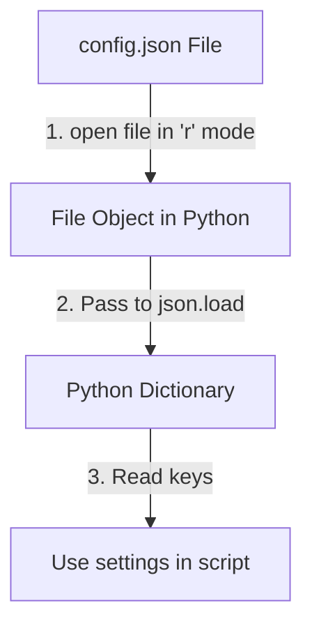

# Reading JSON Files

In system automation, configuration settings are frequently stored in JSON files. When your script runs, it needs to open these files, read the text, and parse the data into Python variables so you can use them. Python's built-in `json` module has specific functions to handle reading from both file objects and raw string variables.

In this guide, we will look at how to read JSON data. We will compare `json.load` and `json.loads` and write a configuration loader script.

## load vs loads

The `json` module has two primary functions for reading data. The naming difference is simple, but confusing for beginners:
* **`json.load()`** (no "s" at the end): Reads and parses JSON data directly from a **file object**.
* **`json.loads()`** (with an "s" at the end, meaning "load string"): Reads and parses JSON data from a **string variable** in memory.

Let's compare these two functions.

| Function | Input Source | Usage Example | Requires open()? |
| :--- | :--- | :--- | :--- |
| **`json.load()`** | File Object | `json.load(file_object)` | **Yes** (Must open file in `"r"` mode first) |
| **`json.loads()`** | String variable | `json.loads(json_string)` | No (Directly parses string in RAM) |

Here is a diagram showing the workflow when reading a configuration file using `json.load()`:



## Reading JSON from a File

Let's write a script that opens a JSON file and parses its contents. First, we will create a sample configuration file named `app_settings.json`.

Create a file named `read_json_file.py` and write the code below.

```python
import json

# Create a test JSON file
config_data = """{
    "environment": "staging",
    "db_port": 5432,
    "debug_mode": true
}"""
with open("app_settings.json", "w") as f:
    f.write(config_data)

print("Opening app_settings.json file...")

# Open the file using a context manager
with open("app_settings.json", "r") as file:
    # Use json.load() to parse the file object directly
    settings = json.load(file)

print("\nResolved Settings:")
print("Environment: " + settings["environment"])
print("Port:        " + str(settings["db_port"]))
print("Debug Mode:  " + str(settings["debug_mode"]))
```

Run this file in your terminal.

```bash
python3 read_json_file.py
```

Expected output:
```text
Opening app_settings.json file...

Resolved Settings:
Environment: staging
Port:        5432
Debug Mode:  True
```

## Parsing JSON Strings

If you receive JSON data from a network command output or an environment variable, it arrives as a string. You use `json.loads()` to parse it.

```python
import json

# A string variable containing JSON
raw_string = '{"status": "online", "response_time_ms": 142}'

# Parse the string variable
data = json.loads(raw_string)

print("Current Status: " + data["status"])
print("Latency:        " + str(data["response_time_ms"]) + "ms")
```

Run the script.

```bash
python3 read_json_string.py
```

Expected output:
```text
Current Status: online
Latency:        142ms
```

## Real-World Example: Credentials Loader with Error Handling

Let's write a robust configuration loader. The function will attempt to open a database configuration file (`db_config.json`). If the file is missing, or contains invalid JSON syntax, the script catches the errors and falls back to safe default settings.

Create a file named `credentials_loader.py` and write the code below.

```python
import json
import os

config_path = "db_config.json"

def load_db_credentials():
    print("=== Loading Database Credentials ===")
    
    # Define fallback defaults
    default_config = {
        "host": "localhost",
        "port": 3306,
        "ssl": False
    }
    
    try:
        # Check if file exists using EAFP try block
        with open(config_path, "r") as file:
            config = json.load(file)
            print("✅ Success: Custom config loaded from file.")
            return config
            
    except FileNotFoundError:
        print(" ⚠️  Warning: db_config.json is missing. Loading defaults...")
        return default_config
        
    except json.JSONDecodeError as err:
        print(f" ❌ ERROR: db_config.json contains invalid JSON syntax: {err}")
        print("Loading safe defaults...")
        return default_config

# Test 1: File is missing (runs fallback)
active_config = load_db_credentials()
print("Active Config Details: " + str(active_config))
```

Run the script.

```bash
python3 credentials_loader.py
```

Expected output:
```text
=== Loading Database Credentials ===
 ⚠️  Warning: db_config.json is missing. Loading defaults...
Active Config Details: {'host': 'localhost', 'port': 3306, 'ssl': False}
```

## Common Mistakes

### Confusing load() and loads()
Calling `json.loads()` on a file object, or `json.load()` on a string, is one of the most common mistakes in Python.

* **The Bad Way:**
```python
# This raises an AttributeError because strings don't have a read() method
json.load('{"port": 80}')
```

* **The Good Way:**
Use `loads` for string variables.
```python
json.loads('{"port": 80}')
```

### Accessing Nested Keys Without Checking
When reading JSON files, assuming that all optional keys exist can cause key errors that crash your scripts.

* **The Bad Way:**
```python
# If the JSON doesn't have a 'timeout' key, this crashes
timeout = settings["timeout"]
```

* **The Good Way:**
Use the `.get()` method to provide a fallback value if the key is missing.
```python
timeout = settings.get("timeout", 30)
```

## Summary

* Use `json.load(file)` to parse JSON directly from an open file object.
* Use `json.loads(string)` to parse JSON from a text string variable.
* Always wrap file operations in context managers (`with open`) to ensure they close.
* A `JSONDecodeError` exception is raised if the file contains invalid JSON syntax.
* Catching `FileNotFoundError` allows you to load default values if a config is missing.
* Do not call `json.loads()` on a raw file handler variable.
* Use `.get()` when reading optional settings to prevent `KeyError` crashes.
* Parsing config directories dynamically is easy using JSON loaders.
* Standardizing credential loading keeps server keys isolated from script files.
