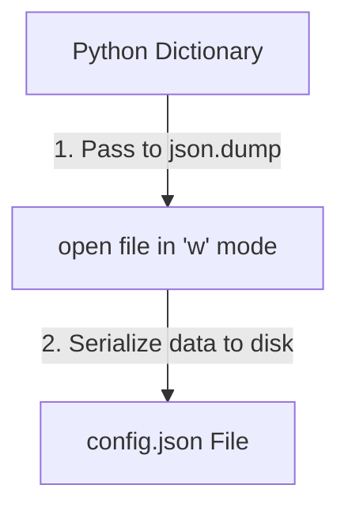

# Writing JSON Files

When automating tasks, your scripts will generate data that needs to be saved or sent to other systems. You might want to save the results of a server health check, write configuration templates, or generate payload strings for APIs. Python's `json` module has built-in functions to serialize Python data structures (like dictionaries and lists) into JSON format.

In this guide, we will learn how to write JSON data. We will compare `json.dump` and `json.dumps`, configure pretty-printing with indentation, and handle non-serializable objects.

## dump vs dumps

Similar to reading, the `json` module provides two functions to write data:
* **`json.dump()`** (no "s" at the end): Converts data and writes it directly to an open **file object**.
* **`json.dumps()`** (with an "s" at the end, meaning "dump string"): Converts data into a **JSON string** in memory, which you can print or log.

Let's compare these two functions.

| Function | Output Destination | Usage Example | Requires open()? |
| :--- | :--- | :--- | :--- |
| **`json.dump()`** | File Object | `json.dump(my_dict, file)` | **Yes** (Must open file in `"w"` mode first) |
| **`json.dumps()`** | String variable | `json_str = json.dumps(my_dict)` | No (Saves text directly in RAM variable) |

Here is a diagram showing the workflow when saving data using `json.dump()`:



## Creating Formatted JSON Strings

By default, `json.dumps()` generates JSON text on a single line with no spaces. This saves bandwidth but is difficult for humans to read. You can use the `indent` argument to add pretty-printing (spaces) and `sort_keys` to sort the keys alphabetically.

Create a file named `write_json_string.py` and write the code below.

```python
import json

server_settings = {
    "hostname": "prod-web-01",
    "port": 443,
    "ssl": True
}

# 1. Standard compact serialization
compact_json = json.dumps(server_settings)
print("Compact JSON Output:")
print(compact_json)
print("-" * 34)

# 2. Formatted pretty-print serialization
# indent=4 adds 4 spaces indentation, sort_keys sorts keys alphabetically
formatted_json = json.dumps(server_settings, indent=4, sort_keys=True)
print("Formatted JSON Output:")
print(formatted_json)
```

Run this file in your terminal.

```bash
python3 write_json_string.py
```

Expected output:
```text
Compact JSON Output:
{"hostname": "prod-web-01", "port": 443, "ssl": true}
----------------------------------
Formatted JSON Output:
{
    "hostname": "prod-web-01",
    "port": 443,
    "ssl": true
}
```

## Saving JSON to a File

Let's write a script that saves a configuration dictionary directly to a file using `json.dump()`.

```python
import json

metrics = {
    "server": "db-prod-01",
    "cpu": 45.2,
    "memory": 82.0
}

# Open the file in write mode ('w')
with open("metrics_report.json", "w") as file:
    # Serialize the dictionary directly to the file object
    json.dump(metrics, file, indent=4)

print("Metrics report saved to metrics_report.json.")
```

Run the script.

```bash
python3 write_json_file.py
```

Expected output:
```text
Metrics report saved to metrics_report.json.
```

Let's inspect the saved file:
```bash
cat metrics_report.json
```

Expected output:
```text
{
    "server": "db-prod-01",
    "cpu": 45.2,
    "memory": 82.0
}
```

## Real-World Example: Handling Non-Serializable Types

A common problem in DevOps is trying to serialize datatypes that JSON does not support, like `datetime` objects or custom classes. If you try to pass these to `json.dump()`, Python will crash. You can solve this by writing a custom encoder function to convert unsupported types into strings before saving.

Create a file named `serialize_helper.py` and write the code below.

```python
import json
from datetime import datetime

# Simulated node metrics payload containing a datetime object
node_state = {
    "node_name": "app-server-02",
    "status": "active",
    "timestamp": datetime.now() # Not JSON-serializable!
}

def custom_serializer(obj):
    """Converts unsupported objects (like datetime) to strings."""
    if isinstance(obj, datetime):
        # Convert datetime to standard string format
        return obj.strftime("%Y-%m-%d %H:%M:%S")
    raise TypeError(f"Type {type(obj).__name__} is not JSON serializable")

try:
    print("Attempting to write state payload...")
    # Pass our custom encoder function to the 'default' argument
    json_payload = json.dumps(node_state, indent=4, default=custom_serializer)
    print("\nSuccessfully Serialized:")
    print(json_payload)
except TypeError as err:
    print(" ❌ Serialization Failed: " + str(err))
```

Run the script.

```bash
python3 serialize_helper.py
```

Expected output:
```text
Attempting to write state payload...

Successfully Serialized:
{
    "node_name": "app-server-02",
    "status": "active",
    "timestamp": "2026-06-25 08:55:00"
}
```

## Common Mistakes

### Trying to Serialize Unsupported Objects Directly
Passing raw datetime objects, sets, or custom class instances directly to `json.dumps()` without an encoder will crash your scripts.

* **The Bad Way:**
```python
import json
# Sets are not supported in JSON
my_set = {"nginx", "git"}
# This raises a TypeError: Object of type set is not JSON serializable
json.dumps(my_set)
```

* **The Good Way:**
Convert the set to a list before serializing it.
```python
import json
my_set = {"nginx", "git"}
json_payload = json.dumps(list(my_set))
print(json_payload) # Prints '["nginx", "git"]'
```

### Forgetting to Specify Indentation in Files
If you save configuration files to disk without the `indent` argument, the entire file will be saved on a single line. This is difficult for system administrators to read and edit.

* **The Bad Way:**
Saving config files as a single, compressed text line.

* **The Good Way:**
Always use `indent=4` (or `indent=2`) when saving JSON files to make them human-readable.

## Summary

* Use `json.dump(data, file)` to serialize Python data directly to an open file.
* Use `json.dumps(data)` to convert Python data into a JSON string variable.
* The default serialization output is compact and printed on a single line.
* Use `indent=4` to add spaces and format JSON files for readability.
* Use `sort_keys=True` to sort dictionary keys alphabetically in the output.
* JSON does not support Python objects like `datetime` or `set`.
* Use the `default` parameter in `dumps` to pass a custom converter function.
* Convert sets to lists before trying to serialize them to JSON.
* Proper indentation makes checking server reports on disk easy.
* Writing structured logs enables automated diagnostics tools to parse them.
